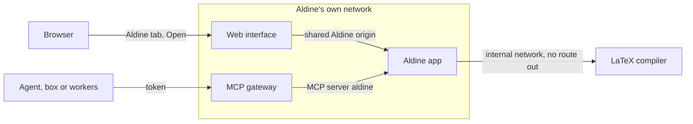
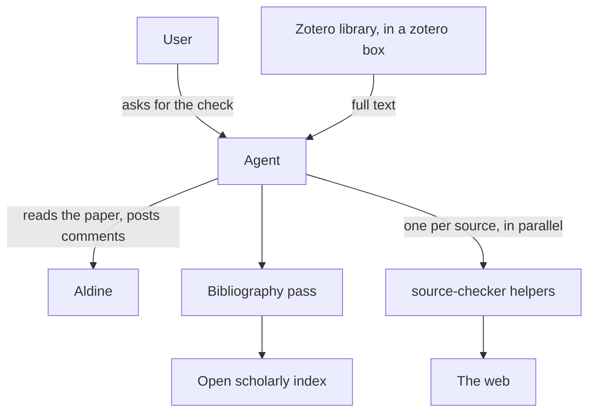

# Aldine

[Aldine](https://github.com/trahloff/Aldine) is a self-hosted LaTeX editor that several people and agents can edit at once. RS can run one Aldine for the whole installation. The operator writes in it from the browser; agents read and write it through the MCP server `aldine`.

It is off until the operator turns it on, in the Aldine tab of the Services page. Turn on downloads Aldine's two images the first time (a few GB), starts them and lists Aldine on the [MCP gateway](MCP-servers.md). The same tab shows Aldine itself once it runs, under a bar with its state, Update when the installation pins a newer version, Open (Aldine in a new browser tab), Turn off and Refresh. `research aldine on | off | status` does the same from the host.

## How it is reached

| Who | How | Needs |
|---|---|---|
| The operator | Services → Aldine (or its Open, in a new browser tab), or the Aldine tab of a project | The webui's Management sign-in |
| An agent, a box or a research project's workers | The MCP server `aldine`, ticked for them on Services → MCP | A wiring like any other MCP server |
| The LaTeX compiler | Only the Aldine app, on a network with no route out | Nothing; nothing else reaches it |

A project gets an **Aldine** tab when Aldine is on and at least one of its consumers (its agent, a box, its workers) is wired to `aldine`. Unwiring the last one, or turning Aldine off, removes the tab. Services → Aldine, the project tab and Open show the same editor.

## One shared library

There is one Aldine and one set of papers. Every operator tab and every wired agent sees every paper, whichever project it comes from. Wiring decides who reaches Aldine, not which papers it sees.

## Checking a paper's citations

Some agents can check the citations of a paper in Aldine and leave review comments on it. The check exists for Claude Code and pi alike.

| Where | Who has the check |
|---|---|
| A `researcher` or `researcher-subagents` project | The project's own agent |
| A zotero box | The box's agent, in every project type that holds boxes except `research` |
| A `research` project, other project types, other box types | No one |

The agent must be ticked for Aldine on Services → MCP. The user asks it to check a paper: `/paper-check <paper>` in Claude Code, `/skill:paper-check <paper>` in pi, or in plain words. Existing researcher projects and zotero boxes get the check after **Rebuild all** on **Host → Software** and a stop and start of the project.

### What comes back

The agent leaves review comments on the paper, read in the Aldine tab. Each comment covers one problem and sits on the citing sentence or on the bibliography entry. It names the problem: the source says something else, says less, or is the wrong source for the sentence; the source is retracted or does not exist; or the entry's year or venue is wrong.

A comment quotes the source's own words with where they stand, and says how the source was read: full text, abstract only, someone else's description, or not reachable. Where it helps, it carries a suggested rewording the user accepts with one click. A citation the source supports gets no comment.

For a place the user marked as needing a reference (`[CITE]`), the comment lists the references found, with their identifiers. When the literature does not support the sentence as written, it also gives a hedged wording.

Every citation and its verdict is listed in one file in the agent's workspace, `/workspace/paper-check/<paper>/checks.md`. A later run reads it and checks only what changed. The user can send it to co-authors, who cannot open RS's Aldine. The agent only comments; it changes the paper's files only when the user asks.

### How it works

A bibliography pass runs first, with no agent: it looks every entry up in an open scholarly index and reports retracted works, entries that match no record, wrong years or venues, open copies and abstracts. The agent then hands each cited source to one `source-checker` helper. The helpers run in parallel, in the background; each reads its source and judges every sentence that cites it. In a zotero box the agent first looks each source up in the user's library and hands the library's full text to the helper.

The helper has web search and page fetch (Claude Code only), a shell and a file reader. It has no MCP servers, so no Aldine tools. Under pi the helper has no web search: it reads sources through the open indexes and the addresses it knows, and looks for references in the indexes only. The project image and the box image carry the PDF text tool `pdftotext`, which also lets Claude Code's file reader read a PDF.

### Limits

- A source with no open copy ends as "abstract only" or "could not be read", never as a guessed verdict.
- A bibliography entry with no DOI or arXiv id is looked up by its title, and the open index allows only a limited number of title searches a day from one network address. Past that, the entry is left to its helper.
- No disguised browser is used: the helpers fetch as a declared agent, and a site that refuses them stays unread.
- Comment-only is an instruction to the agent, not a lock. Every wired agent has full edit rights in Aldine.
- Under pi the helper also receives the project's instruction files; under Claude Code it starts without them.

## Turning it off, and the version

| Event | Effect |
|---|---|
| Turn on, first time | Downloads the images, starts the app and the compiler, lists `aldine` on the gateway |
| Turn off | Removes the containers and their networks and the gateway entry, which unwires it everywhere. The papers and Aldine's access key are kept |
| Turn on again | Finds the kept papers; agents need `aldine` ticked again |
| `research start` | Brings a turned-on Aldine back; never starts one that was not turned on |
| `research stop` | Stops it with the rest of the shared services |
| An RS update that pins a newer Aldine | The row offers Update; the next Turn on or `research start` replaces the containers, keeping the papers |

## Design decisions

- **One shared service, not one per project.** Papers are written across projects and by several agents at once, and the images are large. The cost is that every wired agent sees every paper.
- **Its own networks, with only the webui and the gateway.** The app sits on a network of its own with a route out (for references and templates), shared only with the web interface and the MCP gateway; the compiler, which runs untrusted LaTeX, sits on an internal network with no route out and upstream's resource limits. Aldine is not on the shared network that holds Gitea and the registry.
- **Aldine's own login is off, behind the webui.** Whoever reaches Aldine edits every paper, so only the web interface (behind its Management sign-in, on a shared origin of its own like Gitea's) and the gateway (behind its per-consumer tokens) can reach it.
- **Pinned by version and image digest.** The installation pins one Aldine version; the containers follow it at the next Turn on or start, and the papers stay in named volumes across the change.
- **No Git integration yet.** Papers live in Aldine's own store; they are not mirrored to the shared Gitea or GitHub.
- **The paper check is one skill and one helper role, with no project type or box type of its own.** The task needs only an agent wired to Aldine, so it goes to the agents that already do research work: the researcher projects' agent, and the zotero box's agent, which holds the user's library. The cost is that other agents wired to Aldine cannot run it.
- **The unit of work is the source, not the citation.** One helper reads a source once and judges every sentence that cites it. The cost is that a source cited many times keeps its helper busy longer than the others.
- **A verdict always says how the source was read.** Full text, an abstract and someone else's description are different grounds, and the user must know which one a verdict stands on. The cost is that a paper with no open copy often gets only an abstract-only verdict.
- **The agent comments and does not edit unless asked.** Every change to the paper stays the user's, through a suggested rewording accepted with one click. The cost is that this is an instruction, not a lock: the agent keeps full edit rights.
- **Open scholarly indexes before general web search.** An index gives a work's record, retraction status, open copy and abstract in one plain request, under Claude Code and pi alike. The cost is that a work the indexes lack is found only by web search, which pi's helper does not have.
- **A declared agent, never a disguised browser.** The helpers fetch as what they are, from the publisher, a repository or the author's own page. The cost is that a site that refuses agents stays unread, and its source ends as abstract only or not read.
