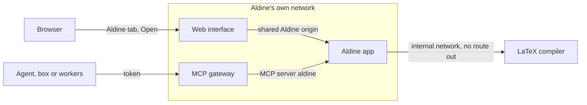

# Aldine

[Aldine](https://github.com/trahloff/Aldine) is a self-hosted LaTeX editor that several people and agents can edit at once. RS can run one Aldine for the whole installation. The operator writes in it from the browser; agents read and write it through the MCP server `aldine`.

It is off until the operator turns it on, in the Aldine tab of the Services page. Turn on downloads Aldine's two images the first time (a few GB), starts them and lists Aldine on the [MCP gateway](MCP-servers.md). The same tab shows its state, offers Update when the installation pins a newer version, Open (Aldine in a new browser tab) and Turn off. `research aldine on | off | status` does the same from the host.

## How it is reached

| Who | How | Needs |
|---|---|---|
| The operator | The Aldine tab of a project, or Open on Services → Aldine | The webui's Management sign-in |
| An agent, a box or a research project's workers | The MCP server `aldine`, ticked for them on Services → MCP | A wiring like any other MCP server |
| The LaTeX compiler | Only the Aldine app, on a network with no route out | Nothing; nothing else reaches it |

A project gets an **Aldine** tab when Aldine is on and at least one of its consumers (its agent, a box, its workers) is wired to `aldine`. Unwiring the last one, or turning Aldine off, removes the tab. The tab and Open show the same editor.

## One shared library

There is one Aldine and one set of papers. Every operator tab and every wired agent sees every paper, whichever project it comes from. Wiring decides who reaches Aldine, not which papers it sees.

## Turning it off, and the version

| Event | Effect |
|---|---|
| Turn on, first time | Downloads the images, starts the app and the compiler, lists `aldine` on the gateway |
| Turn off | Removes the containers and their networks and the gateway entry, which unwires it everywhere. The papers and Aldine's access key are kept |
| Turn on again | Finds the kept papers; agents need `aldine` ticked again |
| `research start` | Brings a turned-on Aldine back; never starts one that was not turned on |
| `research stop` | Stops it with the rest of the shared services |
| An RS update that pins a newer Aldine | The row offers Update; the next Turn on or `research start` replaces the containers, keeping the papers |

## Design decisions

- **One shared service, not one per project.** Papers are written across projects and by several agents at once, and the images are large. The cost is that every wired agent sees every paper.
- **Its own networks, with only the webui and the gateway.** The app sits on a network of its own with a route out (for references and templates), shared only with the web interface and the MCP gateway; the compiler, which runs untrusted LaTeX, sits on an internal network with no route out and upstream's resource limits. Aldine is not on the shared network that holds Gitea and the registry.
- **Aldine's own login is off, behind the webui.** Whoever reaches Aldine edits every paper, so only the web interface (behind its Management sign-in, on a shared origin of its own like Gitea's) and the gateway (behind its per-consumer tokens) can reach it.
- **Pinned by version and image digest.** The installation pins one Aldine version; the containers follow it at the next Turn on or start, and the papers stay in named volumes across the change.
- **No Git integration yet.** Papers live in Aldine's own store; they are not mirrored to the shared Gitea or GitHub.
