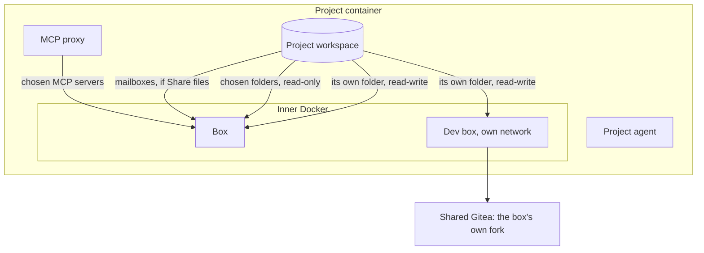

# Boxes

A box is a long-lived container added to a project. It runs in the project's own inner Docker, with its own workspace and no credentials, and sees only what the operator gives it from the project. Each box comes from a box type, which sets its image, its instructions and what it has installed.

## Where boxes run

Boxes need a project with its own inner Docker: research, researcher, sandbox-dind, dev, and any store workflow built on them. A project that runs as a single plain container (sandbox and the docker-based store workflows) cannot hold boxes. A project holds up to 12 boxes, added and removed while it runs, from the **+** button on its tab strip.

A box sits on the project's inner network, and its outbound traffic follows the project's egress rules (see [Networking and egress](Networking-and-egress.md)). A dev box has a separate network of its own, which reaches the shared Gitea and nothing else in the project.

## Box types

A box type is a preset: base or browser image, whether an agent is on by default, and the instructions RS gives the box's agent (a read-only file in the agent's home, rewritten at every box run). Some types also bring a setup script, MCP servers, input fields or a web app of their own.

| Type | Image | Agent default | For |
|---|---|---|---|
| empty | base | off | Blank box, no instructions |
| byo | base | on | Clones a repo at a pinned ref and runs a setup command |
| dev | base | on, editor on | Works a GitHub repo through its own Gitea fork ([Dev lane](Dev-lane.md)) |
| zotero | base | on | A Zotero library through the zotero MCP server |
| open-knowledge | base | on | An OpenKnowledge knowledge base in its own tab |
| paper-orchestra | base | on, editor on | The PaperOrchestra repo, cloned at boot |
| websearcher | browser | on | Web research with Playwright and headless Chromium |
| data-wrangler | base | on | Schemas, queries and extracts through the project's database MCPs |

The zotero type asks for a Zotero API key and library ID and installs its MCP server at boot. The open-knowledge type copies the project's node into the box and starts OpenKnowledge itself. It has Share files on by default, can keep its notes' history on Gitea, and gives every other sharing agent in the project an `/ok` command that writes notes into its mailbox.

The operator can register more types in `~/.research-sandbox/box-registry.json` on the host, with their instructions inline. A registered type uses the base or browser image, cannot reuse a built-in name, and cannot use Gitea history, a web app or skills for other agents. Its MCP servers' environment values may hold only plain text and the type's own fields, because Claude and pi read other forms differently. The catalog is re-read at every box add, so a new type works on existing projects; a registry that cannot be read, or a type that breaks a rule, stops the box add with an error.

## Box window

The box window takes a name (default `box-N`), a type, and the options below. The type preselects its defaults; every default can be changed.

| Option | Effect | Limits |
|---|---|---|
| Agent | None, or an agent the project carries (Claude, pi); model and effort for a Claude box | MCP tools need an agent |
| Block links to the Anthropic account | On by default: Claude in the box gets no claude.ai connectors, no Remote Control, no Claude in Chrome and no claude.ai artifacts | Claude boxes; changeable later in ⚙ |
| Working mode | The dev box agent's working mode and Doer/Checker models | Dev boxes with an agent, outside research projects |
| Test policy | Light (default) or Full, see [Dev lane](Dev-lane.md) | Same as the working mode |
| MCP tools | The project's allowed MCP servers, through the project's MCP proxy | Not on dev boxes |
| Editor | A code-server editor tab for the box | — |
| Browser | Browser image with Playwright and headless Chromium | Not on dev boxes |
| Trusted browser | Every browser tool; without it nine risky actions are blocked | Needs Browser; fixed at create |
| rs-fetch | Read-only fetch of dev-lane agent work into a clone in the box | Needs Gitea; not on dev boxes; not with Gitea history |
| Gitea history | Notes pushed to a private Gitea repo; `main` can grow but never be rewritten | Types that offer it; needs Gitea and a box name |
| Share files | A mailbox the project reads, and read access to the other mailboxes | Fixed at create |
| Read-only folders | Project folders mounted read-only at `/mnt/<path>` | Not on dev boxes; changeable later in ⚙ |
| Type fields | Values the type asks for, such as API keys | Needs a box name |
| Repo, Ref, Setup | The byo clone and its setup command, run inside the box | byo type |
| GitHub repo, Branch, PAT | The repository and base branch a dev box works | dev type |

Field values are stored in a private file on the host and copied into the box's home before it first starts. The box gets them as environment variables; they never appear in the workspace, a command line or a log. A dev box's PAT is kept by Gitea with the mirror; RS stores none.

A box agent's model can be changed later in the project's ⚙ panel under Box agents, and so can a Claude box's block on links to the Anthropic account. Claude sessions started in the box afterwards follow it; a stopped box takes it when it next starts. A box added before this switch existed is blocked from its next start. A box whose agent is pi carries Claude Code too, and Claude there is always blocked, with no switch. A web app in a box that listens on its loopback address (`127.0.0.1` or `::1`) gets a tab through ⚙ → Ports, with that box as the target.

## What a box sees

| What | In the box | Access | When |
|---|---|---|---|
| Its own folder, `boxes/<name>/` in the project | `/workspace` | read-write | Always |
| Its mailbox | `/workspace/shared/<name>/` | read-write | Share files |
| The project agent's mailbox | `/workspace/shared/agent/` | read-only | Share files |
| Other sharing boxes' mailboxes | `/workspace/shared/<box>/` | read-only | Share files, including boxes added later |
| Chosen project folders | `/mnt/<path>` | read-only | Read-only folders |
| Chosen MCP servers | by name | as each server allows | MCP tools |
| The rest of the project | — | none | — |

The project agent, the workers and the other sharing boxes read a sharing box's mailbox. A box sees workers' output only if it is given `shared` as a read-only folder, and a read-only folder exposes everything in it, stored logins included. The project agent can read every box's folder, since it sits under `boxes/` in the project workspace.

A box starts with no credentials; its agent signs in inside the box. Inside, the agent has full control, with sudo. What protects the host is the container and the router.

## Tabs

Each box adds a terminal tab (`<box> (CLI)`). It can also add an editor tab, a `<box> (GIT)` tab for a dev box's fork or a history repo, and an app tab for a type's web app or a port exported in ⚙. The ✕ on the terminal tab removes the box.

## Lifecycle

| Event | What happens |
|---|---|
| Add | Waits until the box has finished booting (clone, setup); a failed boot stops the box and shows its log |
| Model change in ⚙ | Written into the running box at once |
| Links to the Anthropic account changed in ⚙ | Written into the running box at once; a stopped box takes it at its next start. While the box is blocked, every start writes the block again |
| Folders, working mode, test policy or ports changed in ⚙ | The box restarts fresh |
| Project stop | The boxes stop with it |
| Project start | Every box runs again from its saved settings (a fresh restart), on the box image Rebuild all last built |
| Remove | Asks for the master password; deletes the container and the box's folder unless "preserve artifacts" is ticked; files RS cannot delete (such as ones made as root inside the box) stay behind, and the remove warns where they are |
| Project destroy | All boxes go; dev forks and history repos are archived |

A fresh restart keeps the box's `/workspace`, its mailbox, its saved settings and its field values. It loses the box's home: the agent's login, anything installed outside `/workspace`, and a model chosen in the session but not saved. The type's setup runs again; OpenKnowledge, for example, takes about a minute to reinstall, at the version set under Host → Software.

Removing a box keeps its mailbox, so a sharing box added later under the same name writes into it again. A dev box's fork is archived; a history box's notes repo is archived and its Gitea account deleted. The box's stored field values and its exported port tabs are deleted.

## Design decisions

**A box is its own container, not a process in the project container.** Written rules do not bind a third-party or faulty agent. A separate container keeps a box's instructions, memory and tool use out of the project agent's workspace, and lets a box run a different agent. The cost is a separate login for each box.

**A box sees nothing of its project unless the operator gives it.** By default a box has only its own folder; a mailbox and read-only folders are explicit choices, and Share files is fixed at create. The cost is that a folder, once given, is exposed completely, credentials included.

**Box types are data over two images.** A type is a JSON preset whose instructions, MCP servers and setup are written into the box when it is added; the only image choice is base or browser. New types need no image build, and operators can register their own. Other software has to come from a setup script, which runs again at every fresh restart.

**A box is rebuilt from its saved settings; only its workspace persists.** A project start re-creates the project container and its inner Docker, and RS runs each box again from its saved settings. A box therefore always has the settings it was given, whatever happened inside it. The cost is a fresh login and a repeated setup after every project restart.

**A project's boxes run the current box image from its next start.** RS compares the image a project holds with the one Rebuild all last built, by the image itself rather than a version number, and brings the new one in at the next start or re-creating Update. A running project never switches image. If the image cannot be brought in, the boxes that use it are stopped rather than run on the old image, and the start ends with an error naming the cause. The cost is a slower first start after each box image change.

**A browser box is restricted unless added as trusted.** Text on a web page can steer an agent, so nine risky browser actions are blocked by default. Trust is chosen when the box is added and cannot be granted from inside it; changing it means removing and re-adding the box.

**Secret field values never touch the workspace.** API keys and similar values go from the box window to a private host file and into the box's home, never into the workspace, a command line or an error message. The cost is that a box with fields needs its name chosen before it exists.

**An app a box type installs follows the installation's version.** A built-in type's setup names the app's version setting instead of a number, and the box fills it in at every run from what the project was given at its last start. A box whose version cannot be read is stopped, not run on the old one, and the start says why. The cost is that a version change reaches a box only at its project's next start or Update.
