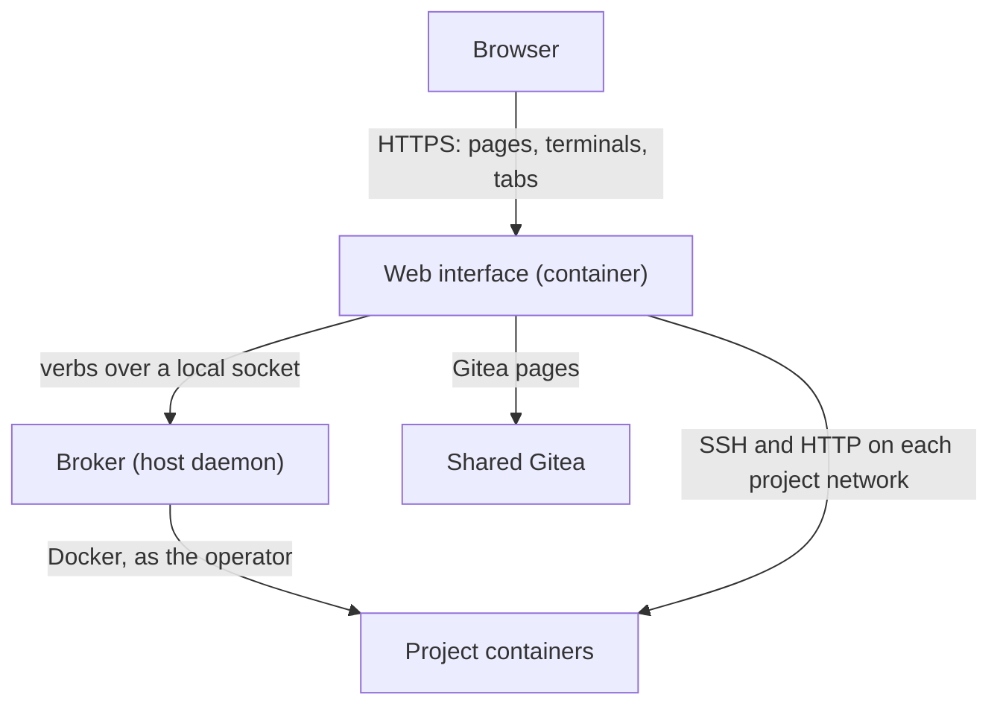
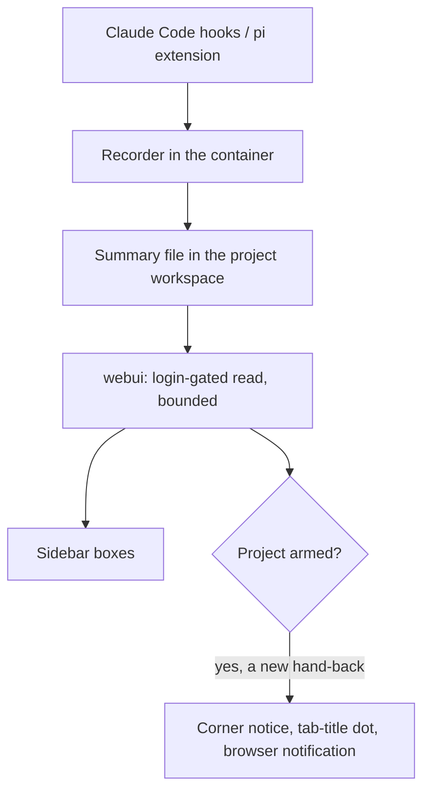
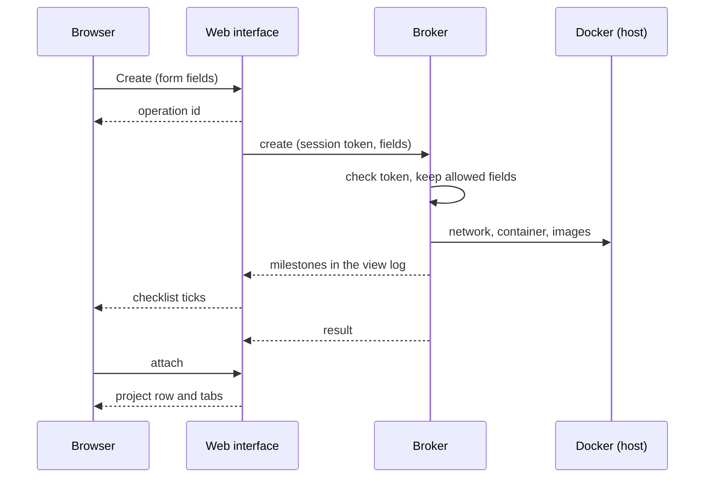

# Browser and broker

The researcher runs RS from a browser. The **web interface** (webui) is a container that serves the pages and relays each project's terminals, editors and apps. The **broker** is a daemon on the host that carries out every lifecycle step the browser asks for, and it accepts only verbs from a fixed list. The webui has no Docker access of its own, so every change on the host goes through the broker.

## Parts

The **webui** runs as the container `rs-webui`, connected to every project's network so it can reach each project container by name. It has no Docker socket. It reads the projects folder read-only for status figures, and sees one broker folder holding the broker's socket and the progress logs meant for display.

The **broker** runs on the host as the operator's user, with that user's Docker access. It listens on a unix socket only that user can open, has no network listener, and accepts connections only from processes of the same user, which is why the webui container runs under the operator's uid. Each request names one verb from a closed list, and every argument is checked before it reaches a Docker command; no verb accepts a raw Docker argument, a host path or an environment variable.

The broker keeps running the code it was started with. After RS is updated on disk the broker must be restarted; until then the projects rail shows that it runs older code.

## Reaching the web interface

The webui is published on one host address and port, by default `127.0.0.1:7777` (`WEBUI_BIND`, `WEBUI_PORT` in `.env`). To use it from another machine, the operator binds one specific host address, such as a LAN or tailnet address. RS refuses a bind on every address (`0.0.0.0`), because every project could then reach the webui at its network gateway.

All traffic is HTTPS. By default the webui generates a self-signed certificate covering `localhost` and the bind address, and regenerates it when the bind changes. A certificate issued by Tailscale can replace it and is never overwritten.

The webui also publishes two port ranges on the same address. The **origin range** (default 10100–10164) gives each web surface inside a project its own port; the **pass-through range** (default 10200–10299) carries raw TCP. Behind a firewall, both ranges must be open.

A change to the address, the port or either range in `.env` takes effect at the next `research webui start`, which re-creates a running webui.

## Pages

The left rail lists the projects, with four entries at its bottom.

| Page | Opens as | What it does |
|---|---|---|
| Projects rail | Always shown | Lists projects and opens their tabs; host CPU and memory, which open Host when clicked |
| New Project | Floating window | Workflow cards to create a project; import an existing one |
| Services | Tabs: Gitea, Repos, Fetch, Reviews, MCP, Aldine | The [Dev lane](Dev-lane.md): Gitea with its Enable, upgrade, admin password and Backup controls (backups in a dialog from its bar), repositories with the image builds of each, fetch commands, reviews and the reviewer's model; the [MCP servers](MCP-servers.md) behind the shared gateway and their wiring; the shared [Aldine](Aldine.md) editor. While Gitea is not running, only Gitea, MCP and Aldine show |
| Host | Tabs: Projects, Software, Ports, Defaults | Project table; agent, editor and image builds; pass-through ports; the default models of a new researcher-subagents project's referee, analyst and surveyor, and the task limit of each project container |
| Settings | Floating window | Interface settings kept in the browser: themes, layout, zoom, terminal font |

Services and Host each reopen on the tab last used. The Host → Projects table is the host's inventory: each project's workflow, state, SSH address and (on request) size. It acts only where nothing else can: Attach puts a running project back in the sidebar, and a project with no sidebar row (its container gone, or stuck in another state than running or stopped) has Destroy. Each project's gear in the sidebar opens its ⚙ window: a floating window in the middle of the screen that lists the sections Tabs, Extensions, Agents, Sharing, Ports, Alerts and Project down the left and shows one at a time. It keeps one size, its corner drags, and it closes when a change made from it finishes. Its Project section holds Update (running projects only), Destroy, and Remove from sidebar; a stopped project's window holds Destroy alone.

The sidebar lists every project. Running ones sit in the order and groups the operator dragged them into; each row ends with a Stop button and a ⚙ button. Stopped ones sit in a "Stopped (n)" fold below the list, each with its workflow badge (dimmed with the row), Start and ⚙. Stop and Start ask inside the row first, then run the action on the broker's lifecycle lane, as Update from the ⚙ window does. The row moving is the feedback: a stopped project moves into the fold, a started one returns to its old place with its tabs. A corner notice appears only when a sidebar action fails, is interrupted, or the sign-in expires.

## Project tabs

An open project shows its tabs in the top strip. Each web surface inside a project is served on its own port from the origin range, so each editor or app keeps its own browser storage.

| Tab | Served by | Reached through |
|---|---|---|
| Supervisor (CLI) or Shell (CLI) | byobu in the project container | SSH to the project container |
| `<box> (CLI)` | A shell in the [box](Boxes.md) | SSH to the project, then into the box |
| Editor, box editor | code-server | HTTP relay on an origin port |
| Reader (opt-in) | Read-only viewer of the workspace | HTTP relay on an origin port |
| App tabs | A web app inside the project, registered or detected | HTTP relay on an origin port |
| Pass-through tabs | An app that needs raw TCP | Forwarded unchanged; no webui sign-in |
| `<name> (GIT)` | That agent's fork in the shared Gitea | HTTP relay on the Gitea origin |
| Aldine | The shared [Aldine](Aldine.md) LaTeX editor, when a consumer of the project is wired to it | HTTP relay on the Aldine origin |

A pass-through port is forwarded below the webui sign-in, so the app's own login is the only check on it. What a project can reach on the way out is in [Networking and egress](Networking-and-egress.md).

## Activity and alerts

Each project row in the rail shows small coloured boxes after its type badge, counting the interactive agent sessions in the project's own container and its boxes. Claude Code and pi are counted alike; headless runs (workers, `claude -p`) are not. The boxes are hidden while the project is down or starting, and OpenKnowledge projects show none. Hovering a box lists where each number comes from.

| Box | Counts |
|---|---|
| Green | Sessions working on a turn, or between turns with subagents or background commands still running |
| Amber | Sessions waiting for the user (handed back, nothing still running) |
| Blue | Subagents running |

A project armed in the ⚙ window's Alerts section shows a bell on its row. When one of its sessions hands back, the page raises one corner notice per project (its count grows in place), marks the tab title while the tab is in the background, and sends a browser notification where the browser allows it. Clicking either opens the project. Opening the page or arming a project never alerts for older hand-backs; locking the vault closes the notifications.

## Sign-in

One **master password** covers the browser side. It is chosen when the browser's vault is created and must match the broker's operator password, set once on the host.

The browser derives two independent values from it. The **vault key** encrypts the vault (saved project bookmarks and per-project interface settings in the browser's local storage) and never leaves the browser. The **login proof** is what the browser sends to sign in; the broker stores only a hash of it. Neither the webui nor the broker ever receives the password, so neither can decrypt the vault.

Unlocking the vault signs in to the broker, which issues an eight-hour session token. The webui keeps the token in memory and gives the browser only an opaque cookie for the management routes. Locking the vault signs out; restarting the broker ends every session; ten failed sign-ins within a minute block sign-in for a minute.

Once signed in, the browser fetches each running project's SSH credentials from the broker and keeps them in memory only. Terminal tabs log in over SSH with them. For web tabs, the webui checks the credentials with an SSH login and issues an eight-hour cookie valid on all of that project's origin ports.

| Verb tier | Examples | Gate |
|---|---|---|
| Open reads | list, status | None at the socket; the webui still requires a session |
| Session verbs | create, start, stop, update, attach, boxes, ports, builds, reviews | Live session token |
| Step-up verbs | destroy, box remove, repository remove, identity purge, Gitea password, backup export, upgrade, rollback | Session token plus the master password typed again |
| Not offered | Gitea restore; anything not on the list | Unreachable from the browser |

A step-up verb carries a fresh login proof derived from the password typed again, so a stolen cookie is not enough. Destroy also asks for the project name. The broker writes one audit line on the host for every sign-in and every write.

## Long operations

The broker handles one request at a time. Reads, create and destroy run inside that loop. Work that takes minutes runs in a separate background process, a **lane**, so the broker keeps answering.

| Lane | Runs | Concurrency |
|---|---|---|
| Lifecycle | Project start, stop, update | One at a time; create and destroy refused meanwhile |
| Build | Agent, editor, reader and node pulls; Rebuild all; starting the MCP gateway; turning Aldine on | One at a time; others queue |
| Review | Review of a pull request or commit | Parallel |
| Dev | Dev box and dev project setup; Gitea upgrade and rollback | Parallel; Gitea actions refused during an upgrade |

Every write operation produces two logs. The **view log** holds milestones and is what the browser shows, as a checklist of the verb's stages; the **full log** holds raw output and stays on the host, because it contains host paths. A build's full output can be read through an authenticated verb, and a long build can be sent to the background with a notice when it ends. After a page reload the browser asks the broker which operations are still running.

## After updating RS

An update to RS's own code (a pull, or agent work collected with rs-fetch) reaches the running system in parts. Each part is brought live by one step.

| Part of RS | Brought live by |
|---|---|
| Host commands (`research …`) | Nothing; each command runs the current code |
| The broker | `research broker stop`, then `research broker start`; it loads the code once, when it starts |
| The web interface | `research webui start --rebuild`; its pages are built into its image |
| What an inner-Docker project receives at each start: RS's instructions, the working-mode and test-policy files, the box tool | Stop and start the project |
| Container images | Host → Software → Rebuild all, then stop and start each project |

When it is unclear which parts an update touched, do all of them. The cost is the rebuild time and one restart per project, which interrupts the work running in it.

A project that has not been restarted since an update keeps working as before. An action that needs the new version there is refused with a message that says to restart the project.

## What stays on the command line

Every normal operation is done in the browser. These host steps are not:

| Step | Command | Why |
|---|---|---|
| Bring up the webui; set its address or certificate | `research webui start`, `research webui cert-tailscale` | Done before there is a web interface |
| Start the broker | `research broker start` | The browser reaches the host only through the broker |
| Set the operator password | `research broker passwd` | With mismatched passwords there is no session to fix it through |
| Store the reviewer token | `research dev reviewer-token` (after `claude setup-token` in a project terminal) | It writes a secret file on the host |
| Restore Gitea from a backup | `research dev board import <file>` | It replaces every repository and board, so it is confirmed at the host |

The browser names these commands only where they apply: when the broker is unreachable, when the passwords do not match, in the reviewer warning, and in the backup dialog (the Backup button on Services → Gitea). Broker error messages follow the same rule, since they reach the browser unchanged.

## Design decisions

**The sidebar never drops a project because of the project list.** A start or an update re-creates a project's container, so for a moment the list reports it missing or half-made. A running row therefore leaves the sidebar only when the page sees its own stop finish, and the list only fills the Stopped fold with cleanly stopped projects. The cost is that a project stopped from another tab or the host shell keeps a grey row until the next page load.

**One project's record cannot blank the others' badges.** The workflow badges of every project, running or stopped, come from one batched read of the project records. A record that is damaged or holds values of the wrong type reads as a plain project, and every other project keeps its badge. The cost is that a damaged project shows a plain badge rather than an error.

**The browser is the main way to operate RS.** Every normal operation gets a browser path from the start; the command line stays complete for scripting and debugging. The cost is that server-side refusals must never send the operator to a shell.

**The broker is the only path to the host, over a closed list of verbs.** The webui is reachable over the network, so giving it a Docker socket would turn any compromise of it into root on the host. With fixed verbs and checked fields, a compromised webui can do no more than a signed-in browser. Every new browser capability needs a deliberate broker change.

**New verbs and fields start closed.** A new verb requires a session unless explicitly opened, and a new field is ignored until it is added to the verb's allowed fields. Fields that act on the host, such as host paths and host ports, are never opened.

**One password, never sent.** The vault key and the login proof are derived separately, so the webui and the broker can verify a sign-in but cannot decrypt the vault. There is no recovery: a forgotten password means re-adding saved projects and setting the broker password again on the host.

**Slow work runs in background lanes.** Handling one request at a time keeps the broker simple and its output capture free of races, but minutes of work inside that loop would freeze every page. Create and destroy still run inside it.

**Activity is counted inside each container and read, never pushed.** Each agent records its own sessions in a file in the project's workspace; the webui reads those files with the same link-refusing, size-capped reads it uses for any project-written file. No new channel from the containers to the host is opened, and one project's bad file never affects another's row. The counts go no further than the browser: no agent context, no extra tokens.

**Alerts are per browser and opt-in.** Arming lives in the browser's own settings, one switch per project; only a hand-back seen after the page loaded counts. A session paused on a question still counts as working, and Esc in Claude Code reports nothing, so an interrupted session reads as working until its next turn ends.

**A session with subagents running has not handed back.** Claude Code and pi wake a session again when its background subagent finishes, so a turn that ends while subagents run counts as working and raises no notice; the hand-back is the end of the turn after the last one finishes. One notice per real hand-back, at the cost of a brief amber moment between a subagent's end and the re-wake.

**A session with a background command running has not handed back either.** Claude Code also wakes a session when a command or monitor it left running in the background ends, so such a session counts as working and raises no notice until that later turn ends. A command that never ends, such as a dev server, keeps its session green and silent until it stops. A turn that ends in an API error always counts as a hand-back, and a command stopped from Claude Code's task list leaves the session green until its next turn.

**Each web surface gets its own origin.** Browser storage is separate per origin, so each editor and app has its own port and keeps its own state. The cost is a range of host ports held open while the webui runs.
