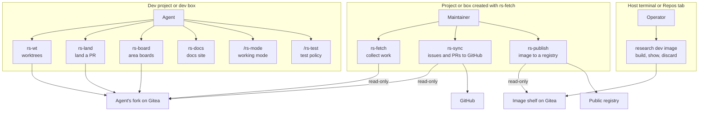

# Container commands

RS puts a small set of commands into its containers. Each one is aimed at a particular user: the dev agent, the maintainer collecting work, or the operator on the host. A container's search path holds only the commands meant for whoever works in that kind of container. RS's own helpers are kept in a private folder (`/usr/local/lib/rs`), and nobody runs them by name.

Most of these tasks can also be done from the webui. The Fetch tab copies ready-made `rs-fetch` and `rs-sync` commands, and the Repos tab builds images and copies the `rs-publish` command. The commands are what an agent uses, and what a person types in a terminal.



## Where each command is

| Command | Who runs it | Available in |
|---|---|---|
| `rs-wt` | Dev agent | Dev projects, dev boxes |
| `rs-land` | Dev agent | Dev projects, dev boxes |
| `rs-board` | Dev agent | Dev projects, dev boxes |
| `rs-docs` | Dev agent | Dev projects, dev boxes (`build` needs a dev project) |
| `/rs-mode` | Dev agent's session (pi: `/skill:rs-mode`) | Docker sandbox projects and their boxes |
| `/rs-test` | Dev agent's session (pi: `/skill:rs-test`) | Same as `/rs-mode` |
| `rs-fetch` | Maintainer | Projects and boxes created with the rs-fetch option |
| `rs-sync` | Maintainer | Same as rs-fetch |
| `rs-publish` | Maintainer | Same as rs-fetch |
| `research dev image` | Operator | Host terminal; the Services page's Repos tab does the same |
| `rs-web-restart` | Anyone in the box | Boxes with a web app (OpenKnowledge) |
| `rs-worker` | Research supervisor | Research projects ([Research workflow](Research-workflow.md)) |

The rs-fetch option is a checkbox in the New Project window (any workflow except dev) and in the box window (any box except a dev box). It needs the shared Gitea to be enabled. A dev box cannot fetch, because it works only on its own fork.

## For the dev agent

These commands follow the work cycle on the [Dev lane](Dev-lane.md) page. The agent's instructions tell it when to run each one, so a maintainer rarely types them. They are listed here so the maintainer can read the agent's session.

### rs-wt — one worktree per piece of work

| Command | Effect |
|---|---|
| `rs-wt new <name>` | Creates the branch `agent/<name>` from the fork's base branch, with a worktree at `/workspace/wt/<name>` |
| `rs-wt new <name> --base origin/<branch>` | The same, branching from another branch |
| `rs-wt list` | Every worktree (branch, last commit, uncommitted changes) and the branches whose worktree was removed |
| `rs-wt done <name>` | Removes the worktree; the branch is always kept |
| `rs-wt reopen <name>` | Puts a worktree back on an existing `agent/<name>` branch |

The main clone stays on the base branch. rs-wt refuses to start new work while the main clone is on any other branch. Several sessions can work on one repository in the same container without touching each other's files.

### rs-land — land an approved pull request

`rs-land <pr>` lands a pull request on the agent's own fork. It tags the work as `<pr>-<name>`, which is the record of what landed. Then it merges fast-forward only and deletes the branch. The agent runs it only after the maintainer approves the pull request in the session.

rs-land refuses instead of fixing things. A typical case is a base branch that has moved since the branch was made: the agent rebases, force-pushes the branch, and runs rs-land again.

### rs-board — the area boards

The maintainer orders work on Gitea boards: one board per `area:*` label, each with the columns Now, Next, Decide, Inbox and Backlog. The agent moves cards only through rs-board.

| Command | Effect |
|---|---|
| `rs-board reconcile` | Run at session start. Creates missing boards and labels, adds and removes cards, moves cards with a decision label from Inbox to Decide |
| `rs-board next [--area A]` | What to plan next: a card the maintainer dragged into Now, otherwise the top of Next |
| `rs-board start N --branch agent/<name>` | Moves the card to Now and comments the branch on the issue |
| `rs-board ask N` / `answered N` | Moves the card to Decide while a question blocks the work, and back to Now |
| `rs-board stop N --reason …` | Moves the card to the bottom of Next |
| `rs-board done N --pr M` | Closes the issue, naming the PR, and removes its card |
| `rs-board place N --column C` | Moves a card when the maintainer asks |
| `rs-board --dry-run <verb>` | Prints the writes without making them (the flag goes before the verb) |

reconcile never changes the order the maintainer set in Now, Next or Backlog.

### rs-docs — a repository's docs site

| Command | Effect |
|---|---|
| `rs-docs init --dry-run` | Reads only. Prints what `init` would write, every file under `docs/` that would be published, template code in the pages, pages with no place in the sidebar, and each reason `init` would refuse |
| `rs-docs init` | In a worktree: writes the site's look, the GitHub workflow and sidebar metadata on the pages in `docs/`. Writes no prose. Refuses and changes nothing when a file is in the way |
| `rs-docs check` | Names page problems from the files alone: no title, no place in the sidebar, a dead link, template code |
| `rs-docs build` | Builds the site with GitHub's own Pages image and checks every link. A dev box has no Docker and is told so |

[Dev lane](Dev-lane.md) says when a repository has a docs site.

### /rs-mode — the working mode

`/rs-mode <mode>` changes how the current session works (plan checks, doers, reviews). The project's setting picks the mode a new session starts in. The modes are listed on the [Dev lane](Dev-lane.md) page.

### /rs-test — the test policy

`/rs-test light` or `/rs-test full` changes how much testing RS asks of the current session. The project's setting picks the policy a new session starts on. The two policies are described on the [Dev lane](Dev-lane.md) page.

## For the maintainer

### rs-fetch — collect an agent's work

```bash
rs-fetch <repo>                        # list the fork's open pull requests
rs-fetch <repo> --pr 42                # stage PR 42 in the clone in this folder
rs-fetch <repo> --pr 42 --auto-commit  # commit each agent commit
```

rs-fetch stages the work in a local git clone, with the agent's commit message prefilled. It does not commit unless asked to. `--auto-commit` commits each agent commit separately, with your identity and the agent's original dates. `--branch` stages a branch instead of a pull request. `--commit` stages one commit of it at a time. A second argument names the clone, if it is not the current folder.

The Fetch tab's 📋 button copies the exact command for each pull request. The maintainer then pushes to GitHub as usual.

### rs-sync — issues and merged PRs to GitHub

```bash
rs-sync <fork owner>/<repo> <github owner>/<repo>           # dry run
rs-sync <fork owner>/<repo> <github owner>/<repo> --apply   # write
```

rs-sync copies a fork's issues and merged pull requests to the GitHub repository; `--wiki` adds the wiki and `--board` the boards. Without `--apply` it only reports what it would do. Settings live in `/workspace/.rs-sync.env`: a classic GitHub token with `repo` (and `project` for `--board`), and the labels whose open issues stay private. The first full run takes hours. Flags, what is copied, and how to remove it again: [GitHub mirror](GitHub-mirror.md).

### rs-publish — a built image to a registry

```bash
rs-publish <repo>                          # dry run: what would be uploaded
rs-publish <repo> --apply                  # upload under each git tag of the commit, move :latest
rs-publish <repo> --no-latest --apply      # upload, leave :latest where it is
rs-publish <repo> --latest <tag> --apply   # move :latest to a tag already published; no upload
```

rs-publish reads the repository's built image from the shelf on Gitea, with a read-only token RS stages beside it, and uploads it byte for byte over HTTPS, without docker. Each git tag on the image's commit becomes a version tag; a commit without tags is published under its full commit id. A version tag that already holds different content is refused before anything is uploaded, and a re-run skips tags that already hold the same image.

Settings live in `/workspace/.rs-publish.env`: the registry (`ghcr.io/<owner>`), the user and the token (for GitHub a classic token with `write:packages`). An agent working in the same project can read the file, as with rs-sync's.

During an upload, rs-publish shows its progress. In a terminal, one line is redrawn in place with the current layer, the total, the speed and the time left, and it says when a sent layer is waiting for the registry's check. When the output goes to a pipe or a log, it prints one line per uploaded layer as it goes. If whatever reads the output goes away (`| head`, a full disk), the run stops with one error and tags nothing more.

GitHub keeps a newly published package private. rs-publish says so after a publish; making it public is a one-time change in the package's settings on GitHub. The Repos tab's 📋 rs-publish button copies the command for a repository with a built image.

## For the operator on the host

### research dev image — build a repository's image

```bash
python research.py dev image build <repo> [--ref <branch or tag>] [--dockerfile <path>]
python research.py dev image show <repo>
python research.py dev image discard <repo>
```

`build` builds the image from what GitHub has now. It runs in a throwaway project with no agent and no credentials. The new image replaces the repository's previous one on the shelf. The Repos tab on the Services page does the same, with a log and a Cancel button. Details: [Dev lane](Dev-lane.md), "Built images".

## Design decisions

**Only typed commands are on the search path.** RS's helpers live in `/usr/local/lib/rs`, so the search path shows only what a person or an agent is meant to type. A container from before this layout refuses helper actions until it is stopped and started.

**Each command goes only where its user works.** Dev tools are linked into dev containers, fetch tools into containers created with rs-fetch, and `rs-web-restart` into boxes with a web app. A dev box cannot fetch, because its token reaches only its own fork.

**Board moves go through one tool.** Every session makes the same moves the same way, and no script reorders the maintainer's columns. `--dry-run` shows the writes first.

**Tools refuse rather than repair.** rs-land and rs-board stop with an error naming the cause instead of rebasing, merging or guessing. The agent fixes the cause and runs the command again.

**Anything that writes outside RS runs by hand, as a dry run first.** rs-sync and rs-publish use the maintainer's own token and write nothing without `--apply`. RS holds no GitHub write credential, and nothing runs on a schedule.

**A tool's settings live in `/workspace`.** Inside a container only `/workspace` survives a recreate, so `.rs-sync.env` and `.rs-publish.env` only have to be written once.

**RS builds, the fetch container publishes.** RS has docker but no registry credential. The fetch container has the credential but no docker and no control over RS. The image waits on the shelf between the two.
