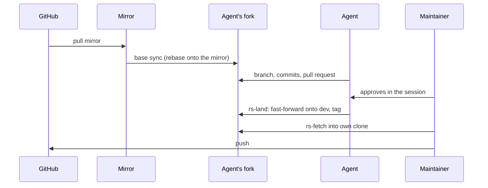
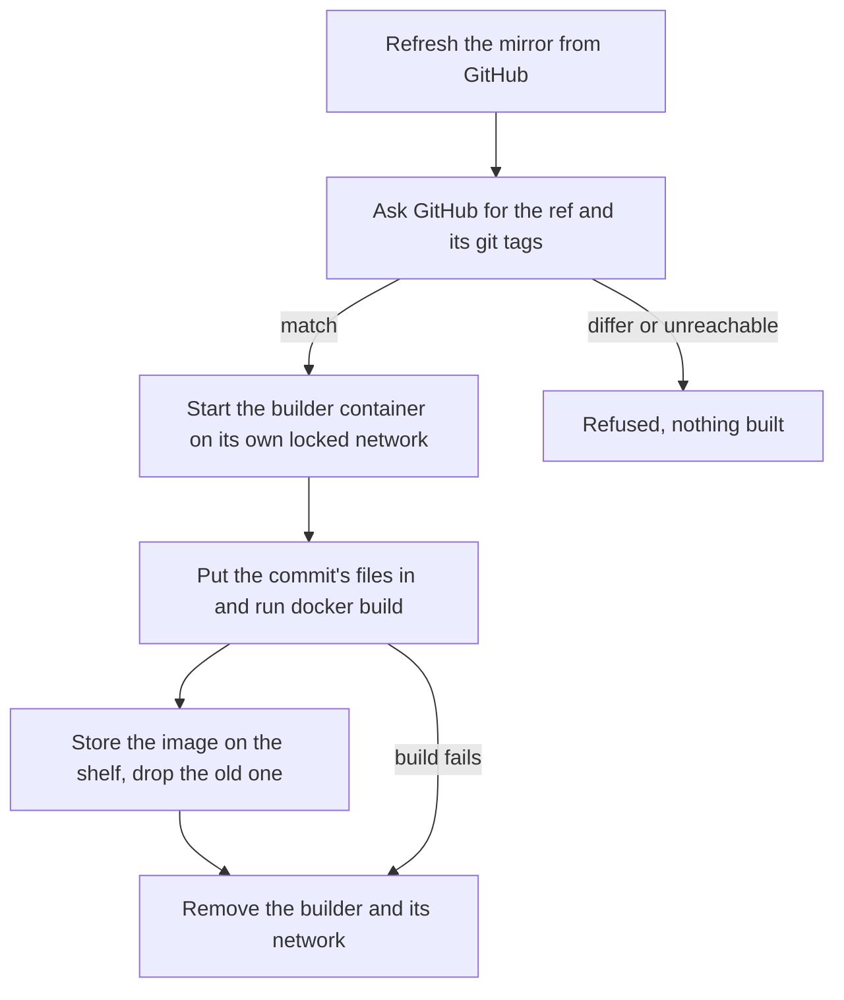
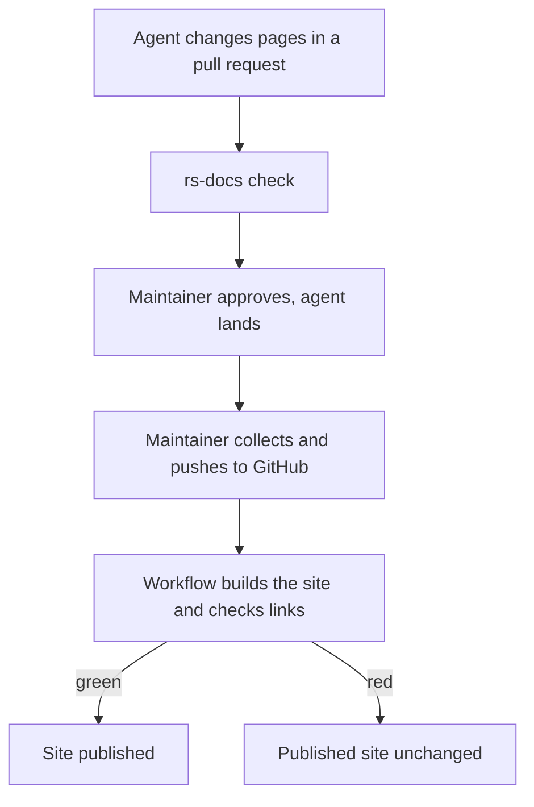

# Dev lane

The dev lane lets an agent work on a GitHub repository without holding any GitHub credentials. RS keeps a private copy of the repository in a shared Gitea. Each agent works on its own fork of that copy. The maintainer reviews the agent's work and carries it to GitHub.

## Parts

The **shared Gitea** is one Gitea server for the whole machine. It is switched on once, under Sandboxes → Infrastructure → Enable Gitea, and the maintainer reads it in the Gitea tab of the Development page.

The **mirror** is a private, read-only copy of the GitHub repository, refreshed every 10 minutes and on demand. It carries code only: no issues, no pull requests, no wiki. A private GitHub repository needs a GitHub token when it is added; Gitea keeps that token with the mirror, and RS stores none.

A mirror is named after the repository alone, without its GitHub owner. Adding a repository whose name another owner's mirror already holds is refused with an error naming both; the existing mirror has to be removed on the Development page first.

A **fork** is one agent's working copy of the mirror. Every agent gets its own Gitea account and its own private fork: a dev project's agent is `agent-<project>`, and each dev box is `agent-<project>.<box>`. The fork holds the agent's branches and pull requests, plus its issues, board and wiki.

A container works exactly one repository. A dev project's agent and its dev boxes each have their own fork, even when they work the same repository.

## The work cycle

The agent works on `agent/…` branches in separate worktrees and opens a pull request against its fork's `dev`. After the maintainer approves in the agent's session, the agent lands it with `rs-land`: a fast-forward merge, a `<pr>-<name>` tag as the record of what landed, and the branch deleted.

The maintainer collects landed work with `rs-fetch` in their own clone. The work arrives staged, with the agent's commit message prefilled and no agent authorship; with `--auto-commit` each agent commit becomes one commit. The maintainer then pushes to GitHub as usual.

The agent's next base sync rebases its fork's `dev` onto the mirror. Collected commits come back from GitHub under new ids, so the agent's own copies drop out. The base stays a straight line on top of the mirror, with no merge commits.

## Who can read what

| Account | Mirror | Its own fork | Other agents' forks |
|---|---|---|---|
| An agent | read | read and write | none |
| A fetch consumer (any project or box created with "rs-fetch") | none | — | read (code; issues, boards and wiki through the issue-reading token rs-sync uses) |
| The maintainer (`sandbox-admin`) | owner | admin | admin |

## Lifecycle

| Action | Where | What happens to the fork |
|---|---|---|
| Create a dev project | New Project window, dev card (GitHub URL) | Mirror added if needed; the project's agent gets a fork |
| Add a dev box | Box window, dev preset (GitHub URL) | Mirror added if needed; the box gets its own fork |
| Destroy a project, remove a box | Project or box controls | Fork archived: kept, read-only |
| Remove the repository | Development page | Mirror and every fork deleted; refused while any fork is still live |
| Purge an identity | Development page, archived forks | The Gitea account and its archived fork deleted; the name can be reused |

## Reviews

An optional reviewer reads a pull request's diff in a locked-down container with no Gitea access and no tools beyond reading files. Its verdict is stored on the host and shown on the Development page next to the pull request. It never writes to Gitea.

## Working modes

A dev project's agent and each dev box agent start in a working mode, chosen at create and changed in the ⚙ panel. Inside a session, `/rs-mode <mode>` (pi: `/skill:rs-mode <mode>`) switches it for that session only; the mode's short code works too (`/rs-mode 2`, `/rs-mode 2b`). The project's own instructions win over any mode. When the two disagree on something in the work at hand, and the project records no ruling on that conflict, the session asks the user; until then it does what does not depend on the answer and holds the rest. Child agents do not carry this rule.

| Mode | Short code | How the agent works | RS subagents |
|---|---|---|---|
| None | 0 | Follows only the project's own instructions | — |
| Direct | 1 | Shows the plan, waits for the user's go, implements and verifies itself | — |
| Doer-checker | 2 | As Direct, plus a checker reviews the plan before any code and the change before it is committed | checker |
| Checker-doer | 2b | Plans with the user; doers implement each unit, the agent reviews each change itself and the whole change before committing | doer |
| Planner-doer-checker | 3 | Plans with the user; doers implement each unit, a checker reviews each one | doer, checker |

Each mode is an entry in one catalog, built from shared rules: plan review, the go, measuring before building, re-reviews, findings, questions and the report. The webui, the installer, the switch and the checks all read that catalog.

RS's dev instructions leave the timing of commits to the mode. In Doer-checker, Checker-doer and Planner-doer-checker the agent commits, and so pushes, only after the review. In Direct and None it commits as it goes. A child agent doing work commits only when its brief says to.

RS's `doer` and `checker` do not start with the session's instruction files. Each is launched with its own part of RS's instructions, the project's instruction file and the workspace's `CLAUDE.md`, in Claude Code and pi alike. The working mode is never part of it. RS's instruction text marks which sections go to every agent, to agents doing work, or to the session only; an unmarked text goes whole to both roles.

| Reader | Sections of the dev instructions | Size |
|---|---|---|
| Session | All | 41 KB |
| Doer | Git remotes and workflow, worktrees, verification, working style, the shell notes, access notes | 18 KB |
| Checker | Access notes | 1.6 KB |

The go, project memory, the wiki, the Gitea API, delivery and the boards stay with the session. A doer's role text says it works under the go its parent quotes. Other box types' texts are unmarked. This needs Claude Code 2.1.322 or RS's pi rules 0.8.0; with an older agent the roles start as before and the project shows a warning.

## Test policy

A second switch, beside the working mode, sets how much testing RS asks of a dev agent. It is chosen at create and changed in the ⚙ panel, per project and per dev box. Inside a session, `/rs-test <policy>` (pi: `/skill:rs-test <policy>`) switches it for that session only.

| Policy | What the agent does | Meant for |
|---|---|---|
| Light (default) | Verifies each change by running it, runs the tests and linters the project already has, adds tests only where the user, the approved plan or its brief asks | A young project |
| Full | Every feature ships its tests, every bug fix a reproduction, and a new or changed test counts only once it was seen failing without the change | A mature project |

The policy is independent of the working mode and holds in every mode, None included. The project's own instructions win over it, as they do over a mode. A doer or checker never reads the policy: when the session works under Full, its brief carries the test rules.

A project's policy change reaches new sessions without a restart. A dev box restarts when its policy changes, and its settings say so before the save.

The switch reaches an existing project at its first start after the RS update that brought it (see [After updating RS](Browser-and-broker.md)). Until then the project has no `/rs-test`, and a dev box in it is refused Full with a message that says to restart the project.

## Built images

The shared Gitea's container registry holds at most one built image per repository, under a private organisation (`rs-images`) that no agent account can read or write. `research dev image show <repo>` reports it and `research dev image discard <repo>` removes it. Removing a repository's mirror removes its image first.

`research dev image build <repo> [--ref <branch or tag>] [--dockerfile <path>]` builds the image. The build runs in a throwaway container with its own Docker, which holds no agent and no credential and is not a project: nothing of it appears in the sidebar, Sandboxes or the project list. The image replaces the repository's previous one. Nothing is loaded into the machine's own docker.

The stored image carries its commit, the git tags on that commit and the repository's address as labels. The broker runs the same build as a background job, which is what the webui's build page will call. Several repositories build at once; one repository builds one image at a time. Cancel stops a running build: the job removes its own builder and the image already stored stays. A build and a discard wait while Gitea is upgraded or restored. A builder left behind by a build that died hard is removed by the next build of any repository.

The Development page's Images tab is the normal way to use this. It lists every mirrored repository with its built image (git tags, commit, build time, size) or "none". Build opens a dialog for an optional branch or tag and Dockerfile path, then a log box with a Cancel button. The log box can be sent to the background: the row then shows "building…" and settles by itself with a notice. Discard removes the stored image. The terminal commands above do the same.

A build started from the terminal is not shown as building on the tab. Publishing the image to a registry is `rs-publish`, typed in a fetch-enabled project or box: see [Container commands](Container-commands.md). When a repository has a built image, its row on the Images tab and its card on the Fetch tab each have a 📋 rs-publish button that copies the command.

## Docs site

A repository can publish its `docs/` folder as a documentation site for the people who use the software. The site uses just-the-docs and is built by a GitHub workflow that runs GitHub's own Pages build each time `docs/` changes on the default branch. The workflow checks every link before it publishes; a failed run leaves the published site as it was.

The maintainer asks a repository's agent to set the site up. The agent shows what `rs-docs init --dry-run` would write and publish. After the go it opens one pull request with the look, the workflow and sidebar metadata for the pages already in `docs/`. On GitHub the maintainer then sets Settings → Pages → Source to GitHub Actions.

A repository that has `docs/_config.yml` has a docs site. There the agent keeps the site's pages instead of the wiki, through pull requests, and runs `rs-docs check` before pushing. Project memory, plans and ledgers never go on the site. A repository without a site keeps its wiki.

The commands are on [Container commands](Container-commands.md).

## Design decisions

**One fork per agent.** Agents never share a fork, a token or a history, so parallel agents cannot overwrite each other's branches. The cost is several forks of one repository when several agents work it.

**The maintainer carries the work to GitHub.** RS holds no GitHub write credentials, and nothing reaches GitHub without the maintainer pushing it. Collection erases agent authorship and neutralises issue references, so a fork's `#12` cannot close the real repository's issue 12. The fork's issues, merged PRs, wiki and boards reach GitHub only through [rs-sync](GitHub-mirror.md), run by hand with the maintainer's own token.

**Rebase, never merge.** Merging the mirror into the fork's `dev` would leave merge commits that break per-commit collection. Rebasing keeps the fork a straight line on the mirror; the agent may rewrite its own fork history, never the mirror.

**Working modes are data built from shared rules.** A mode is a catalog entry listing its rules and subagents; adding one touches no code, and each shared rule is worded to hold in every mode that uses it. Only the host checks a mode against the catalog, so a broken catalog shows an error where a mode is used and never resets a mode a project already has.

**A mode's short code is a shorthand for the switch only.** It is mostly the number of agents the mode uses, with one optional letter to tell a second mode of the same size apart (`2b`); the catalog gives it per mode, optionally. Settings, the CLI and the webui take the mode's name, so a recorded mode is always a name.

**A box is refused a mode its project cannot give it.** A box installs the working-mode files its project staged at its last start. A box asked for a mode those files lack, or one RS no longer offers, is refused at add or settings change with the reason, instead of starting with no mode. The same holds for a box asked for the Full test policy.

**The test policy is its own switch, and Light is the unset state.** How much testing a project has earned depends on its age, not on who does the work and who reviews it, so the policy is not tied to the working mode. Light records nothing and installs no rule; Full adds one rule file. Projects that existed before the switch are therefore on Light from their next start, and the maintainer turns Full on for the mature ones.

**A subagent's instructions are handed to it at launch, never fetched by it.** The runtime starts each role with the texts it needs; no role is told in prose to go and read a file, which it could skip. RS's instructions stay one text with marked sections, so the session and its roles cannot drift apart.

**The dev instructions defer to the working mode.** They serve every mode, so they state no timing of their own for steps a mode decides, such as when to commit. Otherwise the two texts would contradict each other in the reviewing modes.

**A conflict between the project's rules and RS's goes to the user.** Precedence still says the project wins, but a conflict that decides something in the work at hand becomes a question, case by case. Places where RS's text leaves a choice to the project, such as which agent to launch, are not conflicts. Child agents are only doers, so the rule stays with the session.

**Nothing secret or personal goes where GitHub can see it.** Every agent, child agents included, keeps secrets and personal details out of issues, PR bodies, commits, code, tests and the wiki, using a table of what to write instead. An issue that cannot be written without one carries `sync-skip`, which keeps it off the GitHub mirror. Issues follow four prose templates: bug, improvement, plan and question.

**Built images are not backed up.** A backup leaves out Gitea's package store and a restore clears it. That covers every package stored in the shared Gitea, built images included. An image is rebuilt from its commit.

**A build is checked against GitHub, not against the mirror's sync time.** Gitea moves a mirror's last-synced time when a sync fails too. The build therefore asks GitHub for the branch or tag and its git tags, and refuses when they differ from the refreshed copy.

**The builder is a backend job, not a project.** Like a review, it is one throwaway container from an image, on a network of its own with locked egress: a build step reaches the web on 80/443 and nothing inside the machine, the shared Gitea included. It is removed with its network however the build ends; RS removes only builders and networks carrying its build label, and refuses a same-named one it did not make.

**Cancel tells the build to stop; the build cleans up after itself.** The broker records the cancel and signals the job, and the job removes its builder the way it does after any failure. The broker never destroys a builder under a running job. A build that is already storing its image finishes.

**Only the build's own messages reach the log the webui reads.** A failure underneath a build (docker creating the builder, Gitea starting) can carry a folder on the machine or a password, so it shows a fixed sentence there and its detail stays in the log only the broker serves.

**The Fetch tab learns which repositories have an image from one listing.** Each Fetch read lists the image shelf once and marks every repository card from it, instead of asking per repository; per-repository reads would queue several registry requests each on the broker on every render. If the listing fails, no card shows the button and the rest of the page is unchanged.

**A docs site replaces the wiki, and RS does not migrate.** In a repository with a site the agent stops keeping the wiki and writes for the software's users. RS ships how a site is added and kept; taking a project off its wiki is work the maintainer gives that project's agent. The cost is that pages change only through reviewed pull requests and appear as a site only after the push to GitHub.

**The site is built by GitHub's own Pages engine, from a workflow.** `rs-docs build` runs the same image locally, so a local build and the published one agree. The cost is Jekyll 3.10 with GitHub's fixed plugin list.
