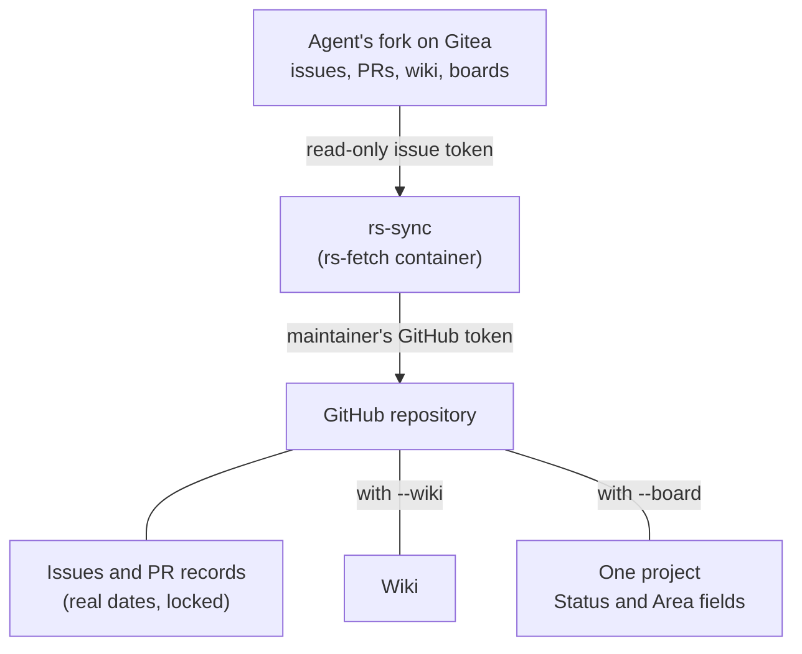

# GitHub mirror

`rs-sync` copies a dev fork's issues and merged pull requests from Gitea to a GitHub repository, and its wiki and boards when asked. Only that direction is supported. The maintainer runs it by hand, in any container that has rs-fetch. GitHub then holds a public record of how the code was made, with the original dates.

## Running it

| Command | Effect |
|---|---|
| `rs-sync <fork owner>/<repo> <github owner>/<repo>` | Dry run: a summary of what would be written, what is left out, what to check first, and how long it would take |
| `… --apply` | Writes to GitHub |
| `… --remove` / `--remove --apply` | Lists, then deletes, the issues, PR records and labels rs-sync put there; the wiki and the project only with `--wiki` / `--board` |
| `--wiki` | Also mirrors the wiki; with `--remove`, puts the GitHub wiki back |
| `--board` | Also mirrors the boards as one GitHub project; with `--remove`, deletes it |
| `--wiki-overwrite` | With `--wiki`: commits (or removes) past edits made on the GitHub wiki |
| `--report` | Adds the full JSON report after the summary, for pasting a run back to an agent |

The Fetch tab copies the dry-run command: each repository card has one `📋 rs-sync <owner>` button per live fork. The GitHub repository is the one the mirror was made from.

Settings live in `/workspace/.rs-sync.env` (mode 600; `--env` names another file): the GitHub token (a classic token with `repo`, plus `project` for `--board`), the labels whose open issues stay off GitHub (`RS_SYNC_HOLD_LABELS`, required), and the header line (`RS_SYNC_HEADER`, on by default; `off` hides it). The first full run takes hours, because GitHub limits how fast content can be created. Run it in a byobu window. On a terminal, one status line shows the writes against the planned total, the time so far and left, what is being read, and every wait or hourly pause counting down with its reason. Off a terminal (a log file, a pipe) the output is the plain lines alone.

Every run ends with a plain summary. After `--apply` it lists what was written. When a run stops on an error, it says either that nothing was written to GitHub or how many write requests were sent and what was recorded as done, then how to continue. rs-sync counts each request before sending it, so "nothing was written" is only said when nothing went out. A GitHub error is shown as one line with GitHub's own message.

## What goes over

| Gitea | GitHub |
|---|---|
| Closed issues, and open issues without a hold label | Imported issues with their original dates and comments, locked, titled `[rs-sync] <title>`, labelled `rs-sync` |
| Merged pull requests | Closed, locked `[rs-sync] [PR] <title>` issues labelled `merged-pr` and `rs-sync`, listing the commits they landed as |
| Issues and merged PRs labelled `sync-skip` | Nothing. A copy already there is deleted first at the next run |
| Labels in use | The same labels, their descriptions tagged ` (rs-sync)` (`(rs-sync)` alone for a label with no description); a label of the same name already on GitHub is used as it is |
| The wiki, with `--wiki` | The GitHub wiki's pages and files, one commit per run |
| The boards, with `--board` | One project: Status from the columns, Area from the board titles |

Later runs bring GitHub level with Gitea: new items, comments, edits, closes, label changes and deletions. An item already on GitHub keeps syncing, even if it later gains a hold label.

The `sync-skip` label works differently from the hold list. It keeps an item off GitHub whether it is open or closed, and it removes a copy that is already there: the next run deletes it before writing anything else. Removing the label brings the item back with its history, under a new GitHub number. Mentions of a flagged item elsewhere are written unlinked. Dev agents set the label on an issue that cannot be written without a secret or a personal detail; `rs-board reconcile` creates it on every dev repository.

References are rewritten through a table of Gitea number to GitHub number, rebuilt on every run. A reference to something not mirrored is written so that GitHub does not link it, and mentions are written so that they ping nobody.

## Reading Gitea

rs-sync reads Gitea with a second token of the read-only operator account, one that can also read issues. A project's start mints it when none works and stages it beside rs-fetch. Every rs-fetch container and fetch box can therefore read every fork's issues, comments, boards and wiki. This is the same reach it already has over their code, and it cannot write anywhere.

## Design decisions

**GitHub holds the record, nothing is kept locally.** Every mirrored item and comment ends with a hidden marker naming its Gitea source. Wiki commits and the project carry a marker too. A container can be rebuilt without losing anything, and `--remove` needs only GitHub. The cost: a marker a person pastes into their own issue is trusted, because rs-sync posts as that person.

**Every mirrored issue is marked as a copy.** Its title starts with `[rs-sync] `, it carries the `rs-sync` label, and its body opens with a line naming rs-sync (on by default). A reader of the GitHub repository sees which issues came from the private dev repo. Changing any of the three edits every mirrored issue once at the next run.

**Numbers are never assumed to match.** GitHub assigns its own numbers, and a deletion does not give them back. Every reference is mapped, and the dry run shows the table.

**The maintainer's own token, by hand.** GitHub keeps original dates only for imports by a repository admin, so rs-sync uses the maintainer's classic token. That token never enters RS, and nothing runs on a schedule.

**Every refusal comes before the first write.** Examples: a token's text in any text, an issue on two boards, a wiki edited on GitHub, a missing scope. A failure partway through stops the run with the item named, and the next run continues from the markers. An apply works out its whole plan before its first write (after the `sync-skip` deletions), so the Gitea reads that decide whether a deleted item is gone also stop the run before anything is written. Two checks still run item by item during the apply, after earlier writes: a token's text in a new issue and a block too large to split. A stop after earlier writes names the item it did not touch, never "nothing was deleted".

**An interrupted import is caught on the next run, not waited for in advance.** GitHub has no list of pending imports, so rs-sync cannot look for one before writing. An import that lands after a stop shows up as a second GitHub issue claiming the same Gitea item, and the next run refuses before any write, naming both; the person deletes one. During a run rs-sync waits on each import's own status with no deadline, and a stop during an import names the Gitea item that was in flight.

**A request GitHub does not answer is tried again when sending it twice is harmless.** Once GitHub has answered in a run, a read, or a change that sets a fixed value (a lock, an edit, a comment edit or delete, a board value, move or setting), that times out, loses its connection or gets a 502, 503 or 504 is tried again every minute, for up to an hour per request, with a line saying so. A repeated delete answered "not found", or a repeated lock refused while GitHub shows the issue locked, counts as done. A request that creates something (an import, a comment, a label, a card) is never repeated, because a second copy could appear; it stops the run, and the next run picks up from what GitHub holds. A GitHub that cannot be reached at all (refused, DNS, certificate) stops the run at once.

**GitHub's listing is waited for after imports.** GitHub can report an import done before its issue list, or its comment list, shows it. The run reads GitHub again every minute, for up to an hour, until every issue it imported is listed with the comments it was imported with. Going on earlier would post those comments twice, and a run started then would import the issue again. New board items are waited for the same way.

**Rate limits are waited out the way GitHub documents.** A wait GitHub names (`retry-after` of a minute or more, or a reset time) is waited exactly. A limit answer that names no usable wait, including a "retry now", is waited out for 1, 2, 4, 8 and 16 minutes, then the rest of the hour, and then the run stops.

**GitHub's hourly allowance is counted across runs.** GitHub allows 500 content writes an hour per account. Every rs-sync run in a container shares a count of the past hour's writes in rs-sync's cache folder, so a run started right after another paces itself against the same allowance, and the dry run's estimate includes the wait. The count is lost when the container is recreated, which only costs that hour's memory. A count file rs-sync cannot read or write stops the run and names it.

**The wiki is replaced, not merged.** The GitHub wiki's tree becomes the converted Gitea tree. Edits made on GitHub stop the run until `--wiki-overwrite` is given; they stay in the wiki's history. A remove with `--wiki` puts the wiki back to its state before rs-sync's first commit. A fork whose Gitea wiki has no page yet is left out of the run, and the GitHub wiki is not touched.

**The wiki and the board go over only when asked.** A plain run copies issues and merged PRs; `--wiki` and `--board` add the other two, for a sync and a remove alike. The summary of every finished run lists the parts left out and the flag that adds each one. A person who does not want them needs no `project` scope on the token, and no git for the wiki. The cost: a repository mirrored earlier with the wiki and board keeps them as the last full run left them, and they stop being updated until a run names the flags.

**A fixed label keeps an item off GitHub for good.** The hold list is the maintainer's setting and only delays open issues. `sync-skip` is set by the agent when it files the issue, so a secret or a personal detail never depends on a setting someone has to remember. Its copy is deleted first in a run, so an unrelated failure later in that run cannot leave it public. The cost: deleting a GitHub issue frees nothing, and a released item comes back under a new number.

**A label already on GitHub is used as it is.** GitHub repositories come with default labels such as `bug` and `enhancement`. When a mirrored issue carries a label of the same name (any case) that rs-sync did not make, the issue gets GitHub's label and rs-sync never changes or deletes it, not even on `--remove`. The summary lists these labels. The cost: such a label keeps GitHub's colour and description, not Gitea's.

**rs-sync knows its own labels by the tag in their description.** A description that is exactly `(rs-sync)` or ends in ` (rs-sync)` marks a label rs-sync made; any other label is a person's. The tag lives on GitHub, so nothing is stored locally. GitHub trims a description, which is why a label with no Gitea description is tagged `(rs-sync)` without the leading space. A label edited by hand on GitHub stays rs-sync's only while the tag is kept.

**The project is public only when the repository is.** The board then never shows more than the repository does. Items a person adds to the project are left alone.

**Settings live in `/workspace`.** Inside a project container or a fetch box only `/workspace` survives a recreate, so the settings file is created once and kept. The cost: the webui container (read-only projects mount) and, for a fetch box, its project container can read the token.

**Reading Gitea uses a separate token.** The operator token is unchanged; the new token adds issue reads only, so nothing that already works changes.
