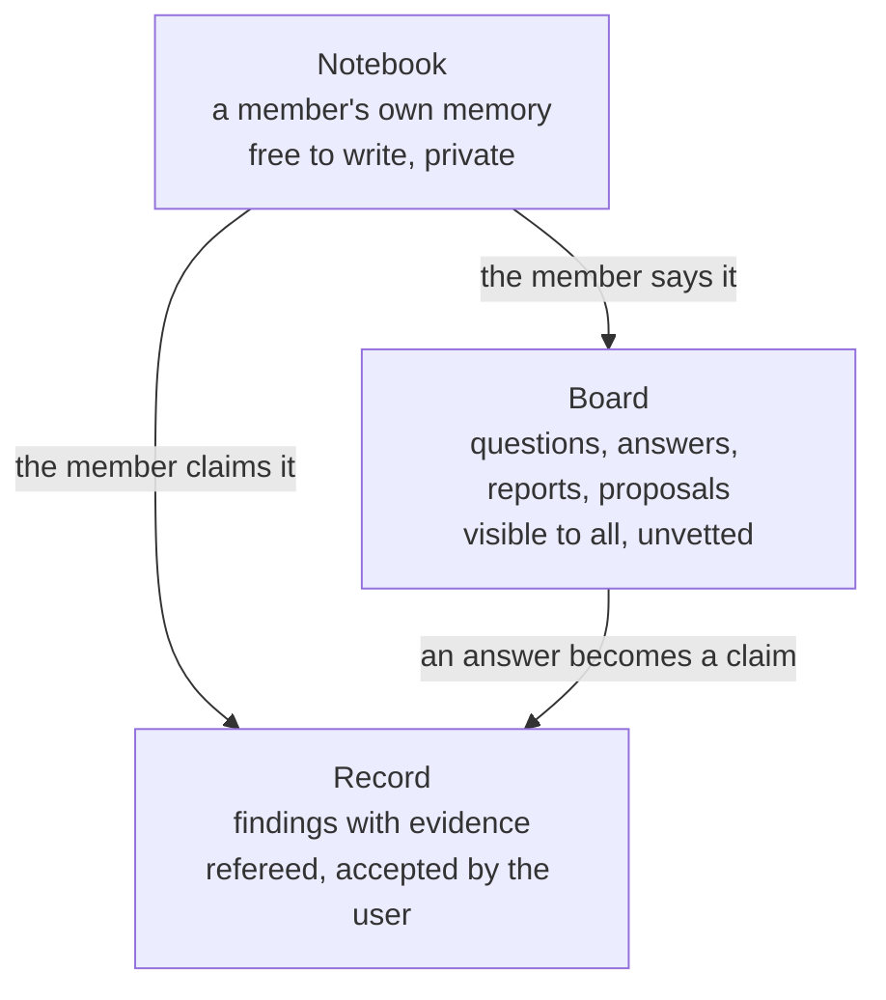
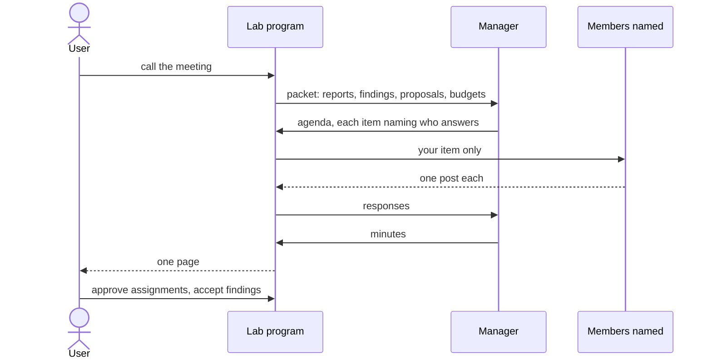

# Lab workflow

**Planned, not built.** Phase 3 of the lab agenda; see [Research](Research.md) for the other workflows.

A `lab` project reproduces a research group. Several long-lived members each own a line of inquiry and the understanding behind it. Each student is a researcher, as in the [Researcher workflow](Researcher-workflow.md), working one line.

| Lab role | Member | Holds | Does |
|---|---|---|---|
| Principal investigator | the user | direction | approves assignments and budgets, accepts findings |
| Lab manager | the manager | who works on what, what is open | agendas, minutes, proposed assignments |
| Student | one per line of inquiry | knowledge of its line | works assignments, publishes findings, answers questions |
| Technical staff | web research, database extraction | know-how | small tasks with minimal context |
| Reviewer | the referee | no stake in the result | judges claims against evidence |

## Three places

Most of what a student learns stays in its notebook. The board is the lab's only channel: every post has a headline, a kind, a sender, and an addressee that is a member or a topic. The user reads and posts on the same board.

## Staying lean

| Waste in agent assemblies | Rule |
|---|---|
| Agents wake to check for work | Nobody polls; a program does the waiting |
| Everyone reads everything | A post to a member wakes it; a post to a topic wakes nobody |
| Agents chat | A question gets one self-contained answer |
| Loops that never end | Work runs only against an approved assignment with a budget |
| Free questions | The asker's budget pays for the answer |

A member with no assignment and nothing addressed to it costs nothing.

## The lab meeting

The user calls the meeting. The packet is compiled without any agent run, and only members named on the agenda run. A meeting costs two manager runs plus one per member named.

## Design decisions (proposed)

**A student selects its own context.** A subagent knows what its parent told it; a student answers from its own memory, which holds more than a manager ever saw. The cost is that asking a student is an agent run.

**The manager keeps the map, not the knowledge.** Knowledge stays with the member who produced it and in the shared record. The manager's view is generated from members' front pages, the record and the board.

**Addressing wakes; broadcasting does not.** This one rule removes polling and all-hands reading. The cost is that a member learns of a topic post only as a headline, the next time something wakes it.

**Work needs an assignment and a budget.** Cost is predictable and approved by the user. A student's own ideas wait on the board as proposals until a meeting.

**The meeting is written and in rounds.** No shared transcript grows. The cost is that a question needing a conversation is not settled there.
