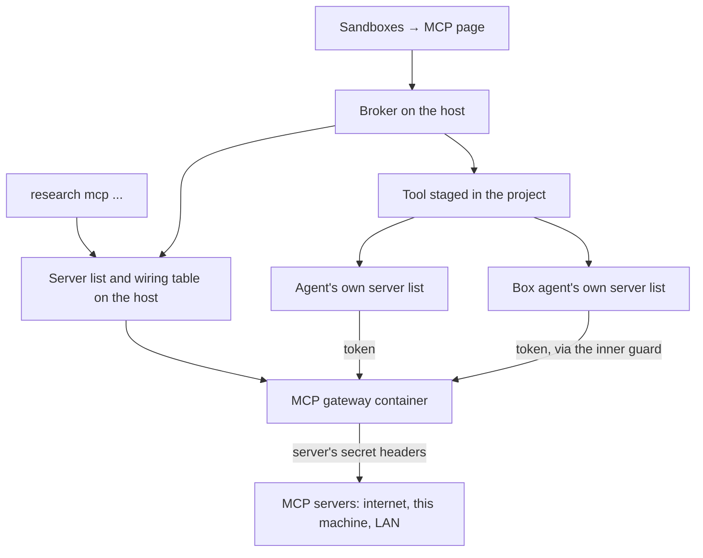

# MCP servers

An MCP server gives an agent extra tools (a reference library, a database, a search service). RS keeps two lists of them. The newer one sits behind a shared gateway and is managed and wired in the browser. The older one is per project and managed from the host. Both serve a research project's analysis workers.

## The gateway list (Sandboxes → MCP)

A server on this list is an address (`http://` or `https://`) plus optional secret request headers, such as an API key. The page adds, edits, tests and removes servers. `research mcp server list | add | edit | remove | test | reset` does the same from the host.

Test asks the server to introduce itself and reports one of four results.

| Result | Meaning |
|---|---|
| Answers as an MCP server | Usable |
| Refuses the credentials | Reachable; the secret header is missing or wrong |
| Does not speak MCP | Something answers at the address, but not an MCP server |
| Not reachable | No answer, with the reason |

## Wiring

Wiring gives one consumer a set of servers. A consumer is a project's own agent, one of its boxes, or a research project's analysis workers. On the page: pick a project, pick who in it, tick servers, Save. From the host: `research mcp wire <project> [--box NAME | --workers] --set a,b` and `research mcp wiring`.

Nothing restarts. The agent sees a change in its next session, in Claude Code and pi alike. A worker spawned after the Save can be given the new servers; a running worker keeps what it has until it is spawned again. Unticking takes effect at once at the gateway.

| Consumer | Wirable |
|---|---|
| A plain or Docker-in-Docker project's agent | Yes |
| A dev project's agent | Yes |
| A box, dev boxes included | Yes; a project made before wiring needs one Stop and Start first |
| A research project's analysis workers | Yes; each worker gets only the servers the supervisor names when it spawns it; a project made before this needs Rebuild all then Stop and Start |
| A research project's own agent | No; it plans and delegates to its workers |

The gateway forwards a call only when three things hold: the token is known, the call arrives from that token's own project network, and the server is on that consumer's list. It replaces the token with the server's own secret headers.

What Save reports, per agent in the container:

| Line | Meaning |
|---|---|
| added | In the agent's list; available from its next session |
| already there | Nothing to change |
| removed | RS's entry was taken out |
| applied when it next starts | The project or box is stopped or still starting |
| NOT added | The agent already has a server of that name; it is left as it is |

For a research project's analysis workers Save reports one line instead: workers spawned from now on can be given the servers, or, for a stopped project, that they reach its workers when it next starts.

## The per-project registry (host commands)

Servers registered with `research mcp add` are granted to a project with `research project mcp allow`. Research workers reach them through a small proxy inside the project. This path is unchanged: a research project's workers can be given servers from either list, the supervisor naming which ones per worker.

## What starts and stops the gateway

| Event | Effect |
|---|---|
| `research start` | Builds the gateway image (cached), starts the gateway, attaches it to every project; a failure warns and does not stop the start |
| `research stop` | Stops it |
| Start on the page | Starts it; builds the image first if missing; attaches it to every project |
| Software → Rebuild all | Rebuilds the image and moves a running gateway onto it |
| A change to the list or the wiring | A running gateway re-reads both; a stopped one stays stopped |
| A project starts, or a box starts | Its agents get their wired servers again |

## Design decisions

- **One shared gateway, not one proxy per project.** Server addresses and secrets live in one place outside every project, so wiring is a table entry and needs no restart.
- **Secrets never enter a project and are never shown again.** They are stored on the host in a file only the operator can read. The page shows header names only.
- **A consumer holds a token, never a server's secret.** The token is useless outside its own project's network.
- **One fixed gateway address per project.** It is the last address of the project's network, so nothing is re-configured when the gateway is re-created. This needs Docker 29.0, which is RS's minimum.
- **RS adds to the agent's own server list and marks its entries.** It never rewrites that list and never touches an entry it did not add. A name already in use is an error, not a replacement.
- **Each project applies its own wiring.** RS stages a small tool into the project; the tool records what it did for the page.
- **A removed server is refused at once.** Agents' leftover entries are tidied at the next start or wiring change.
- **A server sees its own address as the Host.** The gateway follows no redirect and passes no packets between project networks.
- **A damaged list or wiring table is an error with one explicit remedy.** A file written by a newer RS is never offered for discarding.
- **The gateway never blocks the fleet.** If it cannot be built or started, `research start` continues with a warning.
