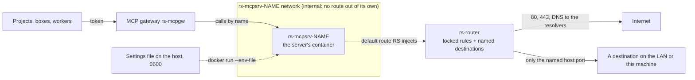
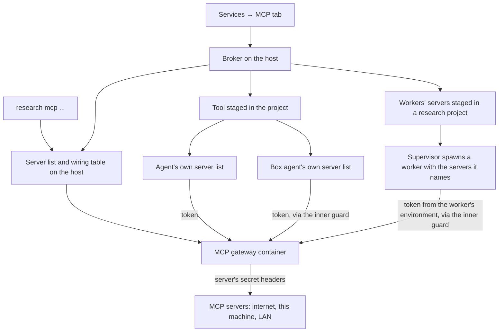

# MCP servers

An MCP server gives an agent extra tools (a reference library, a database, a search service). RS keeps two lists of them. The newer one sits behind a shared gateway and is managed and wired in the browser. The older one is per project and managed from the host. Both serve a research project's analysis workers.

## The gateway list (Services → MCP)

A server on this list is one of two kinds, each with optional secret request headers such as an API key:

- **An address** (`http://` or `https://`) of a server that already runs somewhere.
- **A server RS runs** from a container image: RS starts it in a container of its own on the host, beside the gateway, and gives it its settings. Its address is made from its name, so nothing on the consumer side changes.

The page adds, edits, tests and removes servers. `research mcp server list | add | edit | remove | test | reset` does the same from the host, and `research mcp server start | stop | restart | logs | update` acts on a server RS runs.

## Servers RS runs

The operator gives an image reference, the port and path it serves MCP on (streamable HTTP), and optionally its arguments, a data folder kept across restarts, its settings (environment values, each secret or not), per-request secret headers, and named destinations (`host:port`) on the local network or this machine it may reach.

- The image is pinned by content digest at Add; the container never runs the floating tag. Update fetches the reference again, shows the old and the new digest, and re-creates the server on the new one. An image that exists only on this host is pinned by its image id.
- The settings reach only the server's container, through a settings file on the host that only the operator can read. A secret setting is never shown again; the page shows its name. Edit replaces or removes a secret explicitly; a secret not mentioned keeps its value.
- The server's own network is shared only with the gateway and the router. It is created without a route out; RS gives the server its route through the router each time it starts it. Docker never restarts a server by itself, so one that crashed, or that was running when the host restarted, shows as stopped with the reason until Start, Restart or the next RS start.
- Its outbound traffic follows the rules of a locked project: ports 80 and 443 on the internet and DNS to the configured resolvers, nothing on the local network or this machine, plus each named destination. A destination's name is resolved once, when it is added or edited.
- The container runs with every capability dropped and no privilege escalation, publishes no port and mounts no host folder; its only storage is a docker volume RS makes for its data folder.
- On the page, Add server first asks which kind: an address, or a server RS runs. Add, Edit, Start, Restart and Update run in the background and show their log until they end; Stop, Logs and Remove answer at once. In Edit a secret setting's field starts empty: left empty, the setting keeps its value; its remove box takes it off.
- Each row shows running, stopped or failed (with the reason), and Logs shows the server's last lines of output. A server may print its own secrets there; Logs is shown only to the signed-in operator.
- Remove deletes the container, the router's rules, the network, the data volume and the settings file, each by its name.
- What RS made for a server whose name is no longer on the list (after a damaged list was replaced, for instance) shows as a leftover row; Remove on that row clears it, and Add of the same name refuses until then.

Two credentials for the same kind of server (a lab's account and a personal one) are two servers with their own names.

When the shared [Aldine](Aldine.md) LaTeX editor is turned on, RS keeps a server named `aldine` on this list; it is wired like any other server, and Turn off removes it again.

Test asks the server to introduce itself and reports one of four results.

| Result | Meaning |
|---|---|
| Answers as an MCP server | Usable |
| Refuses the credentials | Reachable; the secret header is missing or wrong |
| Does not speak MCP | Something answers at the address, but not an MCP server |
| Not reachable | No answer, with the reason |

## Wiring

Wiring gives one consumer a set of servers. A consumer is a project's own agent, one of its boxes, or a research project's analysis workers. On the page: pick a project, pick who in it, tick servers, Save. From the host: `research mcp wire <project> [--box NAME | --workers] --set a,b` and `research mcp wiring`.

Nothing restarts. The agent sees a change in its next session, in Claude Code and pi alike. A worker spawned after the Save can be given the new servers; a running worker keeps what it has until it is spawned again. Unticking takes effect at once at the gateway.

| Consumer | Wirable |
|---|---|
| A plain or Docker-in-Docker project's agent | Yes |
| A dev project's agent | Yes |
| A box, dev boxes included | Yes; a project made before wiring needs one Stop and Start first |
| A research project's analysis workers | Yes; each worker gets only the servers the supervisor names when it spawns it; a project made before this needs Rebuild all then Stop and Start |
| A research project's own agent | No; it plans and delegates to its workers |

The gateway forwards a call only when three things hold: the token is known, the call arrives from that token's own project network, and the server is on that consumer's list. It replaces the token with the server's own secret headers.

What Save reports, per agent in the container:

| Line | Meaning |
|---|---|
| added | In the agent's list; available from its next session |
| already there | Nothing to change |
| removed | RS's entry was taken out |
| applied when it next starts | The project or box is stopped or still starting |
| NOT added | The agent already has a server of that name; it is left as it is |

For a research project's analysis workers Save reports one line instead: workers spawned from now on can be given the servers, or, for a stopped project, that they reach its workers when it next starts.

## The per-project registry (host commands)

Servers registered with `research mcp add` are granted to a project with `research project mcp allow`. Research workers reach them through a small proxy inside the project. This path is unchanged: a research project's workers can be given servers from either list, the supervisor naming which ones per worker.

## What starts and stops the gateway and the servers RS runs

| Event | Effect |
|---|---|
| `research start` | Builds the gateway image (cached), starts the gateway, attaches it to every project; a failure warns and does not stop the start |
| `research start` (servers RS runs) | Starts every server RS runs that the operator did not stop, gives it its route out again and attaches the gateway to its network; a failure warns and does not stop the start |
| `research stop` | Stops the gateway and every server RS runs (they come back at the next start) |
| Stop on a server's row | Stops it; `research start` leaves it stopped until its Start |
| Start, Restart on a server's row | Starts it (Restart re-creates it on its saved settings) |
| Edit, Update on a server's row | Re-creates a running server on the change; a stopped one runs it at its next Start |
| Start on the page | Starts it; builds the image first if missing; attaches it to every project |
| Software → Rebuild all | Rebuilds the gateway image and moves a running gateway onto it; servers RS runs are not touched (their images are pinned) |
| A change to the list or the wiring | A running gateway re-reads both; a stopped one stays stopped |
| A project starts, or a box starts | Its agents get their wired servers again |

## Design decisions

- **One shared gateway, not one proxy per project.** Server addresses and secrets live in one place outside every project, so wiring is a table entry and needs no restart.
- **Secrets never enter a project and are never shown again.** They are stored on the host in a file only the operator can read. The page shows header names only.
- **A consumer holds a token, never a server's secret.** The token is useless outside its own project's network.
- **One fixed gateway address per project.** It is the last address of the project's network, so nothing is re-configured when the gateway is re-created. This needs Docker 29.0, which is RS's minimum.
- **RS adds to the agent's own server list and marks its entries.** It never rewrites that list and never touches an entry it did not add. A name already in use is an error, not a replacement.
- **Each project applies its own wiring.** RS stages a small tool into the project; the tool records what it did for the page.
- **A worker gets only the servers its supervisor names.** Ticking servers for analysis workers makes them available to the supervisor, not to every worker; the supervisor grants each worker the servers its task needs, the same rule as for the per-project registry.
- **A worker's token is never written to a file.** It reaches the worker through its environment, and the worker's server list refers to it by name. The webui reads every project folder, so a token there would be readable outside the project.
- **A removed server is refused at once.** Agents' leftover entries are tidied at the next start or wiring change.
- **A server sees its own address as the Host.** The gateway follows no redirect and passes no packets between project networks.
- **A damaged list or wiring table is an error with one explicit remedy.** A file written by a newer RS is never offered for discarding.
- **The gateway never blocks the fleet.** If it cannot be built or started, `research start` continues with a warning.
- **A server RS runs lives on the host beside the gateway, never inside a project.** Its secrets stay out of every project.
- **One network per server, shared only with the gateway and the router.** A compromised server reaches neither a project nor another server.
- **Fail-closed by construction.** The server's network has no route out of its own; the only way out is the route RS injects through the router, under a locked project's rules plus the destinations the operator named.
- **Settings are values handed over in a private file, never on a command line.** Values only for now; a server that needs a secret file cannot be run yet.
- **Images are pinned by digest.** Update is explicit and shows what changed.
- **One credential per server.** Everyone wired to a server acts with its one credential.
- **Anything of a server's name that RS did not make is an error.** RS never adopts, renames or deletes it.
- **Removal is by name.** RS deletes what it made for that server, one named thing at a time.
