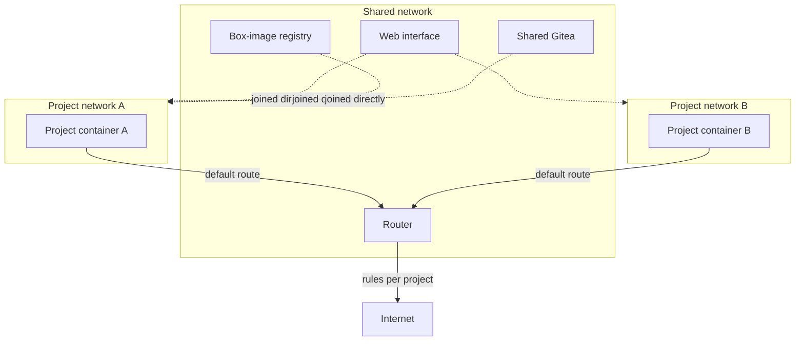
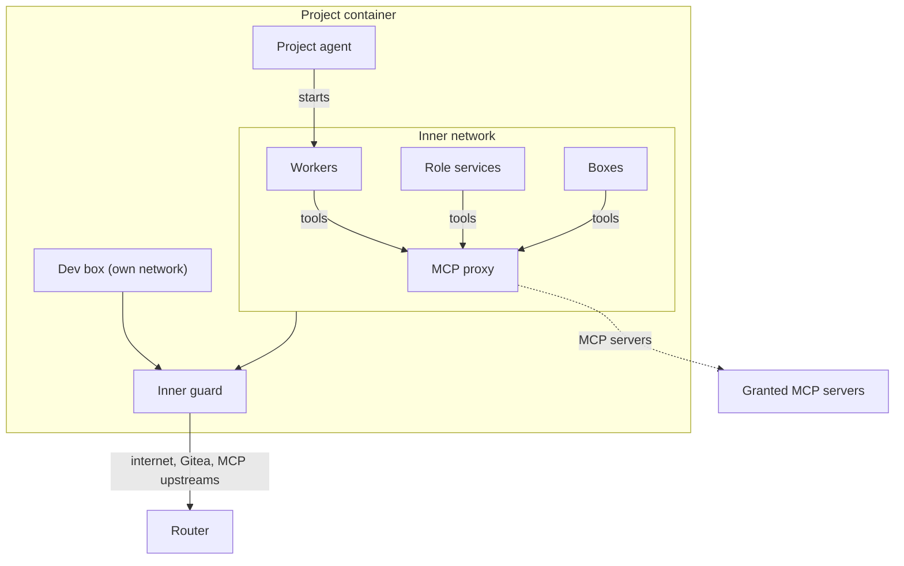

# Networking and egress

Every RS project has its own network. All outbound traffic from a project goes through one shared router, which applies that project's egress rules. The shared services (the box-image registry, Gitea, the web interface) are attached to each project network directly and do not pass through the router. Inside a project, workers and boxes sit on an inner network and reach their tools through an MCP proxy.

## Project networks and the router

Each project gets its own Docker bridge network, created with the project and removed when it is destroyed. RS points the project container's default route at the router, which is joined to every project network. Traffic between projects is blocked by Docker's isolation between bridges and by the router, which drops private destinations.

The **router** is one small container on the shared network. It filters traffic by source project network and masquerades it out. Its default policy is to drop, so a project without recorded rules has no egress. Each project's rules are stored on the router's volume and replayed when the router starts; destroying a project removes them.

Project networks are plain bridges, not Docker "internal" networks, because Docker drops published ports on internal networks and the project's SSH port would stop working. Egress control therefore rests on the injected route and the router's rules.

## Egress modes

A project is created with one of two egress modes. Private and link-local addresses (10.0.0.0/8, 172.16.0.0/12, 192.168.0.0/16, 169.254.0.0/16) are blocked in both, which covers the operator's LAN and other Docker networks.

| Traffic | Open | Locked |
|---|---|---|
| Private and LAN addresses | blocked | blocked |
| Web (TCP 80, 443) | allowed | allowed |
| DNS | allowed | configured resolvers only |
| Other ports and protocols | allowed | blocked |
| Ping (ICMP echo) | allowed | blocked |
| A granted external MCP (its address and port) | allowed | allowed |

Projects resolve names through the configured resolvers, by default the public Quad9 servers; RS refuses private or loopback addresses there. A granted external MCP gets its own allow rule for that one address and port, ahead of the private-address block. Destroying a project removes these MCP rules with its other rules, and creating or reviewing a project clears any MCP rules left on its network range before adding its own. The range 100.64.0.0/10, which Tailscale uses, is not blocked.

The egress mode is chosen in the create form. The research workflow defaults to the operator's configured default (open unless changed); every other shipped workflow defaults to locked.

## Shared services

The registry, Gitea and the web interface sit on the shared network and are also joined to every project network. A project reaches them by container name over its own bridge, without the router, which would block their private addresses. Each shared container keeps its own default route on the shared network.

| Service | How projects reach it | Operator's side |
|---|---|---|
| Box-image registry | Read-only instance on each project network | Separate writable instance on a loopback port |
| Shared Gitea | Joined to each project network | Loopback port; Gitea tab in the web interface |
| Web interface | Joined to each project network, to open terminals, editors and tabs | Published on the address the operator chose |

The web interface joins project networks only to open connections into them; it refuses connections that arrive from a project's bridge. RS will not publish it on every host address (`0.0.0.0`). The dev lane's pull-request reviewer runs on a separate bridge with locked egress.

## Inside a project

A project with an inner Docker daemon runs its workers, role services, boxes and the MCP proxy on an inner network. Their traffic leaves through the project container, so it also goes through the router. Single-container projects have no inner network.

The **MCP proxy** is the only route from workers and boxes to tools. It gives every granted MCP one address, `mcp-proxy:8888/<name>/`, forwards requests to the real server, and logs one line per request in the project's workspace. A worker knows only the MCPs it was granted, the proxy only the project's allowlist, and the router lets traffic through only to granted destinations.

The **inner guard** is always on in a project with an inner daemon. It drops new connections from inner containers to private addresses and to the project container itself, so a box cannot reach its project's SSH server or editor, the host, the registry, or another box's published port. It allows the internet, Gitea's HTTP port and the proxy's granted upstreams. Boxes on the same inner network can still reach each other.

The **inner firewall** is an opt-in extra for research projects, set at create and not offered in the web interface. It stops workers from making any connection of their own beyond the proxy. Role services, boxes and the proxy keep their outbound access.

**Dev boxes** each run on their own small network instead of the inner network. A dev box has no route to the MCP proxy, so it gets no MCP tools. It reaches Gitea directly at its project-network address, and the internet through the router; see [Dev lane](Dev-lane.md).

## Reaching a project from the browser

The web interface relays every in-project web surface (the project's editor, a box's editor, an exported port) on its own **origin port**, so each gets separate browser storage; all of them require the web interface login. An exported port that listens only on the container's loopback address is relayed by a small forwarder. **Pass-through ports** are raw TCP ports a project claims for applications the relay cannot front, such as ones running their own TLS; they are not behind the login, so the application's own authentication protects them. Each project's SSH port is published on the host for remote-SSH editors. See [Browser and broker](Browser-and-broker.md).

## What RS does not do on the host

RS changes nothing on the host outside its own containers. It never writes host firewall rules, never changes host sysctls, and never checks whether the operator hardened the host. The router's IP-forwarding setting applies only inside the router container.

Two paths stay open until the operator closes them. A project's root can replace the injected route and send traffic past the router, and a host service listening on all interfaces (SSH by default) can be reached from a project at its bridge gateway. Every project bridge has a host interface name starting with `rsn`, so two generic host rules close both paths; they are listed as operator-applied suggestions in `docs/SECURITY.md`.

## Design decisions

**Egress is enforced outside the project, by one shared router.** The project's root can change any rule inside its own container, so the policy lives in a container the project does not control. The cost is that a project root can still route around the router until the operator applies the host rule.

**Private and LAN addresses are blocked in every egress mode.** The operator's LAN, the host and other Docker networks are never reachable through the router. As a consequence shared services have to be attached directly, and a private-address MCP needs its own allow rule.

**Shared services are attached to project networks, not routed.** The registry and Gitea work offline and stay reachable without opening private ranges in the router. The cost is that they are neighbours of every project, so the inner guard limits what boxes and workers can reach on that bridge.

**Tools are reached through one proxy per project.** Workers and boxes get one stable address per MCP, and tool access is gated by the allowlist and the router together. Dev boxes, on their own networks, have no tools.

**RS never touches the host.** Host firewall rules, sysctls and services belong to the operator; RS documents the two rules it needs and keeps working when they are applied. Until then, the re-route and host-service paths stay open.

**Each in-project web surface gets its own browser origin.** Separate ports keep each editor's browser storage apart while one login covers all of them. The cost is a reserved port range on the host.
