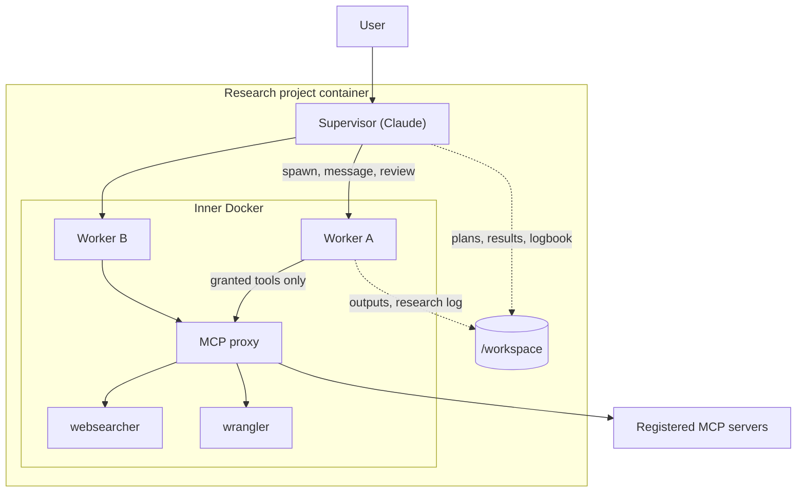
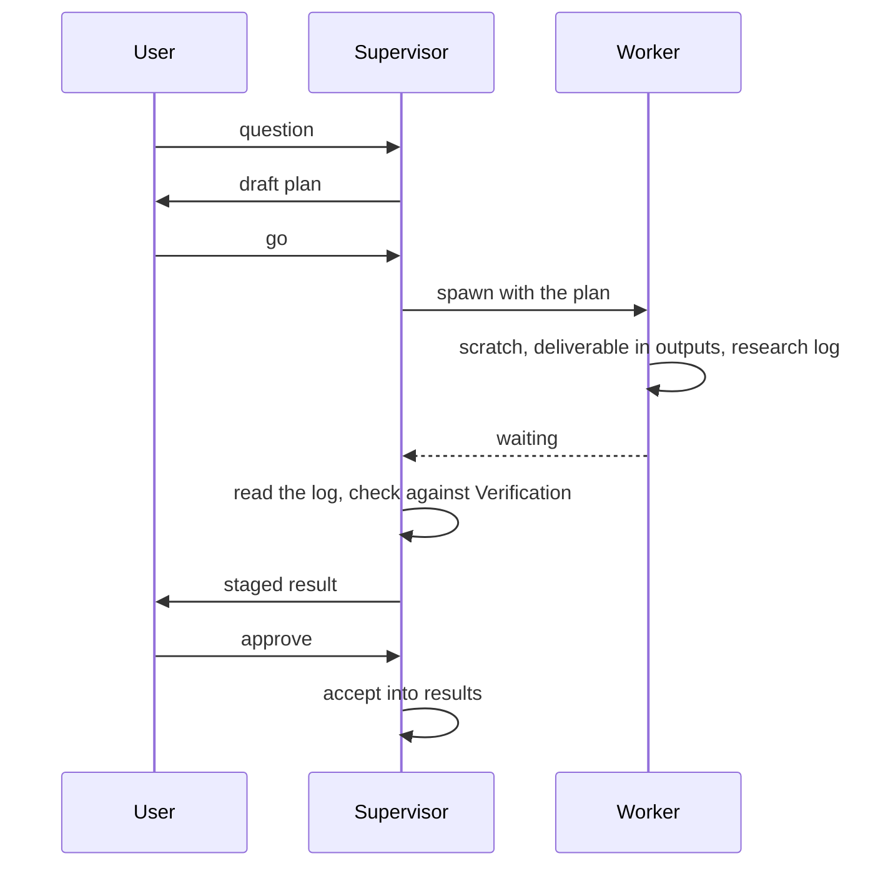

# Research workflow

The `research` workflow, shown as **research (legacy)** in the New Project window, is the original research workflow, kept until the planned lab takes its parts. Its agent is a **supervisor**: it plans analyses with the user, runs each in a **worker** container inside the project, reviews the results and reports back. See [Research](Research.md) for the comparison with the other research workflows.

The supervisor does not analyse data, run statistics or install packages. It turns the user's question into worker tasks, judges each result against its plan, and passes on only accepted results. Each worker is a container in the project's inner Docker running Claude without a terminal; parallel parts of one question run as parallel workers.

A research project always runs Claude, because its supervision check is a Claude Code hook.

## Plan before spawn

Every worker starts from a plan the user approved. The supervisor writes a draft to `plan/draft/<name>.md` and waits for an explicit go; the spawn copies it to `plan/<name>.md` and into the worker's brief. A spawn is refused unless the plan has five sections: **Question**, **Inputs**, **Deliverables**, **Verification** and **MCPs** (the tools the worker gets, each with a reason).

## A cycle

A worker puts each cycle's deliverable (a clean notebook or script and the files it produces) in `outputs/<slug>/`, exploration in `scratch/`, and a narrative in `research_log.md`. It reruns the deliverable end to end before reporting. Follow-up tasks go to the same worker as messages.

The supervisor cannot hand control back to the user while a finished worker's research log is unread. An accept is refused when the output folder is empty, holds file types outside an allowed list or debris such as caches, or reuses a slug. An accepted cycle is copied, with its plan, to `results/<name>/<NNN>_<slug>/`.

## Sessions

A session ends when the user types `/log`. Each worker writes a short `summary.md`, the supervisor writes its logs, and the workers are shut down. Their folders stay, so a later session can respawn a worker with a new plan on top of its own history; a destroyed worker's name is never reused.

## Role services and tools

Role services are per-project containers that workers call for specialised jobs. **websearcher** does web research in a headless browser and is on by default; **wrangler** explores and extracts from the databases a project allows. Each call starts a fresh agent, about a minute of startup, whose only memory is the notes the role keeps in its own folder.

When a site blocks websearcher's browser on the first visit, it retries once with Claude's own fetch tool, or the query with Claude's web search, before calling the site unreachable. It notes which tool the site serves, so later calls go straight to it. A rate limit is backed off, never retried this way.

Workers reach every tool, role services and registered external MCP servers alike, through the project's **MCP proxy**. A worker gets only the tools named at its spawn, none by default.

## What the user reads

| Folder in `/workspace` | Holds | Level |
|---|---|---|
| `logbook/pi/` | One topic log per subject of a session | Summary |
| `logbook/supervisor/` | One detailed log per session | Detail |
| `results/<name>/` | Accepted cycles with their plans; `manifest.json` lists them | Detail |
| `staging/<name>` | A result waiting for approval | Review |
| `plan/`, `plan/draft/` | Approved plans and drafts | Reference |
| `workers/<name>/work/` | Outputs, research log, scratch, summary, raw log | Source |
| `shared/<name>/` | Each worker's and role's mailbox | Exchange |

Each topic log names the session log it comes from. Logs are never edited after they are written; corrections go into the next one.

## Design decisions

**Workers are nested in the project's own Docker.** A project is isolated as a whole and destroying it removes everything it ran. The cost is an inner-Docker runtime on the host.

**Supervision is enforced by checks, not instructions.** A spawn needs an approved five-section plan, the supervisor cannot report while a finished worker's log is unread, and an accept checks the deliverable's shape. Small tasks still cost a worker, which keeps analysis out of the supervisor's context.

**Logs are immutable and read from summary to source.** The user reads topic logs first and follows their references down to session logs, results and worker folders. Nothing is rewritten, so the record can be trusted; a correction is a new entry.

**Work lives with the agent that did it.** Each worker writes its own log and summary; the supervisor writes its own logs. No agent re-reads all the others' work, at the cost of several places to look.

**Tools are granted per worker, through one proxy.** A worker sees only the tools its approved plan names, which bounds what it can reach. Role services start a fresh agent per call: independent calls, about a minute each.

**websearcher falls back to a declared agent, never a disguise.** On a bot wall it uses Claude's fetch tool, which names itself to the site as a Claude agent; it never poses as a person's browser. A rate limit means the site wants less traffic, so it gets no fallback.

**This workflow is the benchmark for the lab-agenda workflows.** It is not changed by the lab agenda; the lab-agenda workflows are measured against it.
