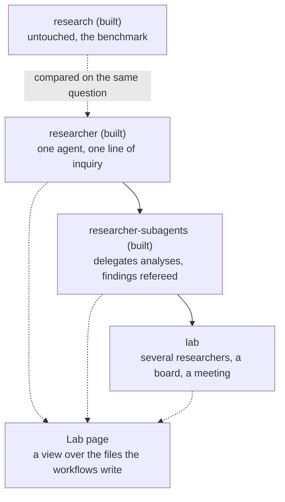

# Research

RS has two research workflows today and two more planned. Each is a project type chosen in the New Project window. They are independent: none needs another to be used, and the existing one is not changed by the others.

On these pages **the user** is the person working with RS, and a **researcher** is the agent of a lab-agenda workflow.

The three newer workflows form the **lab agenda**. They are built in order, because each is made of the one before; the first two are built. The existing workflow is the benchmark they are measured against.

| Workflow | Status | Agents | Who analyses | What remembers | Independent check | Page |
|---|---|---|---|---|---|---|
| `research` | built | a supervisor and worker containers; Claude only | workers, never the supervisor | session logs, written at session end | the supervisor, against its own plan | [Research workflow](Research-workflow.md) |
| `researcher` | built, phase 1 | one long-lived agent; Claude or pi | the agent itself | the agent's own memory, written as it works | none; the user accepts findings | [Researcher workflow](Researcher-workflow.md) |
| `researcher-subagents` | built, phase 2 | a researcher and its short-lived subagents; Claude or pi | subagents, with context the researcher selects | the researcher's memory | a re-run and a referee, on every finding; the user accepts | [Researcher with subagents](Researcher-with-subagents.md) |
| `companion` | built | one long-lived agent for one-off and mixed tasks; Claude or pi | the agent itself, one folder per task | the researcher's memory, with the user's standing preferences in place of a line of inquiry | none; claims only when the user asks, and the user accepts | [The companion](Researcher-workflow.md#the-companion) |
| `lab` | planned, phase 3 | several researchers, staff, a manager | each member, on its own line of inquiry | each member's memory, plus a shared record | a referee, on every claim | [Lab workflow](Lab-workflow.md) |

The `companion` stands beside the lab agenda rather than in it: a researcher kept for one-off and mixed tasks instead of one line of inquiry, described on the [Researcher workflow](Researcher-workflow.md#the-companion) page.

## How they differ

| | `research` | `researcher` | `researcher-subagents` | `lab` |
|---|---|---|---|---|
| The user talks to | the supervisor only | the researcher | the researcher | the manager, or any member |
| Long-lived agents | supervisor, workers | one | one | every member |
| Containers | supervisor, workers, role services | one | one | one per member (to be decided) |
| Knowledge lives in | session and topic logs | a record of findings with evidence | the same record | each member, and a shared record |
| Parallel work | parallel workers | none | parallel subagents | parallel lines of inquiry |
| Rules enforced by | the worker tool and a Claude hook | a memory command | the memory command | the memory command and a lab program |
| Cost when idle | none | none | none | none, by design |

## The lab page

A fourth phase adds a page that shows what the planned workflows write: the state of knowledge, each researcher's front page, the lab's board and meeting minutes, and answers with their notebook or plot in place. Until it exists, the same files are read in the reader and editor tabs.

Later, the user's decisions (accept a finding, approve an assignment, ask a member) move from the chat to that page.

## Design decisions

**The existing research workflow is the benchmark and is not changed.** The planned workflows are added beside it and compared with it on the same multi-session question. The cost is four workflows to explain instead of one.

**Three independent workflows, built in order.** A member of the lab is a researcher; a researcher with subagents is a researcher. Each can be used alone, so a small question never pays for a lab.

**Tools before prose.** A rule that matters is a command that refuses and names the next step. An agent's standing instructions hold its role and judgment; mechanics live in commands.

**The same under Claude and pi.** Nothing in the lab-agenda workflows may depend on a feature only one agent has. The existing workflow runs Claude only, because its supervision check is a Claude hook.

**The user is the only oracle.** Nothing becomes established knowledge without the user's acceptance. A referee advises the user and binds the agent.

**The files are the interface.** Agents write files in known places and know nothing about the page that shows them.
