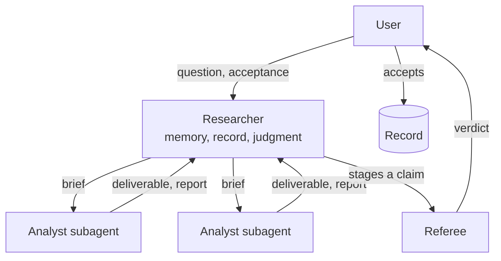

# Researcher with subagents

**Planned, not built.** Phase 2 of the lab agenda; see [Research](Research.md) for the other workflows.

A `researcher-subagents` project holds one researcher, as in the [Researcher workflow](Researcher-workflow.md), with two additions. It hands analyses to short-lived subagents, and an independent referee checks its claims before the user is asked to accept them.

It is meant to do what the [Research workflow](Research-workflow.md) does with far fewer parts: no worker containers, no role-service containers, no supervision hook.

## Delegation

A subagent knows only what its brief says. The researcher's context is not spent on the analysis, and the analysis is not coloured by everything else the researcher holds.

A subagent is short-lived and keeps no memory. What it learned comes back in its report, and the researcher writes what matters into its own journal, record or skills.

## The referee

| | A coding checker | The referee |
|---|---|---|
| Checks | a change against a plan | a claim against its evidence |
| Independent of | the author's context | the hypothesis |
| A failed check leads to | a fix | a narrower claim, or an objection kept on record |
| Authority | asserts defects | asserts gaps; the user decides |

The referee returns a verdict per claim: supported, overreaches (with the narrower claim that would hold), or unsupported. A claim does not reach the user without a current verdict. The user may accept over an objection, and the objection is recorded on the finding.

A verdict is bound to the content it judged. If the claim or its evidence changes, the referee runs again.

## The re-run check

Before a claim is staged, the deliverable behind it is run again in a clean environment, and the result is recorded beside the claim. A re-run shows that a deliverable reproduces, not that it is right.

## Design decisions (proposed)

**Subagents keep nothing.** Knowledge stays with the researcher, in one memory. The cost is that long-lived workers with their own context are given up; the [Lab workflow](Lab-workflow.md) restores them.

**The referee guards the record, not the work.** A wrong finding that enters the record is built on silently; a wrong intermediate result costs little. The cost is one agent run per result that carries claims.

**The referee cannot be briefed by the researcher.** It reads the claim and its evidence, never the researcher's reasoning. How it is started so that this holds is still to be measured.

**Checks are conditions, not a sequence.** The researcher may ask for the referee's read early; work with no claims costs no referee run.
