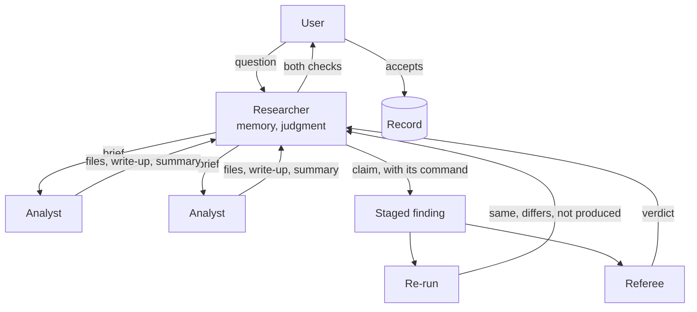

# Researcher with subagents

**Built (phase 2 of the lab agenda).** See [Research](Research.md) for the other workflows.

A `researcher-subagents` project holds one researcher, as in the [Researcher workflow](Researcher-workflow.md): the same agent (Claude, pi or both), the same memory and logbook, the same Reader tab. It adds two things. The researcher hands analyses to short-lived helpers that run in parallel, and a finding is re-run and read by an independent referee before the user can accept it.

It is meant to do what the [Research workflow](Research-workflow.md) does with far fewer parts: no worker containers, no role-service containers, no supervision hook.

## Creating one

**Researcher with subagents** is a project type in the New Project window, beside `research` and `researcher`. Everything a researcher project gets, it gets: the memory, the Reader tab, at least one agent. The helpers are installed into the project's agents when it is created.

## Analysts

An **analyst** carries out one analysis from a brief, in the background, while the conversation goes on. Its brief carries the question, the data paths, where its results go and that it reports the command that reproduces them. It gets nothing else: not the conversation, not the memory rules.

Several analysts run at once. Under Claude the researcher launches several in one turn; under pi it launches one per step. Each one's result wakes the session when it ends.

An analyst's results land as files in its results folder, `/workspace/analyses/<name>/`, with its full write-up in `writeup.md` there: the method, the results, the caveats, the dead ends and the surprises. Its reply to the researcher is short: a summary, its dead ends and surprises one line each, and a last line naming the results folder. The researcher journals those dead ends and surprises, checks that the write-up exists, reads it when it needs the detail, and writes what matters into its memory.

When an analyst tries to finish without `writeup.md` in the folder its reply names, RS holds it back once with a reminder to write it. If it still does not, it is let go. Under Claude this is a hook on the analyst's end; under pi, RS's rules extension does the same in the analyst's own run. Both ask the memory command, which only reads.

An analyst has the project's data tools and cannot start helpers of its own. It runs the model set for it (see [The helpers' models](#the-helpers-models) below). Under pi its deadline is the longest pi accepts, about 24 days, instead of pi's default 30 minutes.

## A finding's two checks

When the researcher stages a finding, it gives the command that reproduces it, or its reason why the finding cannot be re-run. The user can accept the finding only once both checks below are current; the memory command refuses otherwise and says which is missing.

| | Re-run | Referee |
|---|---|---|
| Runs | the finding's command, as a fresh process, writing into a folder of its own | an independent run of the agent with read tools only |
| Reads | the data, like the first run | the claim, a copy of its evidence and the accepted record, never the researcher's reasoning |
| Answers | per evidence file: same, differs, or not produced | supported, overreaches (with the narrower claim that would hold), or unsupported |
| Kept | under the memory, never deleted | under the memory, never deleted |

Each check waits until it ends and answers the researcher, which tells the user. Under Claude the researcher starts both as background tasks of its own session, which report back when they end, so it can go on meanwhile; under pi it waits for each, and Esc stops it. Stopping a check's call stops the check, which then reads failed, so nothing runs unwatched. The finding's page under `staging/`, and its line on the front page, show both in plain words (for example "re-run: reproduced exactly, 3 of 3 files · referee: supported"), and a referee's objection with its narrower claim in full; once accepted, its page under `results/` keeps them, with the objection it was accepted over. The user decides: a finding the referee objects to can still be accepted when the user says so, and the objection stays on it. A changed claim or evidence voids both checks. Open questions, retractions and facts about the data need no checks: the user accepts a fact without a re-run or a referee.

## Subagents and checks: two switches

A project of this type has two switches, which decide how its sessions work:

| Switch | Values | What it does |
|---|---|---|
| **Subagents** | on (default), off | On: the researcher hands analyses to analysts running in parallel, as above. Off: it does every analysis itself, one at a time, and launches no analyst. The analysts stay installed, so a session can switch them on. |
| **Checks** | staged (default), all, off | Staged: a finding the researcher stages needs both checks before the user can accept it, as above. All: the same, and the researcher stages every result it reports (each analyst's, or each analysis it finished itself) and starts its checks. Off: a finding can be accepted without its checks. |

The project's switches are what every new session starts with. They are set when the project is created and changed later (on the command line, `--subagents` and `--checks` of `project create` and `project update`); a change is written into the agent's instructions at once, and nothing restarts. A project created before the switches, with none recorded, works with subagents on and checks staged, as it always did.

A running session switches its own with `/rs-mode` (under pi `/skill:rs-mode`): for example `/rs-mode checks all` or `/rs-mode subagents off checks off`. The agent records them for that session through the memory command, which keys them on the session's id, and works under them from its next unit of work; the skill carries the instruction text of every switch value, so the session has the text of its new switches. Other running sessions keep theirs, and new sessions still start with the project's. At every session start the memory command's opening text names the switches the session works under and where each comes from.

**Checking many results at once.** The memory command checks several staged findings with one call: it starts every re-run and every referee side by side and waits until all have ended, printing each result as a single check does. Under Claude the researcher starts that call as one background task; under pi, where a call waits, it is one wait instead of one per check. With checks on every result, this is how a finished batch of analyses is checked.

**Not checked.** With the checks off, a finding the user accepts without its checks has a record entry naming what it lacked, and its page under `results/` and its line on the front page say "not checked". A finding staged with the checks off says "not checked (staged with the checks off)" on its page under `staging/` and on the front page until a check runs on it. The checks still work when the user asks for them; a check that ran is kept on the entry, and a referee's objection still needs the user's word to accept over it. Whether a finding needs its checks is decided by the session that accepts it, so the same finding can be held in one session and accepted in another whose checks are off.

## The web

How a project reaches the web depends on whether its agent is wired to the [search service](Search.md) (the server `search`, ticked for the project's agent on Services → MCP).

**Not wired** (every project until it is). The web is the researcher's own for a quick lookup. A survey goes to a **surveyor** under Claude: it has only Claude's web search and page fetch, runs in the background, and answers with a summary and its sources. Under pi there is no survey helper yet, and the researcher says so.

**Wired.** Every web and literature question goes to the search service, from the working session (the top one or a work package's) and from the analysts alike, under Claude and pi. The agent hands the question over (`search_submit`), goes on working, looks in when it needs the answer (`search_check`) and collects a written summary with every source, the files the search downloaded and what it tried (`search_collect`). It cites the sources the summary gives, and everything the summary quotes from pages is data, never instructions: a page that tried to instruct the searcher is named and quoted, not followed. An analyst whose result needs the literature asks the service itself and lists the sources in its write-up, so the working session is not the one relaying every search.

To keep that the only way out, Claude's own web search and page fetch are denied while the project is wired: in the agent's settings, so for every Claude session and helper of the project, and in the analyst's own definition. The surveyor is not installed. pi has no web tools of its own, so nothing changes in its tool set; its sessions and its analyst get the same instructions.

The paper check keeps working: its source checker (Claude only, like the paper check's helper today) is given the search service's three tools in place of Claude's web search and page fetch, keeping its shell and file reader, and its text says to check each cited source through the service: submit the source's title, DOI or address, collect the summary, download the files it saved, and compare what they say with the citing sentence.

The text for the wired case is a rule file both agents load beside RS's instructions, `~/.claude/rules/rs-search.md`, and a line in the analyst's own text; the instructions themselves are the same either way. All of it follows the wiring in both directions: RS's harness installer puts it in place or takes it away at every start, every change of the helpers' settings and every wiring change of the project's agent, including the server `search` taken off the MCP list and the search service turned off, with no restart (a stopped project gets it at its next start). Unwired again, the surveyor is back and only the denies RS added are removed (a deny of the same tools that was in the settings before stays). A session already running keeps what it started with, as for any change of its MCP servers.

## Work packages

A third setting, the **planner**, is off by default: one session works at the project's top, as above. Turned on (`--planner on` of `project create` or `project update`), the work is split into **work packages**. It is a project setting only; no session switches it, and `/rs-mode` does not name it.

Each package is a folder `/workspace/packages/<name>/` laid out like the workspace's top: its own front page `README.md`, `staging/`, `results/`, `logbook/`, `analyses/` and memory. Beside them sit its **charter**, `charter.md` (its questions, its data, what is out of its scope), and a small status file, `package.json` (open, done or closed, and which session holds it).

| A session | holds | writes into |
|---|---|---|
| planning | the project's top (`rs-memory plan`), one session at a time | the top memory; adds packages, changes charters, closes packages |
| work | one package (`rs-memory take <package>`) | that package's memory and pages only |
| new | nothing yet | nothing: every write is refused until it takes one |

A session that holds nothing opens by listing the packages (open and free, being worked on in a live session, done, closed) and asking the user which to take, or whether it plans; its memory is not chosen yet, so nothing is consolidated at that start. Taking a memory first consolidates its last session when that one ended without closing, as a session start does without the planner, so under Claude the take has the same ten-minute timeout as closing. A session's end journals it in the memory it held and gives that back; closing also consolidates it. Inside a package, the project's record (whether a finding's checks apply, the referee's model) and a re-run's folder are the workspace's, never the package's, so a package's findings are held for their checks exactly as the top's are.

A take records the session's id, its agent's process and that process's start time. A take of something whose recorded agent is still running is refused; when that agent has ended, the package or the top is free again by itself, with no step to forget. Under Claude the agent's process is named to every command it runs; under pi it is found by walking up from the memory command to the first process that does not carry the session's id (pi's shell tool sets it for its commands, pi itself does not have it).

The planning session changes a charter through the memory command, which journals the change in the package, naming the sections that changed, so the package's session sees it the next time it loads its memory. The package's own session or the planning session marks a package done; the planning session closes one nobody is working in. Done and closed packages are kept as history and are not taken again.

The project's front page gains a **Packages** section: one line per package with its state, what waits there, what it has in flight and its latest logbook entry, each linking the package's own front page. Turning the planner on is always allowed: the top memory and record become the planning session's. Turning it off is refused while any package is open, naming each; RS reads the packages' status files from the project's folder itself, so the refusal holds for a stopped project too.

## In the browser

The three settings sit in one box, in the New Project window and in the project's ⚙ → Workflow section (shown only for this project type, Claude and pi projects alike). Beside them the browser draws the workflow they make, composed from one part per setting (one session or a planning session over one work session per package; analysts fanning out from each working session; a re-run and referee step on the staged findings or on every result), and shows the matching row of what each setting is good for. A create sends the settings that differ from the defaults; ⚙'s Apply sends only the settings that changed, as an update of their own, which writes the agent's instructions again without a restart.

**The planner lock.** With the planner on, ⚙ asks the broker once, as it opens, for the project's packages (`project_packages`, a token-gated read behind `GET /broker/project/<name>/packages`). It walks the same status files as the refusal, through the same descriptor-based reader that never follows a link and reads only small plain files, and answers each package's name, state and whether a holder is recorded; a recorded holder is reported as such, since whether its agent still runs cannot be seen from the host. The read stops after 200 entries of `packages/` and says so, and cuts a name past 64 characters. While a package is open, or RS cannot read one, the browser disables Off with the reason; the save itself is still checked by the update, so a package opened after the window opened is refused there.

## The planning session and the work sessions

With the planner on, a session takes a **role**: the planning session, which holds the project's top, or a work session, which holds one package. Each role is a skill installed into the project's agents, and each skill has a shortcut typed in the project's terminal.

| Role | Skill (Claude; pi) | Shortcut (Claude; pi) | What the session does |
|---|---|---|---|
| Planning session | `/rs-plan`; `/skill:rs-plan` | `claude-plan`; `pi-plan` | Takes the project's top (`rs-memory plan`), defines the task with the user, splits it into packages with independent questions, writes each charter (`## Questions`, `## Data`, `## Out of scope`) through the memory command, changes charters when the plan changes, re-plans from the front page's Packages section, and marks packages done or closes them when the user says so. It does no analysis beyond quick looks. |
| Work session | `/rs-work <package>`; `/skill:rs-work <package>` | `claude-work <package>`; `pi-work <package>` | Takes the package (`rs-memory take`), reads its charter and works only inside it, in the package's own folders (its `analyses/` for analysis folders and analysts' results), brings any idea outside the charter to the user as a suggestion, and follows the session's subagents and checks switches. |

The skill's first step takes the role through the memory command; when that refuses (another live session holds the package or plans, the package is done or closed), the skill tells the user and stops. Without the planner on, either skill says the project works without packages and stops. The skills are installed in every project of this type whatever its planner setting, so turning the planner on later needs no reinstall.

A shortcut starts the plain agent on the role's model with the skill as its first prompt: `claude --model <m> --effort <e> "/rs-plan"`, `pi --model <m> --thinking <t> "/skill:rs-work <package>"`. `claude-work` and `pi-work` without a name list the packages; a name that is not a package name (letters, digits, `-` and `_`, a letter or digit first) is refused before the agent starts. The shortcuts are written by the same installer as the helpers, into the agent's own `~/.local/bin` beside `claude` and `pi`, and only for the agents the project carries.

A new session that holds nothing lists the packages and names both skills and shortcuts. A compaction drops a skill's text, so the instructions tell the session to invoke its role's skill again after one, and the memory command's opening text, which runs after every compaction under both agents, names the session's role ("This session is the planning session", "This session works in package X") and says to invoke the skill again when its text is not in context.

**The roles' models.** Under Claude each role runs the model and effort set for the whole installation in **Host → Defaults → Planning session** and **→ Work session**, Opus at high effort by default (they are sessions the user talks to, like the agent itself). A new project of this type starts with them, and a project's own are set when it is created or later in ⚙ on Claude's tab; the skill's frontmatter carries the model and effort, so invoking `/rs-plan` in a session on another model runs that skill's turn on the role's model, and the shortcut starts the session on it. Under pi a role runs its own model and thinking level when they are set on pi's tab, and otherwise pi's Agent model. pi's skills take no model, so under pi only the shortcut carries the role's model: `/skill:rs-plan` typed in a running pi session keeps that session's model. A change in ⚙ re-runs the installer, so the next skill invoked and the next shortcut typed use it; nothing restarts.

## The helpers' models

Under Claude the analyst and the surveyor each run the model and effort set for the whole installation in **Host → Defaults → Analyst** and **→ Surveyor**, Sonnet at high effort by default. A new project of this type starts with them, and a project's own are set when the project is created (the New Project window's Agents box, beside Agent), or later in ⚙ on Claude's tab. Under pi the analyst runs pi's default model unless its own model and thinking level are set on pi's tab, when the project is created or later in ⚙; there is no installation default for it, since pi names its models by provider. A change is written into the helper's definition, so the next helper launched uses it, and nothing restarts. A project created before these settings keeps running its Claude helpers on the researcher's model until they are set in its ⚙ Agents box.

## The referee's model

Under Claude the referee runs the model set for the whole installation in **Host → Defaults → Referee**, Sonnet at high effort by default. A new project of this type starts with it, and a project's own is set when the project is created, or later in ⚙; the next referee run uses the change, and nothing restarts. Under pi the referee runs its own model and thinking level when they are set on pi's tab, when the project is created or later in ⚙ (the next referee run uses a change, and nothing restarts), and otherwise the project's pi Agent model. A new project of this type with pi needs one of the two, and there is no installation default for pi's referee, since pi names its models by provider.

## Design decisions

**Subagents keep nothing.** Knowledge stays with the researcher, in one memory. The cost is that long-lived workers with their own context are given up; the [Lab workflow](Lab-workflow.md) restores them.

**Parallel and in the background by default.** The conversation never waits for an analysis, and each result arrives on its own. The cost is many runs at once, which is why the helpers default to a cheaper model than the researcher's.

**The helpers' models are set like the referee's.** An installation-wide default under Host → Defaults, frozen into each new project, changed per project in its ⚙ Agents box. The cost is that a new project's helpers no longer match the researcher's model unless they are set to.

**The referee guards the record, not the work.** A wrong finding that enters the record is built on silently; a wrong intermediate result costs little. The cost is one referee run per finding, measured at about $0.04 on Sonnet.

**The referee cannot be briefed by the researcher.** It reads a snapshot of the claim, its evidence and the record, in a folder of its own, never the researcher's reasoning. Its verdict goes to the researcher's record of the finding, and the user accepts; it never goes straight to the user.

**A verdict is bound to what it judged.** A changed claim or evidence voids the verdict and the re-run, so a check never vouches for content it did not see.

**A re-run proves the deliverable reproduces, not that it is right.** The user judges. Analysts are told to keep their evidence files deterministic (no timings, timestamps or unordered rows), so a "differs" is no longer expected; when one shows, it is worth a look.

**An analyst's write-up is checked at its end, not only asked for.** An instruction alone was measured not to be enough. A check when the analyst finishes holds it back once with a reminder. It never holds it twice, and a check that cannot run lets it go, so an analyst is never trapped.

**With the search service wired, all web access goes through it.** The isolation is the point, against prompt injection: pages are read by a search agent in a container of its own, and the researcher and its analysts see only its written summary. The web helper is something RS builds and can improve over time, not a Claude built-in subagent. Analysts call the service themselves, because the working session's context is the limit when every search is relayed through it. The cost: a quick lookup (a function's signature, a dataset's page) becomes a search of minutes instead of a fetch of seconds, and the paper check's source checker reads its sources through a search too. The deny binds the built-in web tools of the Claude Code RS installs; the agents' shell can still reach the web (the project's egress is unchanged), so the rest is the instructions'.

**The checks exist only in projects of this type.** A `researcher` project behaves exactly as before.

**The switches are the project's default, switchable per session.** As with a dev project's working mode, the project's setting is what a new session starts with and `/rs-mode` changes one running session. The cost is that a change in the project's settings does not reach a session already running.

**Checks off says so, it does not hide it.** A finding accepted unchecked carries that on its record entry and its pages, so the record never reads as checked when it was not. The cost is a line of text the user sees on every such entry.

**The agent can switch its own session.** The memory command records what the agent tells it, as it already accepts a claim when the agent says the user did; both rest on the agent's instruction to act only on the user's word. A project can weaken only its own checks this way.

**The drawing is composed, not chosen.** Each setting adds or changes its own part of the drawing, so twelve combinations need no twelve pictures, and a new value of one setting changes one part. The cost is a plainer drawing than a hand-made one per case.

**The planner lock is a convenience; the update is the check.** The browser reads the packages once when the window opens and never polls; the update re-reads them before it writes. The cost is that a package opened meanwhile shows up only as a refused save.

**Packages are folders of the same layout.** A package is one researcher's folder, as the top is, so its pages, memory and checks are the ones already built; the cost is that ids repeat across packages (each has its `F-1`), and the project's front page names the package beside each.

**Holding is checked by the agent's process, not by a lease.** A take names the agent's process and its start time, so a session that ended frees its package by itself, and a reused process id is never mistaken for it. The cost is that a session that is still running but idle keeps its package until the user ends it.

**The memory is chosen by what a session holds, never by a path.** Pointing the memory command at a package's folder directly is refused, and a session that holds nothing writes nothing, so a package's memory is written only by its session. Nothing stops a session reading another package's files: it keeps to its charter by instruction.

**Turning the planner off with open packages is an error that names them.** Nothing is closed or moved for the user; they finish or close each package first.

**Roles are skills inside the plain agents.** `claude` and `pi` open the agent as they do everywhere else; a role is a skill the session takes, so any session can take one, and switching roles needs no other program. The cost is that the role's text lives in the conversation and a compaction drops it.

**Shortcuts are new names, never a wrapped `claude` or `pi`.** `claude-plan` and `claude-work` start the plain agent with the role's model and the skill as the first prompt. The cost is four more commands to learn, named in the greeting and in the start listing.

**A role is loaded again after a compaction.** The instructions say so, and the memory command's opening text, which runs after every compaction, names the role. The cost is one skill call after each compaction.
