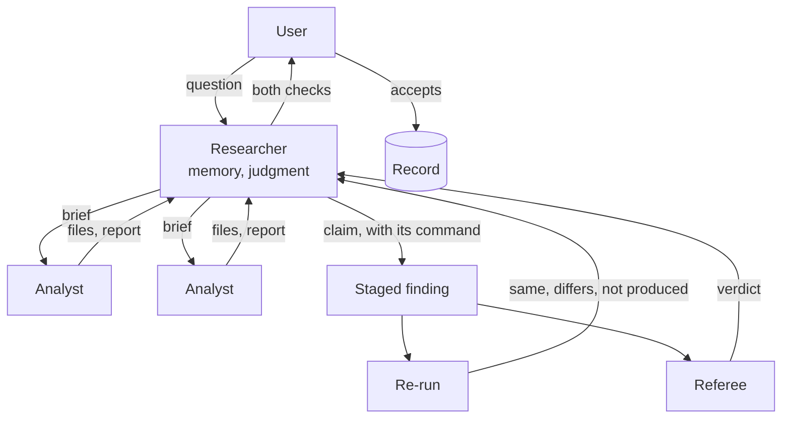

# Researcher with subagents

**Built (phase 2 of the lab agenda).** See [Research](Research.md) for the other workflows.

A `researcher-subagents` project holds one researcher, as in the [Researcher workflow](Researcher-workflow.md): the same agent (Claude, pi or both), the same memory, the same Reader tab. It adds two things. The researcher hands analyses to short-lived helpers that run in parallel, and a finding is re-run and read by an independent referee before the user can accept it.

It is meant to do what the [Research workflow](Research-workflow.md) does with far fewer parts: no worker containers, no role-service containers, no supervision hook.

## Creating one

**Researcher with subagents** is a project type in the New Project window, beside `research` and `researcher`. Everything a researcher project gets, it gets: the memory, the Reader tab, at least one agent. The helpers are installed into the project's agents when it is created.

## Analysts

An **analyst** carries out one analysis from a brief, in the background, while the conversation goes on. Its brief carries the question, the data paths, where its results go and that it reports the command that reproduces them. It gets nothing else: not the conversation, not the memory rules.

Several analysts run at once. Under Claude the researcher launches several in one turn; under pi it launches one per step. Each one's result wakes the session when it ends. An analyst's results land as files in the workspace with a short report, and the researcher writes what matters into its memory.

An analyst has the project's data tools and cannot start helpers of its own. It runs the model set for it (see [The helpers' models](#the-helpers-models) below). Under pi its deadline is the longest pi accepts, about 24 days, instead of pi's default 30 minutes.

## A finding's two checks

When the researcher stages a finding, it gives the command that reproduces it, or its reason why the finding cannot be re-run. The user can accept the finding only once both checks below are current; the memory command refuses otherwise and says which is missing.

| | Re-run | Referee |
|---|---|---|
| Runs | the finding's command, as a fresh process, writing into a folder of its own | an independent run of the agent with read tools only |
| Reads | the data, like the first run | the claim, a copy of its evidence and the accepted record, never the researcher's reasoning |
| Answers | per evidence file: same, differs, or not produced | supported, overreaches (with the narrower claim that would hold), or unsupported |
| Kept | under the memory, never deleted | under the memory, never deleted |

Both checks run in the background and answer the researcher, which tells the user. The user decides: a finding the referee objects to can still be accepted when the user says so, and the objection stays on it. A changed claim or evidence voids both checks. Open questions and retractions need no checks.

The web is the researcher's own for a quick lookup. A survey goes to a **surveyor** under Claude: it has only Claude's web search and page fetch, runs in the background, and answers with a summary and its sources. Under pi there is no survey helper yet, and the researcher says so.

## The helpers' models

Under Claude the analyst and the surveyor each run the model and effort set for the whole installation in **Sandboxes → Infrastructure → Analyst** and **→ Surveyor**, Sonnet at high effort by default. A new project of this type starts with them, and a project's own are changed in its ⚙ Agents box, on Claude's tab. Under pi the analyst runs pi's default model unless its own model and thinking level are set on pi's tab of the same box; there is no installation default for it, since pi names its models by provider. A change is written into the helper's definition, so the next helper launched uses it, and nothing restarts. A project created before these settings keeps running its Claude helpers on the researcher's model until they are set in its ⚙ Agents box.

## The referee's model

Under Claude the referee runs the model set for the whole installation in **Sandboxes → Infrastructure → Referee**, Sonnet at high effort by default. A new project of this type starts with it, and a project's own can be changed in its ⚙ Agents box; the next referee run uses the change, and nothing restarts. Under pi the referee runs the project's pi model.

## Design decisions

**Subagents keep nothing.** Knowledge stays with the researcher, in one memory. The cost is that long-lived workers with their own context are given up; the [Lab workflow](Lab-workflow.md) restores them.

**Parallel and in the background by default.** The conversation never waits for an analysis, and each result arrives on its own. The cost is many runs at once, which is why the helpers default to a cheaper model than the researcher's.

**The helpers' models are set like the referee's.** An installation-wide default under Infrastructure, frozen into each new project, changed per project in its ⚙ Agents box. The cost is that a new project's helpers no longer match the researcher's model unless they are set to.

**The referee guards the record, not the work.** A wrong finding that enters the record is built on silently; a wrong intermediate result costs little. The cost is one referee run per finding, measured at about $0.04 on Sonnet.

**The referee cannot be briefed by the researcher.** It reads a snapshot of the claim, its evidence and the record, in a folder of its own, never the researcher's reasoning. Its verdict goes to the researcher's record of the finding, and the user accepts; it never goes straight to the user.

**A verdict is bound to what it judged.** A changed claim or evidence voids the verdict and the re-run, so a check never vouches for content it did not see.

**A re-run proves the deliverable reproduces, not that it is right.** A file with a timestamp always shows "differs"; the user judges.

**The checks exist only in projects of this type.** A `researcher` project behaves exactly as before.
