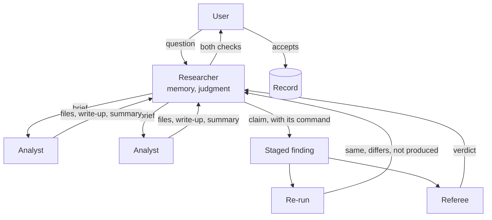

# Researcher with subagents

**Built (phase 2 of the lab agenda).** See [Research](Research.md) for the other workflows.

A `researcher-subagents` project holds one researcher, as in the [Researcher workflow](Researcher-workflow.md): the same agent (Claude, pi or both), the same memory and logbook, the same Reader tab. It adds two things. The researcher hands analyses to short-lived helpers that run in parallel, and a finding is re-run and read by an independent referee before the user can accept it.

It is meant to do what the [Research workflow](Research-workflow.md) does with far fewer parts: no worker containers, no role-service containers, no supervision hook.

## Creating one

**Researcher with subagents** is a project type in the New Project window, beside `research` and `researcher`. Everything a researcher project gets, it gets: the memory, the Reader tab, at least one agent. The helpers are installed into the project's agents when it is created.

## Analysts

An **analyst** carries out one analysis from a brief, in the background, while the conversation goes on. Its brief carries the question, the data paths, where its results go and that it reports the command that reproduces them. It gets nothing else: not the conversation, not the memory rules.

Several analysts run at once. Under Claude the researcher launches several in one turn; under pi it launches one per step. Each one's result wakes the session when it ends.

An analyst's results land as files in its results folder, `/workspace/analyses/<name>/`, with its full write-up in `writeup.md` there: the method, the results, the caveats, the dead ends and the surprises. Its reply to the researcher is short: a summary, its dead ends and surprises one line each, and a last line naming the results folder. The researcher journals those dead ends and surprises, checks that the write-up exists, reads it when it needs the detail, and writes what matters into its memory.

When an analyst tries to finish without `writeup.md` in the folder its reply names, RS holds it back once with a reminder to write it. If it still does not, it is let go. Under Claude this is a hook on the analyst's end; under pi, RS's rules extension does the same in the analyst's own run. Both ask the memory command, which only reads.

An analyst has the project's data tools and cannot start helpers of its own. It runs the model set for it (see [The helpers' models](#the-helpers-models) below). Under pi its deadline is the longest pi accepts, about 24 days, instead of pi's default 30 minutes.

## A finding's two checks

When the researcher stages a finding, it gives the command that reproduces it, or its reason why the finding cannot be re-run. The user can accept the finding only once both checks below are current; the memory command refuses otherwise and says which is missing.

| | Re-run | Referee |
|---|---|---|
| Runs | the finding's command, as a fresh process, writing into a folder of its own | an independent run of the agent with read tools only |
| Reads | the data, like the first run | the claim, a copy of its evidence and the accepted record, never the researcher's reasoning |
| Answers | per evidence file: same, differs, or not produced | supported, overreaches (with the narrower claim that would hold), or unsupported |
| Kept | under the memory, never deleted | under the memory, never deleted |

Each check waits until it ends and answers the researcher, which tells the user. Under Claude the researcher starts both as background tasks of its own session, which report back when they end, so it can go on meanwhile; under pi it waits for each, and Esc stops it. Stopping a check's call stops the check, which then reads failed, so nothing runs unwatched. The finding's page under `staging/`, and its line on the front page, show both in plain words (for example "re-run: reproduced exactly, 3 of 3 files · referee: supported"), and a referee's objection with its narrower claim in full; once accepted, its page under `results/` keeps them, with the objection it was accepted over. The user decides: a finding the referee objects to can still be accepted when the user says so, and the objection stays on it. A changed claim or evidence voids both checks. Open questions, retractions and facts about the data need no checks: the user accepts a fact without a re-run or a referee.

## Subagents and checks: two switches

A project of this type has two switches, which decide how its sessions work:

| Switch | Values | What it does |
|---|---|---|
| **Subagents** | on (default), off | On: the researcher hands analyses to analysts running in parallel, as above. Off: it does every analysis itself, one at a time, and launches no analyst. The analysts stay installed, so a session can switch them on. |
| **Checks** | staged (default), all, off | Staged: a finding the researcher stages needs both checks before the user can accept it, as above. All: the same, and the researcher stages every result it reports (each analyst's, or each analysis it finished itself) and starts its checks. Off: a finding can be accepted without its checks. |

The project's switches are what every new session starts with. They are set when the project is created and changed later (on the command line, `--subagents` and `--checks` of `project create` and `project update`); a change is written into the agent's instructions at once, and nothing restarts. A project created before the switches, with none recorded, works with subagents on and checks staged, as it always did.

A running session switches its own with `/rs-mode` (under pi `/skill:rs-mode`): for example `/rs-mode checks all` or `/rs-mode subagents off checks off`. The agent records them for that session through the memory command, which keys them on the session's id, and works under them from its next unit of work; the skill carries the instruction text of every switch value, so the session has the text of its new switches. Other running sessions keep theirs, and new sessions still start with the project's. At every session start the memory command's opening text names the switches the session works under and where each comes from.

**Checking many results at once.** The memory command checks several staged findings with one call: it starts every re-run and every referee side by side and waits until all have ended, printing each result as a single check does. Under Claude the researcher starts that call as one background task; under pi, where a call waits, it is one wait instead of one per check. With checks on every result, this is how a finished batch of analyses is checked.

**Not checked.** With the checks off, a finding the user accepts without its checks has a record entry naming what it lacked, and its page under `results/` and its line on the front page say "not checked". A finding staged with the checks off says "not checked (staged with the checks off)" on its page under `staging/` and on the front page until a check runs on it. The checks still work when the user asks for them; a check that ran is kept on the entry, and a referee's objection still needs the user's word to accept over it. Whether a finding needs its checks is decided by the session that accepts it, so the same finding can be held in one session and accepted in another whose checks are off.

The web is the researcher's own for a quick lookup. A survey goes to a **surveyor** under Claude: it has only Claude's web search and page fetch, runs in the background, and answers with a summary and its sources. Under pi there is no survey helper yet, and the researcher says so.

## The helpers' models

Under Claude the analyst and the surveyor each run the model and effort set for the whole installation in **Host → Defaults → Analyst** and **→ Surveyor**, Sonnet at high effort by default. A new project of this type starts with them, and a project's own are set when the project is created (the New Project window's Agents box, beside Agent), or later in ⚙ on Claude's tab. Under pi the analyst runs pi's default model unless its own model and thinking level are set on pi's tab, when the project is created or later in ⚙; there is no installation default for it, since pi names its models by provider. A change is written into the helper's definition, so the next helper launched uses it, and nothing restarts. A project created before these settings keeps running its Claude helpers on the researcher's model until they are set in its ⚙ Agents box.

## The referee's model

Under Claude the referee runs the model set for the whole installation in **Host → Defaults → Referee**, Sonnet at high effort by default. A new project of this type starts with it, and a project's own is set when the project is created, or later in ⚙; the next referee run uses the change, and nothing restarts. Under pi the referee runs its own model and thinking level when they are set on pi's tab, when the project is created or later in ⚙ (the next referee run uses a change, and nothing restarts), and otherwise the project's pi Agent model. A new project of this type with pi needs one of the two, and there is no installation default for pi's referee, since pi names its models by provider.

## Design decisions

**Subagents keep nothing.** Knowledge stays with the researcher, in one memory. The cost is that long-lived workers with their own context are given up; the [Lab workflow](Lab-workflow.md) restores them.

**Parallel and in the background by default.** The conversation never waits for an analysis, and each result arrives on its own. The cost is many runs at once, which is why the helpers default to a cheaper model than the researcher's.

**The helpers' models are set like the referee's.** An installation-wide default under Host → Defaults, frozen into each new project, changed per project in its ⚙ Agents box. The cost is that a new project's helpers no longer match the researcher's model unless they are set to.

**The referee guards the record, not the work.** A wrong finding that enters the record is built on silently; a wrong intermediate result costs little. The cost is one referee run per finding, measured at about $0.04 on Sonnet.

**The referee cannot be briefed by the researcher.** It reads a snapshot of the claim, its evidence and the record, in a folder of its own, never the researcher's reasoning. Its verdict goes to the researcher's record of the finding, and the user accepts; it never goes straight to the user.

**A verdict is bound to what it judged.** A changed claim or evidence voids the verdict and the re-run, so a check never vouches for content it did not see.

**A re-run proves the deliverable reproduces, not that it is right.** The user judges. Analysts are told to keep their evidence files deterministic (no timings, timestamps or unordered rows), so a "differs" is no longer expected; when one shows, it is worth a look.

**An analyst's write-up is checked at its end, not only asked for.** An instruction alone was measured not to be enough. A check when the analyst finishes holds it back once with a reminder. It never holds it twice, and a check that cannot run lets it go, so an analyst is never trapped.

**The checks exist only in projects of this type.** A `researcher` project behaves exactly as before.

**The switches are the project's default, switchable per session.** As with a dev project's working mode, the project's setting is what a new session starts with and `/rs-mode` changes one running session. The cost is that a change in the project's settings does not reach a session already running.

**Checks off says so, it does not hide it.** A finding accepted unchecked carries that on its record entry and its pages, so the record never reads as checked when it was not. The cost is a line of text the user sees on every such entry.

**The agent can switch its own session.** The memory command records what the agent tells it, as it already accepts a claim when the agent says the user did; both rest on the agent's instruction to act only on the user's word. A project can weaken only its own checks this way.
