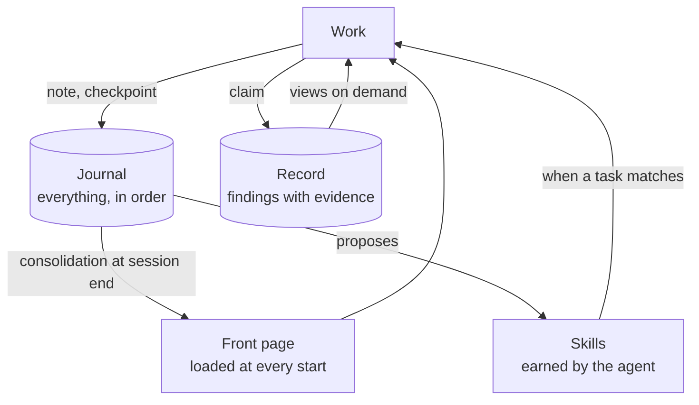

# Researcher workflow

**Built (phase 1 of the lab agenda).** See [Research](Research.md) for the other workflows.

A `researcher` project holds one agent that pursues one line of inquiry for weeks. The user talks to it directly, and it does the analysis itself, in the project's own container. It has no workers and no subagents.

Its purpose is memory. A finding from the first week is still there in the fourth week without anyone carrying it over. A dead end is remembered as a dead end, and a wiped context costs minutes.

## Creating one

**Researcher** is a project type in the New Project window. The project runs Claude, pi or both, and needs at least one of them. The Reader tab is always on, because the user reads the agent's pages there. The container is the sandbox image with its own inner Docker. The agent installs the analysis software it needs under `/workspace`.

## Memory

| Part | Holds | Changes | Reaches the agent |
|---|---|---|---|
| Front page | current work, beliefs as pointers, work in flight, open threads; the accepted facts about the data | rewritten at each consolidation; its facts section at each accept | at every session start and after every compaction |
| Record | findings and facts with scope, evidence and relations; open questions | append-only | as views, on demand |
| Journal | what was done and why, dead ends included | append-only | searched on demand |
| Skills | procedures worth keeping | promoted after a successful use, retired when stale | when a task matches |

The memory lives under `/workspace/memory/`, as plain files: it is the agent's own.

## The pages the user reads

The memory is written for the agent: records with every field, checksums and session labels. The user reads pages written from it, beside it in the workspace, in the Reader tab:

| Path | For |
|---|---|
| `README.md` | The front page: each claim waiting for the user (its title, its kind, its checks in plain words, the words to decide it), what is running (jobs and checks in flight), where things stand (the agent's own front page), the logbook (its latest entries, and how many journal entries came after the last one, with the words to ask for more: `/log`), and what is known (current findings and facts by topic, contested pairs, open questions) |
| `staging/<id>.md` | One page per staged claim: statement, scope, hedge, topics, checks, relations as links, evidence as links, earlier versions, and the words to accept or strike it |
| `results/<id>/<id>.md` | One page per accepted entry, in the same shape, with how it stands now (current, superseded and by which entry, withdrawn and by which, contested and with which, or resting on entries that no longer stand) and an objection it was accepted over |
| `results/<id>/evidence/` | A read-only copy of the entry's evidence files, made at accept and checked against the hashes pinned when it was staged; never rewritten |
| `results/index.md` | Every accepted entry by topic, each with its standing |
| `logbook/<date>-<topic>.md` | The logbook: one entry per topic, the question, the results, the open threads and where to pick up, in the agent's words; below its title, the date and the journal entries it covers. Written once, read-only, never rewritten or removed |
| `analyses/<name>/` | The agent's analyses, one folder each (the pages link their evidence there) |

The pages are views: the memory stays the one source of truth, and the memory command rewrites every page from it after each change a page shows (a note, a claim, an amend, an accept, a strike, a checkpoint, a job, a logbook entry, a check that ends, a consolidation, a session's end) and at every session start, which is how a project made before the pages gets them. A page is rewritten only when its text changed. A staging page goes when its claim is accepted or struck.

Every page starts with a marker line and ends with a line saying it is rebuilt from the record. A file without the marker, such as the user's own `README.md`, is never overwritten, moved or removed: that page is not written, and the agent is told, at every session start, which file is in the way, until the user moves or renames it. Every link in a page is relative to the page, so a researcher's folder reads the same wherever it sits; a file outside the workspace is named, not linked.

The logbook is not a view. The user asks for it with `/log`, the same command under Claude Code and pi: the agent drafts one entry per topic it worked on since the last entry (several analyses feeding one question are one topic) and files each with `log`, which refuses a draft without its title and four sections (the question, the results, the open threads, where to pick up), with an empty section, or with a link to an absolute path. It adds the date and the journal entries the entry covers, those since the previous entry, each linked, and writes the entry under the first free name for that day and topic. The filing is journalled but does not by itself start a consolidation. At every session start the agent is given the latest entry's path, to read when it needs the story; `recall` searches the entries too.

The evidence copy is what makes a result page last: a finding's notebook output may be rewritten next week, while the copy stays as it was accepted. An accept whose copy cannot be made is refused before anything moves. An entry accepted before the copies existed gets one at the next session start when its file still has the hash it was accepted with; otherwise its page says that the file had changed and no copy was kept.

## The memory command

The agent keeps its memory through one command, `rs-memory`. Its refusals name the next step.

| Verb | Does |
|---|---|
| `note`, `checkpoint` | add to the journal; a checkpoint before long work lets an interruption resume |
| `claim`, `amend` | stage a finding or a fact about the data with its title and evidence; correct a staged one in place |
| `accept`, `strike` | enter a staged finding or fact in the record, or drop it, after the user says so |
| `view`, `recall` | show the state of knowledge or one entry with its chain; search the journal, the claims and the logbook as text |
| `log` | file a logbook entry from the agent's draft |
| `skill propose`, `used`, `promote`, `retire` | turn a working procedure into a skill for both agents |
| `open`, `close`, `consolidate` | start a session; end one and rewrite the front page |
| `job add`, `list`, `done` | register a long run left going, show its state, mark it handled |

A claim is one kind: a finding, an open question (`--question`), a retraction (`--withdraws`) or a fact (`--fact`). A claim given two kinds is refused. Every claim has a title (`--title`), a few words naming the result, by which the user's pages list it; a claim without one is refused. A title is a label, like a topic: changing it with `amend` voids no check. An entry staged before titles existed shows its statement in their place.

A fact (`claim --fact`, an id `D-<n>`) is a descriptive result about the data: an inventory line, a gap, a count. It needs a scope and evidence like a finding, and the user's accept, but never the checks of a project with analysts. One accept can take several facts at once.

The front page ends with a section of its own, "What we know about the data": one line per current accepted fact, with its id, statement and scope. It is written from the record every time the page is written, and an accept that changes it rewrites the page under the same page number. A fact that is withdrawn or superseded leaves it. The section is never read back as items, so consolidation cannot change it, but its beliefs may point at a fact, as at a finding.

A finding's standing (current, superseded, contested, withdrawn) is computed from its relations each time it is shown. Accepted entries are never edited, so a correction of one is a new entry that supersedes it.

A staged claim, still waiting for the user, can be corrected in place with `amend`. It keeps its id, and every earlier version stays on the entry. In a project with analysts, a changed statement, scope, hedge or evidence voids the finding's checks, which must run again.

A long run left going, such as a build of many hours, is registered with `job add`, by its process id and its log. Every session start shows each registered job as running, ended (with its log's last line, so a crash shows) or gone, so the next session knows about it and a crash does not go unnoticed.

The memory command is part of the project's image, while RS's instructions to the agent are rewritten at every start, so the two must match. A researcher project is refused at create when RS's image has an older memory command than the instructions need. An existing one's start ends with an error, and its memory is not set up, until **Rebuild all** on **Host → Software** and a stop and start of the project.

## A session

At start, a hook gives the agent its front page: Claude's start hook, or pi's extension. The agent then works and writes at named moments: a finished unit of work, a dead end, a surprise, a correction.

When the user ends the session, the agent runs `close`: a headless run of the same agent reads the journal since the last consolidation and writes a new front page, and `close` waits for it, up to about ten minutes, then reports how it went. When the session ends without `close` (the window is closed), the end is only recorded, and nothing is started: the next session consolidates before the agent's first reply, so it starts from the new page. The old page is kept. A run that does not finish in time is stopped, the front page stays as it was, the next start says so, and the next start or `close` tries again.

The user accepts a finding by saying so in the chat, for example "accept F-3". The front page lists what waits, with the words to say.

## The companion

A `companion` project is a researcher for one-off and mixed tasks: a draft review, a literature check, a quick analysis, one after another, rather than one line of inquiry for weeks. **Companion** is a project type in the Research group of the New Project window, created like a researcher: Claude, pi or both, at least one of them, the Reader tab always on, egress locked by default. Its agent has the paper check, as a researcher's does.

It keeps everything above that does not assume one line of inquiry: the journal with its corrections and dead ends, the checkpoints of what is in flight, the long runs registered as jobs, the skills, and the front page given to the agent at every session start. What differs comes from one key in the project's record, `"companion": true`, written at create. The memory command reads it and keeps the memory in its companion mode; its verbs are the same. A record that sets both `companion` and `subagents` is refused by every verb.

| | Researcher | Companion |
|---|---|---|
| The agent's front page | line of inquiry, beliefs, in flight, open threads | standing preferences, in flight, open threads |
| The consolidation | updates the front page and proposes claims and skills | updates the front page and proposes skills, never claims |
| Claims | staged as the work produces them | staged only when the user asks; the agent may offer one |
| The work's files | `analyses/<name>/`, one folder per analysis | `analyses/<task>/`, one folder per task, with its `README.md` |
| The user's front page | always shows what waits and what is known | adds the tasks; shows what waits and what is known only when there is something in them |
| The logbook | one entry per topic | one entry per task, under the task folder's name |

**Standing preferences.** When the user says how they want things done (wording, sources, where answers go), the agent journals it in the user's words as a decision. The consolidation carries it into "Standing preferences" on the agent's front page, and retires one only when the journal shows the user dropped or changed it. It never invents one from what the agent did. Every session reads the standing preferences first.

**Task folders.** Every task gets one folder, `analyses/<task>/`, named in a few words, with all its files. The agent keeps a `README.md` in it with the task's status, the decisions taken and where things are. That file is the agent's own, not a page the memory command writes.

**The user's front page.** In a companion it reads, in order: what waits for the user, only while a claim is staged; what is running; the tasks, one line per folder directly under `analyses/`, linked to its `README.md` when it has one; where things stand, from the agent's own front page; the logbook; and what is known, only once the user accepted something. A link or a file under `analyses/` is not a task, and is never followed. At session start the agent is likewise shown the state of knowledge and the staged claims only when they hold something.

**Claims.** Claim, amend, accept and strike work as in a researcher, with the same pages under `staging/` and `results/`. The difference is when a claim is made: only when the user asks for one, so a companion's record grows only from what the user wants to cite.

## Design decisions

**Memory is four things, kept apart.** Each part changes differently and is trusted differently, so each has its own place and rule for writing. The cost is four places to keep consistent.

**The record is immutable and the user accepts every entry.** Established knowledge cannot drift, and the user decides what is known. The cost is one decision per finding.

**One command carries the rules.** A rule that matters is a refusal of the memory command, not a sentence in the instructions. The instructions hold the agent's role and judgment.

**The front page comes through the agent's own hooks.** Both agents receive it at start and after a compaction, so a wiped context recovers without the user. Claude's built-in memory is off in these projects, so the agent has only one memory.

**Consolidation is waited for, never left running.** A headless run of the same agent writes the new page, using the user's model quota, while the session that started it waits, so nothing runs unwatched. The cost is a wait of up to about ten minutes when the user ends the session, or before the first reply of the next session when the window was closed instead. A session killed with its container records no end, so its entries wait for the next `close`.

**Skills are earned.** A procedure becomes a skill only after a successful use. It goes into both agents' skills folders, so Claude and pi share it.

**Plain search first.** The journal is searched as text. An index is added only if measurement shows plain search missing things.

**Facts keep the user's accept and drop only the checks.** A description of the data is true or false by looking at it, so a re-run and a referee add little, while the user's accept still decides what is known. The agent's front page lists the accepted facts, so every session starts with them, and the user's front page lists them under what is known. The cost is a second kind of record entry, and a section of the page that code writes.

**The user reads pages, the agent keeps records.** A record is written to be checked and searched, which makes it hard to read; the user's pages are written from it, in plain words, and say what waits for a decision. Both are files in the workspace, so the user needs nothing but the Reader tab. The cost is a second set of files, kept current by the memory command at every change.

**A page never overwrites the user's file.** The pages sit where the user also keeps files, so a file without the memory command's marker is left alone and reported, never renamed or moved. The cost is a page that is missing until the user moves their file.

**The logbook is the story, the record is the truth.** An entry says what was asked and what came out, in words a reader who missed the conversation can follow, and it is never edited, so it keeps what was said at the time. The record is where a result's standing lives: where an entry and the record disagree, as when a result the entry tells of was later superseded or withdrawn, the record's standing holds, and the result's page says so. The cost is an entry that can read out of date; a correction goes into a later entry.

**The companion is its own type, and the same memory command in a mode.** A setting on the researcher would have put two behaviours into one type's instructions and pages; as its own type, the researcher's text and pages stay untouched and each type's instructions say one thing. The mode lives in the memory command, keyed on the project's record, so the journal, the jobs, the skills, the logbook and the paper check are shared and change together. The cost is one more project type to choose from, and a memory command with two front-page layouts.

**Discipline, not security.** The agent can write the memory files by hand. The command is the easy path, and the user's accept is a chat message the agent acts on.
