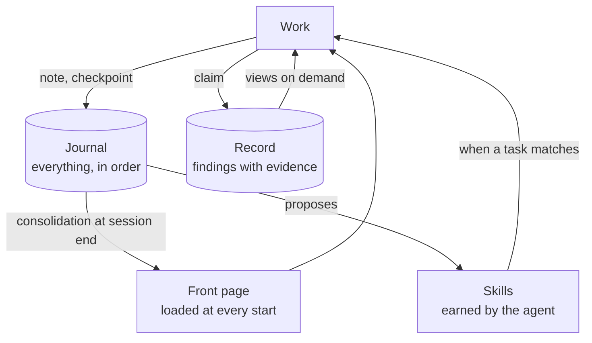

# Researcher workflow

**Built (phase 1 of the lab agenda).** See [Research](Research.md) for the other workflows.

A `researcher` project holds one agent that pursues one line of inquiry for weeks. The user talks to it directly, and it does the analysis itself, in the project's own container. It has no workers and no subagents.

Its purpose is memory. A finding from the first week is still there in the fourth week without anyone carrying it over. A dead end is remembered as a dead end, and a wiped context costs minutes.

## Creating one

**Researcher** is a project type in the New Project window. The project runs Claude, pi or both, and needs at least one of them. The Reader tab is always on, because the memory is read there. The container is the sandbox image with its own inner Docker. The agent installs the analysis software it needs under `/workspace`.

## Memory

| Part | Holds | Changes | Reaches the agent |
|---|---|---|---|
| Front page | current work, beliefs as pointers, work in flight, open threads; the accepted facts about the data | rewritten at each consolidation; its facts section at each accept | at every session start and after every compaction |
| Record | findings and facts with scope, evidence and relations; open questions | append-only | as views, on demand |
| Journal | what was done and why, dead ends included | append-only | searched on demand |
| Skills | procedures worth keeping | promoted after a successful use, retired when stale | when a task matches |

Everything lives under `/workspace/memory/`, as plain files the user reads in the Reader tab.

## The memory command

The agent keeps its memory through one command, `rs-memory`. Its refusals name the next step.

| Verb | Does |
|---|---|
| `note`, `checkpoint` | add to the journal; a checkpoint before long work lets an interruption resume |
| `claim`, `amend` | stage a finding or a fact about the data with its evidence; correct a staged one in place |
| `accept`, `strike` | enter a staged finding or fact in the record, or drop it, after the user says so |
| `view`, `recall` | show the state of knowledge or one entry with its chain; search the journal and claims as text |
| `skill propose`, `used`, `promote`, `retire` | turn a working procedure into a skill for both agents |
| `open`, `close`, `consolidate` | start a session; end one and rewrite the front page |
| `job add`, `list`, `done` | register a long run left going, show its state, mark it handled |

A claim is one kind: a finding, an open question (`--question`), a retraction (`--withdraws`) or a fact (`--fact`). A claim given two kinds is refused.

A fact (`claim --fact`, an id `D-<n>`) is a descriptive result about the data: an inventory line, a gap, a count. It needs a scope and evidence like a finding, and the user's accept, but never the checks of a project with analysts. One accept can take several facts at once.

The front page ends with a section of its own, "What we know about the data": one line per current accepted fact, with its id, statement and scope. It is written from the record every time the page is written, and an accept that changes it rewrites the page under the same page number. A fact that is withdrawn or superseded leaves it. The section is never read back as items, so consolidation cannot change it, but its beliefs may point at a fact, as at a finding.

A finding's standing (current, superseded, contested, withdrawn) is computed from its relations each time it is shown. Accepted entries are never edited, so a correction of one is a new entry that supersedes it.

A staged claim, still waiting for the user, can be corrected in place with `amend`. It keeps its id, and every earlier version stays on the entry. In a project with analysts, a changed statement, scope, hedge or evidence voids the finding's checks, which must run again.

A long run left going, such as a build of many hours, is registered with `job add`, by its process id and its log. Every session start shows each registered job as running, ended (with its log's last line, so a crash shows) or gone, so the next session knows about it and a crash does not go unnoticed.

The memory command is part of the project's image, while RS's instructions to the agent are rewritten at every start, so the two must match. A researcher project is refused at create when RS's image has an older memory command than the instructions need. An existing one's start ends with an error, and its memory is not set up, until **Rebuild all** on **Sandboxes → Software** and a stop and start of the project.

## A session

At start, a hook gives the agent its front page: Claude's start hook, or pi's extension. The agent then works and writes at named moments: a finished unit of work, a dead end, a surprise, a correction.

When the session ends, the end hook runs `close`. A headless run of the same agent reads the journal since the last consolidation and writes a new front page. The user's terminal is not held up. The old page is kept, and a run cut short is reported at the next start.

The user accepts a finding by saying so in the chat, for example "accept F-3".

## Design decisions

**Memory is four things, kept apart.** Each part changes differently and is trusted differently, so each has its own place and rule for writing. The cost is four places to keep consistent.

**The record is immutable and the user accepts every entry.** Established knowledge cannot drift, and the user decides what is known. The cost is one decision per finding.

**One command carries the rules.** A rule that matters is a refusal of the memory command, not a sentence in the instructions. The instructions hold the agent's role and judgment.

**The front page comes through the agent's own hooks.** Both agents receive it at start and after a compaction, so a wiped context recovers without the user. Claude's built-in memory is off in these projects, so the agent has only one memory.

**Consolidation runs in the background at session end.** A headless run of the same agent writes the new page, using the user's model quota. A session killed with its container skips it; the next one consolidates everything since.

**Skills are earned.** A procedure becomes a skill only after a successful use. It goes into both agents' skills folders, so Claude and pi share it.

**Plain search first.** The journal is searched as text. An index is added only if measurement shows plain search missing things.

**Facts keep the user's accept and drop only the checks.** A description of the data is true or false by looking at it, so a re-run and a referee add little, while the user's accept still decides what is known. The front page lists the accepted facts because it is the file the user reads; the agent's own views list them too. The cost is a second kind of record entry, and a section of the page that code writes.

**Discipline, not security.** The agent can write the memory files by hand. The command is the easy path, and the user's accept is a chat message the agent acts on.
