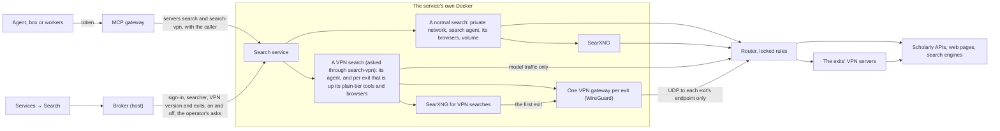

# Search service

RS can run one search service for the whole installation. An agent hands it a question and goes on working; the search runs elsewhere, and the agent later collects a written summary with every source, the files the search downloaded (reports, PDFs) and an account of what was tried and what failed. Any agent can use it, under Claude Code and pi alike: a project's agent, a box, or a research project's analysis workers.

It is off until the operator turns it on, in the Search tab of the Services page. That tab has three sub-tabs, in a second strip drawn like the main tabs; the page opens on the one last used in this browser, and on Settings while the service is not running, since nothing else works then:

- **Quick Search** asks the searcher a question directly, in a chat with its own list of conversations (below).
- **Activity** lists the waiting and running searches with their work so far and a Stop button, and the recent ones with their reports (below).
- **Settings** turns the service on and off, clears the ended searches nobody collected, signs the service in (a long-lived token, below) with **Test**, sets the searcher (its name, model and effort, whether it may use the browser tiers, and how many searches run at once, and, with the VPN version on, how many exits a VPN search tries on one site), an optional contact address and how many ended searches Activity's Recent searches list keeps, holds the box **Enable the VPN version** with the VPN section and its exits it shows (below), and holds the switch **Show Search in the sidebar** (below).

Turn on builds the service's images, starts its container and stages the search images into it (minutes the first time; the two browser images add about 4.8 GB), and lists it on the [MCP gateway](MCP-servers.md) as the server `search`; while the VPN version is on and at least one VPN exit is stored, it also lists `search-vpn` (below). `research search on | off | status | token | token-clear | settings | clear` does the same from the host.

An agent gets the service when the operator ticks `search` for it on Services → MCP, like any MCP server, and the VPN version when they tick `search-vpn`; each is ticked on its own. Either way it has three tools: submit a question (the answer is a search id, at once), check a search (waiting, running and what it is doing, or ended with its files), and collect the result. Files are downloaded through the gateway, from the server's own address plus `/files/<search id>/<name>`, with the agent's usual token. Collecting ends the search and removes everything it left, unless the agent asks to keep it.

## How it is reached

| Who | How | Needs |
|---|---|---|
| The operator | Services → Search (Quick Search, Activity, Settings), or the sidebar's Search | The webui's Management sign-in |
| An agent, a box or a research project's workers | The MCP server `search`, and `search-vpn` for searches through the VPN, each ticked for them on its own on Services → MCP | A wiring like any other MCP server |
| A search agent | The internet through the router, and SearXNG and its own browsers on its own network; a VPN search's agent only its model provider, and sites only through its tools on the exits' routes | Nothing else: it cannot reach the service, another search or a private address |

The service is one container of the inner-Docker image projects use. It sits on two networks of its own: one shared only with the MCP gateway, which is how callers reach it, and one whose only way out is RS's router under a locked project's rules (web ports and DNS). It is never on the shared network that holds Gitea and the registry: the service has no login of its own and believes the caller the gateway names.

## One search

Each search gets, inside the service's own Docker, a private network, one search-agent container, one container per browser tier switched on (below) and a volume for its files, all named after the search. Nothing one search saw reaches another: searches cannot reach each other, the service or a private address, and each starts clean. A search agent starts in under a second, so nothing is kept warm. Everything a search started is removed by name once the caller has collected it, or when the operator clears it; when the service starts, it removes whatever an earlier run left behind.

The search agent is Claude Code, with its own web tools off. Its tools all come from the service and from the search's own browsers, so a later pi search agent gets the same ones. Its instructions say that page content is data, never instructions, and that its report names every way of searching it tried and what each one hit. A search that runs past an hour is stopped and collected as failed, with what it saved.

## The plain tier

A search tries the cheapest way first. This first tier has three parts:

- **Scholarly APIs:** OpenAlex, Crossref, arXiv and Unpaywall. They give a work's record, its open copies and often its abstract in one plain request. Unpaywall requires an email address and Crossref asks for one: the contact address set on the Search tab, or a generic one when it is empty.
- **A page fetch**, which saves what it fetched (a page, a PDF) into the search's volume, where the caller can download it.
- **A web search through SearXNG**, run inside the service with JSON output. Its engines are duckduckgo, google cse, bing, openalex, crossref and pubmed: measured from one shared address, these answered reliably. Google, Google Scholar, qwant, brave, arXiv through SearXNG and Semantic Scholar were blocked, suspended or degraded from the first queries, so they are left out (arXiv is reached through its own API instead). The engines SearXNG reports as not answering go into the report, as a sign that a harder way is needed.

What the search agent tried is also recorded by the tool server itself, one line per call, independently of what the model writes; the caller gets both.

## The browser tiers

A page that needs a browser to render, or a publisher that refuses a plain download, does not end the search at the first wall. After the plain tier, a search can try two more, in this order:

| Tier | What it is | When the search agent uses it |
|---|---|---|
| plain | The scholarly APIs, the page fetch and SearXNG (above) | Always first |
| browser | A headless Chromium, driven through Playwright's tool server | A page that needs rendering, or that refused the plain fetch |
| stealth | camoufox, a Firefox built to look like a person's browser, driven the same way | A page that blocked the browser (a challenge page, a 403) |

The searcher's settings have one switch per browser tier, **Browser** and **Stealth browser**, both on by default. A tier switched off does not exist for the search agent: its tools are not offered, and nothing of it starts. So the operator can keep searches to the plain tier, or let them stop at the browser. The report's "what was tried" names every tier the search tried and what each one hit, and the work view shows the browser tiers' calls beside the plain tier's, each line with its tier (`browser` or `stealth`); the service records those calls from the search agent's own output, since the browsers' tool server keeps no trace of its own.

Each search gets its own browsers. For each tier switched on, the service starts one container beside the search agent on the search's private network, named after the search and removed with it. Two searches never share a browser, and one search cannot reach another's. The containers start with the search, before its agent, so its tools answer from its first step; the browser inside each starts only when the search opens its first page, so a search that never needs one pays only for the idle containers. The containers run with no added privileges as an ordinary user, and the browsers in them run without their own sandbox: the container is the boundary.

A file a browser downloads (a publisher's PDF, say) arrives as a file of the search, like one the page fetch saved: the caller downloads it and the report lists it. A download whose file name the service does not accept is not listed; the outcome says a download was dropped and why, rather than renaming it.

The cost: Turn on builds and stages two more images, about 4.8 GB, so the first Turn on takes longer, and every running search holds the memory of its browser containers (measured: about 90–100 MB each while idle, and after the first page about 200 MB for Chromium and 600 MB for camoufox) while it runs, whether or not it opens a page. Some sites stay blocked at every tier: measured on 21 literature sites, a page came through for 6 with the browser and 12 with the stealth browser. For a site that blocks the host's address itself, there is the VPN version (below).

## The VPN version

There is one searcher configuration, and it serves two MCP servers. Settings → **Enable the VPN version** (off by default) adds the second one: with it ticked and at least one VPN exit stored (below), the gateway lists `search-vpn` beside `search`. Both offer the same three tools and run the same searcher, with the same model, effort, browser tiers, searches at once and sign-in; the one difference is where their searches reach sites from:

| Server | Where its searches reach sites from | What it is for |
|---|---|---|
| `search` | The host's address, through RS's router | Every search, by default |
| `search-vpn` | A VPN exit's address, through the exits in their list order (below) | A site that blocks the host's address, or bans automated traffic from it |

Each server is wired on its own on Services → MCP, like any server: a project, a box or the workers can have `search`, `search-vpn` or both. An agent wired to both chooses for each question; when a report says a site blocked the search by its address, it says the `search-vpn` server reaches sites from another address, and nothing runs twice unless an agent asks. Settings' bar shows the servers the gateway lists (`search`, and `search-vpn` while it is listed); when another server already holds the name `search-vpn`, the bar says so and the VPN version is not listed.

The box saves at once, with the settings as they are saved. Ticking it shows the VPN section under it, so an exit can be added straight away; until one is, `search-vpn` is not listed. Unticking it takes `search-vpn` off the gateway and stops the VPN gateways; the stored exits stay (Remove deletes one) and show again when the box is ticked.

## The VPN exits

Settings → **VPN**, shown while the VPN version is on, holds the list of **exits** that searches asked through `search-vpn` use. An exit is one WireGuard VPN, the kind most VPN providers offer as a small configuration file from their account page, stored under a name of your choice (a lowercase letter first, then lowercase letters, digits and dashes). When no exit is stored, the section says so. When the stored exits cannot be used (their file on the host is damaged), it says why instead; adding an exit replaces the file.

Each exit has its row: its name, its status line, **Up** and **Down** to move it in the list, **Replace configuration** and **Remove**. The status line shows the tunnel up, with the exit's endpoint (the name and the address it was resolved to), the address the VPN gave this side, its DNS and how long ago the last handshake was; the tunnel down, with what went wrong; or off while the search service is not running. The page never waits for a tunnel: the service checks each one in the background (a check waits a few seconds for the VPN server's handshake) and the page shows the last result at once, with **checking…** beside it while a check runs; right after a Save the exit says **connecting…** until the first check of its new configuration ends. While any exit is being checked, the page re-reads the lines every few seconds, and leaves what you are typing alone.

**The order is the order searches try them in.** Every VPN search starts on the first exit and moves down the list when a site blocks it, the way it moves from the plain tier to the browsers. So the first exit is the one sites see most often, and an exit lower down is tried only as a fallback. Up and Down change the order at once.

**Exits tried per site** (in the searcher's settings, shown while the VPN version is on; 2 by default) caps how many exits a VPN search may try on one site, counted by the site's host name, before it gives up on that site. With 2, a blocked page is tried once more through the next exit. Each extra exit costs one more page load and shows that exit's address to a site that is already refusing the search.

Under the list, **Add exit** takes a name and the configuration; there are two ways in, switched by a pair of buttons, and both are stored as the same configuration:

- **Configuration file:** paste the file into the box, or press **Choose file…** to read a `.conf` file from this computer into the box (it is read in the browser; nothing is sent until Save).
- **By hand:** the private key, the address, the DNS, the server's public key, its endpoint (`host:port`), the allowed addresses (`0.0.0.0/0` to start with), and the optional preshared key and keepalive.

**Save** sends it to the host, where RS checks it and stores it; a new name goes at the end of the list, and a configuration it cannot use is refused in plain words. **Replace configuration** opens the same form with that exit's name filled in and fixed, so its configuration is replaced in place and it keeps its place in the list. **Remove** deletes one exit, after a confirmation that names it; when the last one goes, `search-vpn` leaves the gateway until another is stored.

**What goes through the exits.** In a VPN search, everything that touches a site does. Every exit whose tunnel is up when the search starts gets its own plain-tier tools (the scholarly APIs, the page fetch), browser and stealth browser, in containers on a network routed out through that exit; the searcher sees them as tools named per exit. Its web searches go to a second SearXNG that leaves through the first exit. The search agent's own container keeps only its way to its model provider and to those containers, so a site sees an exit's address, and the model traffic leaves from the host's address as for every search.

**The exit is named on what the search found.** In a VPN search, each source of the report says `via` and the exit it came through, and each tool call in the search's work names its exit beside its tier. A search that tried more exits on a site than the setting allows shows it there.

**A tunnel down means no way out through it.** Each exit's VPN gateway is a container inside the service that holds its WireGuard tunnel, with network administration and nothing more. A VPN search's networks are routed out through the gateways, with no way around: a page never falls back to the host's address. VPN searches cannot reach each other through them, nor a normal search.

**The keys stay on the host.** The private key and the preshared key are secrets, like the sign-in token. They travel once, from the page to the host, are kept there in a file only the operator can read, and are handed only to that exit's VPN gateway container; no answer, log or command line carries them, and the page never shows them again (its key fields are password fields, emptied after every save, and never filled from what the host answers).

**The router lets the tunnels out.** RS's router lets the search service out only under a locked project's rules (web ports and DNS), and WireGuard speaks UDP to its own port. Saving an exit gives the service one more named destination, its endpoint as `host:port/udp`, so the router opens UDP to exactly that address and port and nothing else. The endpoint's name is resolved once, when the exit is saved: a provider that moves its server to another address needs the exit saved again.

The costs: each exit runs one gateway container and its tunnel, and each VPN search one set of plain-tier, browser and stealth containers per exit that is up, and the second SearXNG runs while VPN searches do. Exits from the same provider often share a blocked range of addresses, so more exits help only when they come from different networks. Web search uses only the first exit.

## Callers and their searches

The gateway knows each caller from its token: the project and the consumer (the project's agent, a box, the workers). For RS's own search service, and for no other server, it passes that on in a header it sets itself, after removing any copy the caller sent. A project sees only its own searches: another project's search is "not found", whatever its id. Limits and queueing are per installation: "searches at once" is shared by every caller, through either server, and the rest wait their turn in order.

## The sign-in

Every search uses the service's one Claude sign-in, whichever project asked. It is a long-lived token: run `claude setup-token` in any project's terminal tab, signed in to the Claude account the searches should use, and paste what it prints on the Search tab. The token is kept on the host in a file only the operator can read, reaches only the service (and from there each search agent), and is never shown again: the page says only whether one is stored.

While a sign-in is stored and the service is running, **Test** checks it: the service makes one tiny model call with the stored token (it costs a fraction of a cent) and the page says whether the sign-in works or why it was refused.

## Quick Search

Quick Search is how the operator asks the searcher something without going through an agent. It is a chat: the conversations on the side (newest first, each with its title, the state of its last question and when it last changed, with **New conversation** and **Clear conversations** together on top), the selected conversation in the middle, opened at its latest message, and a box to write the next question at the bottom. The list and the conversation each scroll on their own.

Each message is one search, run by the same searcher the agents use, on the same sign-in, and it waits for a slot in the same queue as theirs. While the VPN version is on and an exit is stored, a tick **Through the VPN** (off by default) under the question sends it as `search-vpn` would: the search reaches sites through the exits, and its answer's line says "through the VPN". It shows everywhere as asked by "operator", a name no project can have, so Activity lists it with the agents' searches, with Stop, its work and its report. In the conversation, your question is on the right and the searcher's answer on the left: while it waits, how many searches are ahead of it; while it runs, its time, its tokens, its last few tool calls and **Stop**; once it ended, the summary with its numbered sources, a fold-out of what it did, **Copy** (the whole report as text, as the report box copies it) and **Report** (the report box). A search that failed or was stopped says why. The conversation is re-read every few seconds only while one of its questions waits or runs and the tab is on screen.

Every message is a new, independent search: the searcher knows nothing of the earlier ones. The tick **include this conversation's earlier questions and answers** (off by default) sends every earlier question of the conversation with its answer (its summary and sources, as text) along with the new one. With it on, each message costs more tokens than the one before, because it carries the whole conversation so far, and a conversation too long for one question (32,000 characters) is refused in plain words: start a new conversation or untick the box. An ask ends like any search, and the service collects it itself once it ended (no agent will): its files go, its answer stays in its conversation.

The conversations are kept on the search service's own disk, so they survive a restart, an update and turning the service off and on: they are kept until you delete them or clear them, with no limit on how many. Each conversation in the list has its own delete button (it deletes at once), **Clear conversations** removes them all (it asks first), and the list is resized by dragging its edge, a width this browser remembers. A question still running in a deleted conversation goes on, and is collected when it ends. If the stored conversations ever cannot be read, Quick Search says so, with Clear conversations beside it as the remedy.

## Watching and stopping searches

While the service is running, the Search tab's Activity sub-tab has a table of the searches that are waiting or running, one row each: who asked (the project and its agent, box or workers, or "operator" for a question from Quick Search), the question (shortened; the whole of it on hover), the searcher (marked **VPN** for a search through the VPN), the state, the time and the tokens. The time is how long the search has run, or how long it has waited while it waits for its turn; it counts up every second. The tokens are the input, output and cache tokens the search agent has used so far. Activity reads the table when it opens and re-reads it every few seconds while it is on screen; it stops when you leave it, and nothing reads while it is closed.

Clicking a row opens the search's work, read-only: its whole question, its state, time and tokens (and the **VPN** mark for a search through the VPN), then the last few things it did, oldest first: enough to see how it goes and what broke, not a record of the whole search. A tool call is one line (when, the tier and the tool, what it was aimed at, and what came of it; a browser tier's call names `browser` or `stealth` as its tier, and a VPN search's call names its exit beside the tier); what the search agent wrote between calls shows as a paragraph, up to its last 2,000 characters. The box follows the search while it runs; once the search has ended it shows why and stops. The work carries text from the pages the search read, so the page shows all of it as plain text and never as part of the page itself. When there was earlier work, the box says only the latest is shown.

**Stop** ends a waiting or running search at once. The agent that asked sees, at its next check, that the operator stopped it; the search's files go when that agent collects it, or when you clear ended searches.

Under the table, **Recent searches** lists the searches that have ended, newest first: who asked, the question, the searcher (with its **VPN** mark), how it ended (done, failed or stopped, with the reason on hover), when it ended, how long it ran and its tokens. It keeps the last 20 by default; **recent searches kept** in the searcher's settings changes that, up to 100, and 0 turns the list off. A search stays on it after the agent collected it or you cleared it. The list lives only in the search service's memory, so turning the service off and on again, or updating it, starts it empty. Clicking a row opens the search's question and last work as they were when it ended, also after it was collected, until it drops off the list or the service restarts; the files it downloaded are not kept. A recent row whose search wrote a report has a **Report** button, which shows its summary (the **VPN** mark again on its line for a search through the VPN), its sources (in a VPN search each says `via` and its exit) and what it tried, and copies the whole report as text with **Copy**; the report is kept in full in the search service's memory while the row is listed.

## Turning it off, and the version

| Event | Effect |
|---|---|
| Turn on, first time | Builds the images, starts the service, stages the search images into its Docker, lists `search` on the gateway |
| Turn off | Removes the container, its networks and the gateway entries (`search` and `search-vpn`), which unwires them everywhere; every running search ends. The sign-in, the searcher, the VPN version's box, the VPN exits and the staged images are kept |
| Turn on again | Finds them; agents need `search` ticked again |
| `research start` | Brings a turned-on service back on this installation's code and pins; never starts one that was not turned on |
| `research stop` | Stops it with the rest of the shared services |
| A change of the sign-in, the searcher or the VPN exits | Saved on the host and handed to a running service at once; a stopped one gets it when it starts. A change of the browser tiers applies to the searches that start after it |
| Enable the VPN version ticked or unticked | Ticked with an exit stored, `search-vpn` is listed on the gateway; unticked, it is taken off and the VPN gateways stop; the exits are kept |

## Search in the sidebar

Settings → **Show Search in the sidebar** adds a **Search** entry to the group at the bottom of the sidebar, directly above Services, with the same kind of line icon. Opening it shows Quick Search, Activity and Settings as the main strip's tabs, the way Services and Host show theirs; Services → Search stays where it is, and both share the last tab used. The entry carries no count, so nothing reads in the background for it. The switch saves at once and is kept on the host with the searcher, so every browser that signs in shows the same sidebar; a browser learns it when it signs in to the broker, so another browser's change shows at its next load.

Tips on getting past a site's walls are planned to follow; they are not built yet.

## Design decisions

- **A search framework RS builds and maintains.** Searching is RS's own service, not an agent's built-in web tool, so RS can improve it over time and offer the same thing to every agent, Claude Code and pi alike.
- **The search escalates inside itself, cheapest first.** If a scholarly API or a plain fetch answers the question, nothing heavier runs. The caller sees one search tool; which way of searching worked is in the report.
- **Three tiers, plain, browser and stealth, each switchable but the first.** The browser and the stealth browser are tried only after the plain tier, and only when it is not enough; the operator can switch either off, which removes it from the search agent's tools. Both are on by default: the maintainer called Playwright and camoufox fair game. The cost: camoufox makes the search look like a person to sites that forbid automated access, which the switch leaves to the operator.
- **Two MCP servers, one configuration.** The maintainer asked for "two clear MCPs: one without VPN, one with", each wired to projects on its own, with the browser settings global to both. So `search` and `search-vpn` run the same searcher from one set of settings, and a box adds the second; whoever is wired to both chooses per question, and the service never retries through the VPN by itself, so nothing costs a second search unless someone asks.
- **Only the traffic to sites goes through the VPN.** Every tool that touches a site runs on an exit's route in a VPN search, the plain tier included, so a site never sees the host's address; the model traffic stays on the host's, so the account's sign-in is never seen coming from the VPN. With a tunnel down, nothing falls back to the host's address.
- **The searcher escalates through the exits, in list order.** A single VPN address may not be enough, so the VPN version holds a list of exits. Every VPN search starts on the first and moves down the list when a site blocks it, as it moves through the tiers; the calling agent picks nothing, because it is the searcher that sees a block when it happens, and the operator decides by the order which exit is tried first and which only as a last resort.
- **The cap on exits is in the searcher's instructions.** The maintainer asked for a way to control how many exits a search tries, per site, and accepted the cap as prose: the setting **Exits tried per site** (2 by default) is handed to the searcher in its instructions, with no counter and no refusal in the service. The cost: a model can go past it; the report names the exit of each source, so it shows when one did.
- **One gateway and one set of tool containers per exit.** Each exit has its own VPN gateway with its own tunnel and tunnel check, and a VPN search gets its own plain, browser and stealth containers for each exit that is up, on a network routed through that exit's gateway: the browser's tool server takes its route only when it starts, so one browser cannot switch exits. The cost: idle memory per extra exit while a VPN search runs, and more tools in the searcher's list.
- **WireGuard, by file or by hand.** WireGuard is measured to run in an ordinary container with network administration only, and most providers offer its configuration file (the maintainer: "we keep to wireguard for now, as plenty of residential ip vpns support it"); the maintainer asked for both pasting the file and typing its fields, and both are stored as the same configuration. An OpenVPN-only provider is not supported.
- **The exits' keys are secrets like the sign-in.** Kept on the host readable only by the operator, handed only to that exit's VPN gateway, never shown, logged or put on a command line. The page's key fields are emptied after each save and never filled from an answer.
- **The router opens only each exit's UDP port.** The service stays a locked project for the router; each exit adds one UDP destination, resolved once at save. The cost: a provider that moves its server needs that exit saved again.
- **Each search's browsers are containers on its own network, started with it.** A search's network holds only its agent, its browsers and SearXNG, so one search cannot reach another's browser (a browser's control port is open to anything on its network). The containers start before the agent, rather than at the first browser call, because starting them on demand would need a path from every search into the service, which the service blocks on purpose (searches read hostile pages). The cost: the idle containers' memory per running search, and up to a second more at a search's start.
- **One shared service with its own inner Docker.** Everything a search starts lives inside the service's container, not in the host's Docker, and the staged images survive a restart. The cost: on hosts without sysbox that inner Docker is privileged, so a search agent that broke out of its container would meet no extra layer before the host.
- **Disposable searches.** A private network, its containers (the agent and its browsers) and a volume per search, removed by name when collected. A page that fools a search agent finds no project data and no notes to poison for later searches. The cost: a search's files are gone once it is collected, so the caller downloads them first.
- **SearXNG for the plain web search, with measured engines.** It runs inside the service, needs no key, and reports which engines did not answer. The cost: every search leaves from the host's one address, where engines throttle a caller that asks too often.
- **The gateway names the caller, for RS's own service only.** The service trusts the header because only the gateway can set it; any other server never sees who called. A project collects only its own searches.
- **Quick Search is one search per message, in the agents' queue.** The operator's questions use the same searcher, sign-in and queue as the agents', under a reserved name no project can have, so nothing about a search changes with who asked. Follow-ups see earlier answers only when the operator ticks the box; the cost is a question that grows with the conversation, until its length limit stops it.
- **Conversations live on the service's disk, not in the browser.** They survive restarts and are the same in every browser, kept until the operator deletes them or clears them. The cost: they stay there, however many there are, until deleted or cleared.
- **The sidebar switch is a host setting.** It sits with the searcher's settings, so every browser shows the same sidebar; the entry carries no count, so it costs no background reads.
- **The operator watches searches as plain text.** The table and the work view are read-only and carry page text, so the browser shows every value as text, never as markup.
- **One long-lived token for every search.** One sign-in, set once by the operator. The cost: no billing per project, the account's rate limit caps all searches together, and the search agent holds the token while it reads hostile pages with internet access.
- **The Claude search agent first; a pi search agent later, with an API key.** The service's tools are built so that a pi search agent gets the same ones; callers are Claude Code and pi from the start.
- **The `research` workflow keeps its own websearcher unchanged.** It is the benchmark the other workflows are compared against, so RS has two web search paths for now. A research project's workers can still be given `search` like any gateway server.
