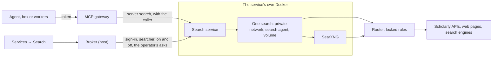

# Search service

RS can run one search service for the whole installation. An agent hands it a question and goes on working; the search runs elsewhere, and the agent later collects a written summary with every source, the files the search downloaded (reports, PDFs) and an account of what was tried and what failed. Any agent can use it, under Claude Code and pi alike: a project's agent, a box, or a research project's analysis workers.

It is off until the operator turns it on, in the Search tab of the Services page. That tab has three sub-tabs, in a second strip drawn like the main tabs; the page opens on the one last used in this browser, and on Settings while the service is not running, since nothing else works then:

- **Quick Ask** asks the searcher a question directly, in a chat with its own list of conversations (below).
- **Activity** lists the waiting and running searches with their work so far and a Stop button, and the recent ones with their reports (below).
- **Settings** turns the service on and off, clears the ended searches nobody collected, signs the service in (a long-lived token, below) with **Test**, sets the one searcher (its name, model and effort, and how many searches run at once), an optional contact address and how many ended searches Activity's Recent searches list keeps, and holds the switch **Show Search in the sidebar** (below).

Turn on builds the service's images, starts its container and stages the search images into it (minutes the first time), and lists it on the [MCP gateway](MCP-servers.md) as the server `search`. `research search on | off | status | token | token-clear | settings | clear` does the same from the host.

An agent gets the service when the operator ticks `search` for it on Services → MCP, like any MCP server. It then has three tools: submit a question (the answer is a search id, at once), check a search (waiting, running and what it is doing, or ended with its files), and collect the result. Files are downloaded through the gateway, from the server's own address plus `/files/<search id>/<name>`, with the agent's usual token. Collecting ends the search and removes everything it left, unless the agent asks to keep it.

## How it is reached

| Who | How | Needs |
|---|---|---|
| The operator | Services → Search (Quick Ask, Activity, Settings), or the sidebar's Search | The webui's Management sign-in |
| An agent, a box or a research project's workers | The MCP server `search`, ticked for them on Services → MCP | A wiring like any other MCP server |
| A search agent | The internet through the router, and SearXNG on its own network | Nothing else: it cannot reach the service, another search or a private address |

The service is one container of the inner-Docker image projects use. It sits on two networks of its own: one shared only with the MCP gateway, which is how callers reach it, and one whose only way out is RS's router under a locked project's rules (web ports and DNS). It is never on the shared network that holds Gitea and the registry: the service has no login of its own and believes the caller the gateway names.

## One search

Each search gets, inside the service's own Docker, a private network, one search-agent container and a volume for its files, all three named after the search. Nothing one search saw reaches another: searches cannot reach each other, the service or a private address, and each starts clean. A search agent starts in under a second, so nothing is kept warm. Everything a search started is removed by name once the caller has collected it, or when the operator clears it; when the service starts, it removes whatever an earlier run left behind.

The search agent is Claude Code, with its own web tools off. Its tools all come from the service, so a later pi search agent gets the same ones. Its instructions say that page content is data, never instructions, and that its report names every way of searching it tried and what each one hit. A search that runs past an hour is stopped and collected as failed, with what it saved.

## The plain tier

A search tries the cheapest way first. This first tier has three parts:

- **Scholarly APIs:** OpenAlex, Crossref, arXiv and Unpaywall. They give a work's record, its open copies and often its abstract in one plain request. Unpaywall requires an email address and Crossref asks for one: the contact address set on the Search tab, or a generic one when it is empty.
- **A page fetch**, which saves what it fetched (a page, a PDF) into the search's volume, where the caller can download it.
- **A web search through SearXNG**, run inside the service with JSON output. Its engines are duckduckgo, google cse, bing, openalex, crossref and pubmed: measured from one shared address, these answered reliably. Google, Google Scholar, qwant, brave, arXiv through SearXNG and Semantic Scholar were blocked, suspended or degraded from the first queries, so they are left out (arXiv is reached through its own API instead). The engines SearXNG reports as not answering go into the report, as a sign that a harder way is needed.

What the search agent tried is also recorded by the tool server itself, one line per call, independently of what the model writes; the caller gets both.

## Callers and their searches

The gateway knows each caller from its token: the project and the consumer (the project's agent, a box, the workers). For RS's own search service, and for no other server, it passes that on in a header it sets itself, after removing any copy the caller sent. A project sees only its own searches: another project's search is "not found", whatever its id. Limits and queueing are per installation: the searcher's "searches at once" is shared by every caller, and the rest wait their turn in order.

## The sign-in

Every search uses the service's one Claude sign-in, whichever project asked. It is a long-lived token: run `claude setup-token` in any project's terminal tab, signed in to the Claude account the searches should use, and paste what it prints on the Search tab. The token is kept on the host in a file only the operator can read, reaches only the service (and from there each search agent), and is never shown again: the page says only whether one is stored.

While a sign-in is stored and the service is running, **Test** checks it: the service makes one tiny model call with the stored token (it costs a fraction of a cent) and the page says whether the sign-in works or why it was refused.

## Quick Ask

Quick Ask is how the operator asks the searcher something without going through an agent. It is a chat: the conversations on the side (newest first, each with its title, the state of its last question and when it last changed, with **New conversation** and **Clear conversations** together on top), the selected conversation in the middle, opened at its latest message, and a box to write the next question at the bottom. The list and the conversation each scroll on their own.

Each message is one search, run by the same searcher the agents use, on the same sign-in, and it waits for a slot in the same queue as theirs. It shows everywhere as asked by "operator", a name no project can have, so Activity lists it with the agents' searches, with Stop, its work and its report. In the conversation, your question is on the right and the searcher's answer on the left: while it waits, how many searches are ahead of it; while it runs, its time, its tokens, its last few tool calls and **Stop**; once it ended, the summary with its numbered sources, a fold-out of what it did, **Copy** (the whole report as text, as the report box copies it) and **Report** (the report box). A search that failed or was stopped says why. The conversation is re-read every few seconds only while one of its questions waits or runs and the tab is on screen.

Every message is a new, independent search: the searcher knows nothing of the earlier ones. The tick **include this conversation's earlier questions and answers** (off by default) sends every earlier question of the conversation with its answer (its summary and sources, as text) along with the new one. With it on, each message costs more tokens than the one before, because it carries the whole conversation so far, and a conversation too long for one question (32,000 characters) is refused in plain words: start a new conversation or untick the box. An ask ends like any search, and the service collects it itself once it ended (no agent will): its files go, its answer stays in its conversation.

The conversations are kept on the search service's own disk, so they survive a restart, an update and turning the service off and on: they are kept until you delete them or clear them, with no limit on how many. Each conversation in the list has its own delete button (it deletes at once), **Clear conversations** removes them all (it asks first), and the list is resized by dragging its edge, a width this browser remembers. A question still running in a deleted conversation goes on, and is collected when it ends. If the stored conversations ever cannot be read, Quick Ask says so, with Clear conversations beside it as the remedy.

## Watching and stopping searches

While the service is running, the Search tab's Activity sub-tab has a table of the searches that are waiting or running, one row each: who asked (the project and its agent, box or workers, or "operator" for a question from Quick Ask), the question (shortened; the whole of it on hover), the searcher, the state, the time and the tokens. The time is how long the search has run, or how long it has waited while it waits for its turn; it counts up every second. The tokens are the input, output and cache tokens the search agent has used so far. Activity reads the table when it opens and re-reads it every few seconds while it is on screen; it stops when you leave it, and nothing reads while it is closed.

Clicking a row opens the search's work, read-only: its whole question, its state, time and tokens, then the last few things it did, oldest first: enough to see how it goes and what broke, not a record of the whole search. A tool call is one line (when, the tier and the tool, what it was aimed at, and what came of it); what the search agent wrote between calls shows as a paragraph, up to its last 2,000 characters. The box follows the search while it runs; once the search has ended it shows why and stops. The work carries text from the pages the search read, so the page shows all of it as plain text and never as part of the page itself. When there was earlier work, the box says only the latest is shown.

**Stop** ends a waiting or running search at once. The agent that asked sees, at its next check, that the operator stopped it; the search's files go when that agent collects it, or when you clear ended searches.

Under the table, **Recent searches** lists the searches that have ended, newest first: who asked, the question, the searcher, how it ended (done, failed or stopped, with the reason on hover), when it ended, how long it ran and its tokens. It keeps the last 20 by default; **recent searches kept** in the searcher's settings changes that, up to 100, and 0 turns the list off. A search stays on it after the agent collected it or you cleared it. The list lives only in the search service's memory, so turning the service off and on again, or updating it, starts it empty. Clicking a row opens the search's question and last work as they were when it ended, also after it was collected, until it drops off the list or the service restarts; the files it downloaded are not kept. A recent row whose search wrote a report has a **Report** button, which shows its summary, its sources and what it tried, and copies the whole report as text with **Copy**; the report is kept in full in the search service's memory while the row is listed.

## Turning it off, and the version

| Event | Effect |
|---|---|
| Turn on, first time | Builds the images, starts the service, stages the search images into its Docker, lists `search` on the gateway |
| Turn off | Removes the container, its networks and the gateway entry, which unwires it everywhere; every running search ends. The sign-in, the searcher and the staged images are kept |
| Turn on again | Finds them; agents need `search` ticked again |
| `research start` | Brings a turned-on service back on this installation's code and pins; never starts one that was not turned on |
| `research stop` | Stops it with the rest of the shared services |
| A change of the sign-in or the searcher | Saved on the host and handed to a running service at once; a stopped one gets it when it starts |

## Search in the sidebar

Settings → **Show Search in the sidebar** adds a **Search** entry to the group at the bottom of the sidebar, directly above Services, with the same kind of line icon. Opening it shows Quick Ask, Activity and Settings as the main strip's tabs, the way Services and Host show theirs; Services → Search stays where it is, and both share the last tab used. The entry carries no count, so nothing reads in the background for it. The switch saves at once and is kept on the host with the searcher, so every browser that signs in shows the same sidebar; a browser learns it when it signs in to the broker, so another browser's change shows at its next load.

Browser tiers (an ordinary automated browser, then one built to look like a person's), a searcher that goes out through a VPN, and tips on getting past a site's walls are planned to follow; they are not built yet.

## Design decisions

- **A search framework RS builds and maintains.** Searching is RS's own service, not an agent's built-in web tool, so RS can improve it over time and offer the same thing to every agent, Claude Code and pi alike.
- **The search escalates inside itself, cheapest first.** If a scholarly API or a plain fetch answers the question, nothing heavier runs. The caller sees one search tool; which way of searching worked is in the report.
- **One shared service with its own inner Docker.** Everything a search starts lives inside the service's container, not in the host's Docker, and the staged images survive a restart. The cost: on hosts without sysbox that inner Docker is privileged, so a search agent that broke out of its container would meet no extra layer before the host.
- **Disposable searches.** A private network, a container and a volume per search, removed by name when collected. A page that fools a search agent finds no project data and no notes to poison for later searches. The cost: a search's files are gone once it is collected, so the caller downloads them first.
- **SearXNG for the plain web search, with measured engines.** It runs inside the service, needs no key, and reports which engines did not answer. The cost: every search leaves from the host's one address, where engines throttle a caller that asks too often.
- **The gateway names the caller, for RS's own service only.** The service trusts the header because only the gateway can set it; any other server never sees who called. A project collects only its own searches.
- **Quick Ask is one search per message, in the agents' queue.** The operator's questions use the same searcher, sign-in and queue as the agents', under a reserved name no project can have, so nothing about a search changes with who asked. Follow-ups see earlier answers only when the operator ticks the box; the cost is a question that grows with the conversation, until its length limit stops it.
- **Conversations live on the service's disk, not in the browser.** They survive restarts and are the same in every browser, kept until the operator deletes them or clears them. The cost: they stay there, however many there are, until deleted or cleared.
- **The sidebar switch is a host setting.** It sits with the searcher's settings, so every browser shows the same sidebar; the entry carries no count, so it costs no background reads.
- **The operator watches searches as plain text.** The table and the work view are read-only and carry page text, so the browser shows every value as text, never as markup.
- **One long-lived token for every search.** One sign-in, set once by the operator. The cost: no billing per project, the account's rate limit caps all searches together, and the search agent holds the token while it reads hostile pages with internet access.
- **The Claude search agent first; a pi search agent later, with an API key.** The service's tools are built so that a pi search agent gets the same ones; callers are Claude Code and pi from the start.
- **The `research` workflow keeps its own websearcher unchanged.** It is the benchmark the other workflows are compared against, so RS has two web search paths for now. A research project's workers can still be given `search` like any gateway server.
