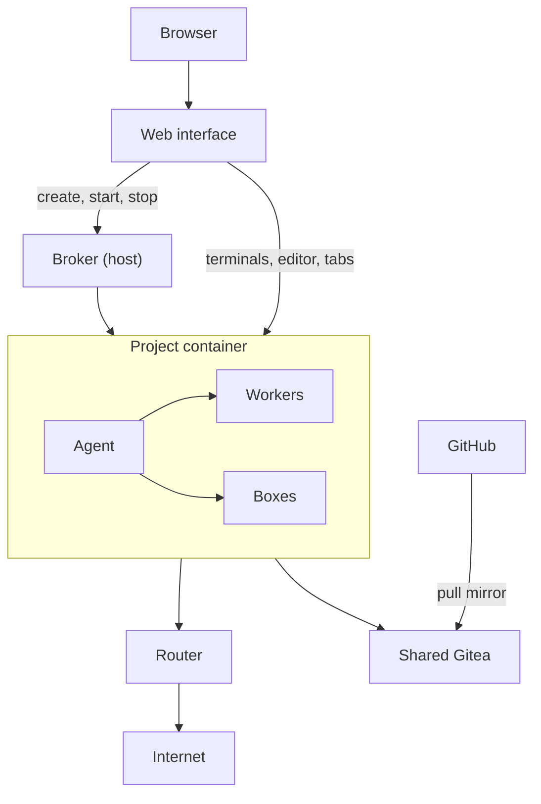

# Research Sandbox

Research Sandbox (RS) runs AI agents in containers on one machine. The user works with it from a browser.

A **project** is one container with its own agent, workspace and network. A **workflow**, chosen at create, decides what the container holds. In a research project the agent is a supervisor: it splits a question into tasks, runs each in a **worker** container, and reviews the results.

A project can also hold **boxes**: extra long-lived containers, such as a literature tool or a second agent.

The **dev lane** gives agents a code repository to work on through a shared Gitea. The maintainer decides what reaches GitHub.

All outbound traffic from a project goes through the **router**, which applies that project's egress rules.

| Page | Covers |
|---|---|
| [Projects](Projects.md) | What a project is, project types, agents, lifecycle |
| [Research](Research.md) | The research workflows compared: three built, one planned |
| ↳ [Research workflow](Research-workflow.md) | Built: how a supervisor plans, runs and reviews workers |
| ↳ [Researcher workflow](Researcher-workflow.md) | Built: one long-lived agent with a memory, the pages it writes for the user, and a logbook; the companion, the same agent for one-off and mixed tasks |
| ↳ [Researcher with subagents](Researcher-with-subagents.md) | Built: a researcher that hands analyses to parallel helpers and has each finding re-run and refereed |
| ↳ [Lab workflow](Lab-workflow.md) | Planned: several researchers, a board, a lab meeting, budgets |
| [Boxes](Boxes.md) | Box types; what a box can see of its project |
| [MCP servers](MCP-servers.md) | The shared gateway, its server list, wiring to agents and boxes; the older per-project registry |
| [Dev lane](Dev-lane.md) | Mirror, one fork per agent, pull requests, landing, collection |
| ↳ [GitHub mirror](GitHub-mirror.md) | rs-sync: a fork's issues and merged PRs, the wiki and boards when asked, copied to GitHub by hand, reversibly |
| ↳ [Container commands](Container-commands.md) | rs-wt, rs-land, rs-board, /rs-mode, /rs-test, rs-fetch, rs-sync, rs-publish, image builds: where each is and how to use it |
| [Browser and broker](Browser-and-broker.md) | The web interface, the broker on the host, sign-in, bringing an RS update live |
| [Networking and egress](Networking-and-egress.md) | Isolation from the host and the LAN; open and locked egress |
| [Aldine](Aldine.md) | The shared LaTeX editor: turned on in the browser, reached by agents as the MCP server `aldine` |

## Core design decisions

Each page ends with its full list of design decisions and their costs; these are the core ones.

### [Projects](Projects.md)

- One container per project; destroying the project removes everything it ran.
- No host credentials enter a project; each project's agent signs in once inside it.
- RS's files (instructions, skills, `/log`, pi's MCP servers) live in the agent's home, never in the workspace's `.claude/` or `.pi/`; a file left by an older RS fails the operation with an error.
- What a person supplies for an RS tool inside a container (a settings file, a token) lives under `/workspace`, the only folder that survives a recreate; RS's own staged files may stay in home because RS writes them again at every start.
- A container's search path holds only the RS commands a person types there; RS's helpers live in a private folder, and a container from before that layout refuses helper actions until it is stopped and started.
- Claude's links to the operator's Anthropic account (claude.ai connectors, Remote Control, Claude in Chrome, claude.ai artifacts) are blocked by default in every project and Claude box, by one switch; it is a default the agent can undo inside its own container, not a wall.

### [Research](Research.md)

- The existing research workflow is the benchmark and is not changed; three lab-agenda workflows are added beside it, the first two (researcher, researcher with subagents) built and the lab planned.
- The lab-agenda workflows are independent and built in order: a researcher, a researcher with subagents, a lab.
- Nothing becomes established knowledge without the user's acceptance; a referee advises the user and binds the agent.
- Tools before prose, and the same behaviour under Claude and pi.

### [Research workflow](Research-workflow.md)

- Workers run in the project's own Docker; tools are granted per worker, through one proxy.
- Supervision is enforced by checks: an approved plan before every spawn, no report while a finished worker's log is unread, a shape check on every accepted result.
- Logs are immutable and read from summary down to source.

### [Researcher workflow](Researcher-workflow.md)

- Memory is four things kept apart: front page, record, journal, skills.
- The record is immutable; a finding enters it only when the user accepts it.
- One command carries the memory's rules; the front page reaches both agents through their own hooks.
- Consolidation runs in the background at session end, on the user's model quota.
- The user reads pages written from the memory (a front page, what waits, what was accepted), not the memory itself; a page never overwrites the user's own file.
- The logbook is the story and the record is the truth: where they disagree, the record's standing holds.
- The companion is its own type, not a setting on the researcher, and the same memory command in a mode, so the journal, jobs, skills and paper check are shared.

### [Researcher with subagents](Researcher-with-subagents.md)

- Subagents keep nothing; knowledge stays in the researcher's one memory.
- Analysts run in parallel and in the background; each result arrives on its own.
- A finding is re-run and read by an independent referee before the user can accept it; the verdict goes to the researcher's record, and the user decides.
- A verdict and a re-run are bound to the claim and evidence they judged; a change voids both.

The lab workflow's decisions are proposals until built; they are listed on [Lab workflow](Lab-workflow.md).

### [Boxes](Boxes.md)

- A box is its own container, not a process in the project container.
- A box sees nothing of its project unless the operator gives it.
- Box types are data over two images; new types need no image build.
- A box is rebuilt from its saved settings at every project start; only its workspace persists.
- A project's boxes move to the current box image at its next start; a box image that cannot be brought in stops its boxes with an error.

### [Dev lane](Dev-lane.md)

- One fork per agent; agents never share a fork, a token or a history.
- The maintainer carries the work to GitHub; RS holds no GitHub write credentials.
- Rebase, never merge: the fork's base is a straight line on top of the mirror.
- Working modes are catalog entries built from shared rules; a new mode touches no code.
- The test policy is its own switch beside the working mode: Light by default, Full on a flip for a mature project.
- A subagent's instructions are handed to it at launch, cut from one marked text; it is never told to fetch them.
- An image build is a backend job: a throwaway container on its own locked network, never a project; it reaches only the web.
- A conflict between the project's rules and RS's that decides something goes to the user as a question; child agents stay out of it.
- No agent puts secrets or personal details where GitHub can see them; an issue that needs one carries `sync-skip`.
- A repository's docs site replaces its wiki and is written for the software's users; RS ships how to add one, not how to migrate.

### [GitHub mirror](GitHub-mirror.md)

- GitHub holds the record (hidden markers), nothing is kept locally; the remove needs only GitHub.
- GitHub numbers are never assumed to match Gitea's; every reference is mapped.
- Run by hand with the maintainer's own token; every refusal comes before the first write.
- A request GitHub does not answer is tried again only when sending it twice is harmless; rate limits and listing lag are waited out.
- GitHub's hourly write allowance is counted across every run in the container.
- Settings live in `/workspace/.rs-sync.env`, kept across recreates; the webui container can read the token.
- `sync-skip` keeps an issue or merged PR off GitHub for good; a copy already there is deleted first.
- A label already on GitHub is used as it is, never changed or deleted.
- The wiki and the board go over only with `--wiki` / `--board`, for a sync and a remove alike.

### [Container commands](Container-commands.md)

- Each command goes only into the containers whose user needs it; helpers stay off the search path.
- Tools refuse rather than repair; anything that writes outside RS runs by hand, as a dry run first.
- RS builds images; the maintainer's fetch container publishes them with its own token, so RS holds no registry credential.

### [Browser and broker](Browser-and-broker.md)

- The browser is the main way to operate RS; the command line is the complete fallback.
- The broker is the only path to the host, over a closed list of checked verbs.
- One master password, never sent: the vault key and the login proof are derived separately.
- Agent activity is counted inside each container and only read by the webui; alerts are per browser and opt-in.

### [MCP servers](MCP-servers.md)

- MCP servers sit behind one shared gateway, not one proxy per project.
- A server's secrets stay on the host: never in a project, never shown again.
- The gateway forwards a call only for a wired consumer, from its own project network.
- RS adds to an agent's own server list and never touches entries it did not add.
- A research project's workers get only the servers the supervisor names, and their token never touches a file.

### [Networking and egress](Networking-and-egress.md)

- Egress is enforced outside the project, by one shared router.
- Private and LAN addresses are blocked in every egress mode.
- Tools are reached through one MCP proxy per project.
- RS never touches the host; host hardening is documented for the operator to apply.

### [Aldine](Aldine.md)

- One shared Aldine for the installation, not one per project; every wired agent sees every paper.
- Aldine's own login is off, so only the web interface and the MCP gateway can reach it, on its own networks.
- Pinned by version and image digest; the papers are kept across updates and Turn off.
- The paper check is one skill and one helper role, in researcher and companion projects and zotero boxes only; no project type or box type of its own.
