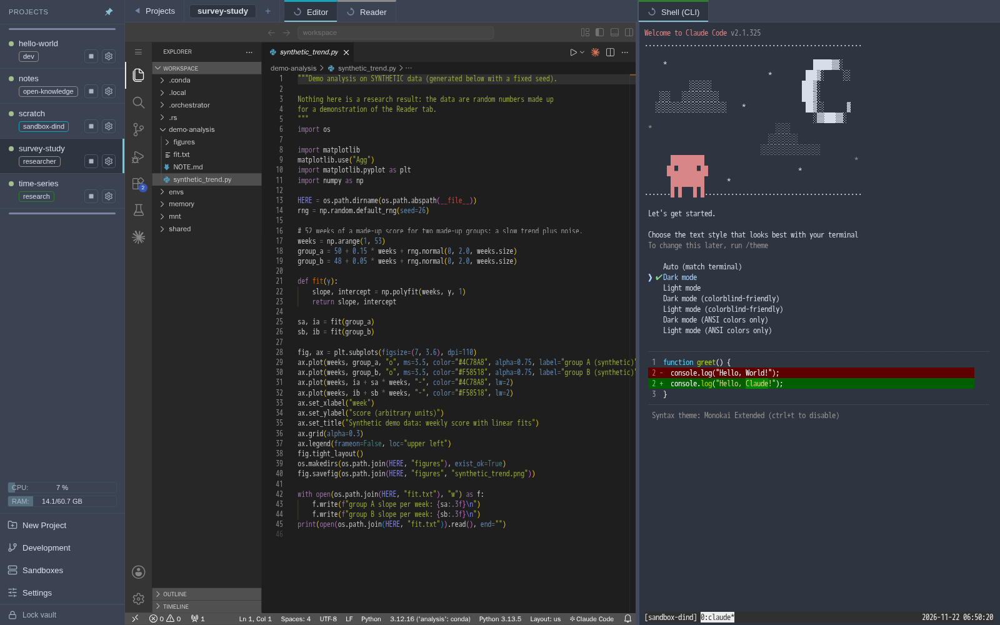
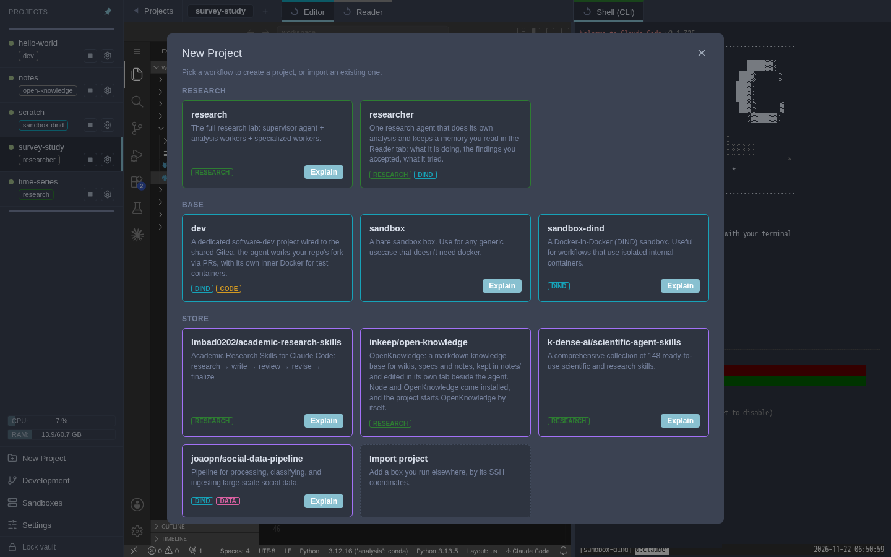
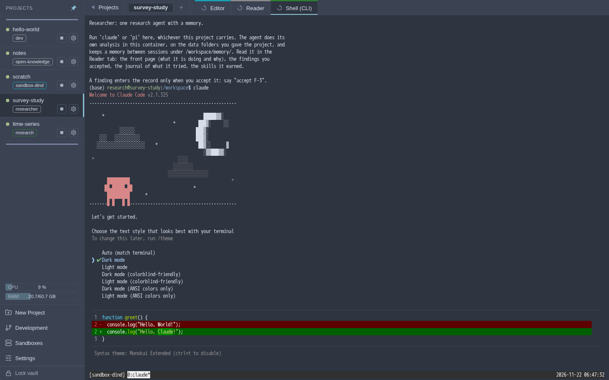
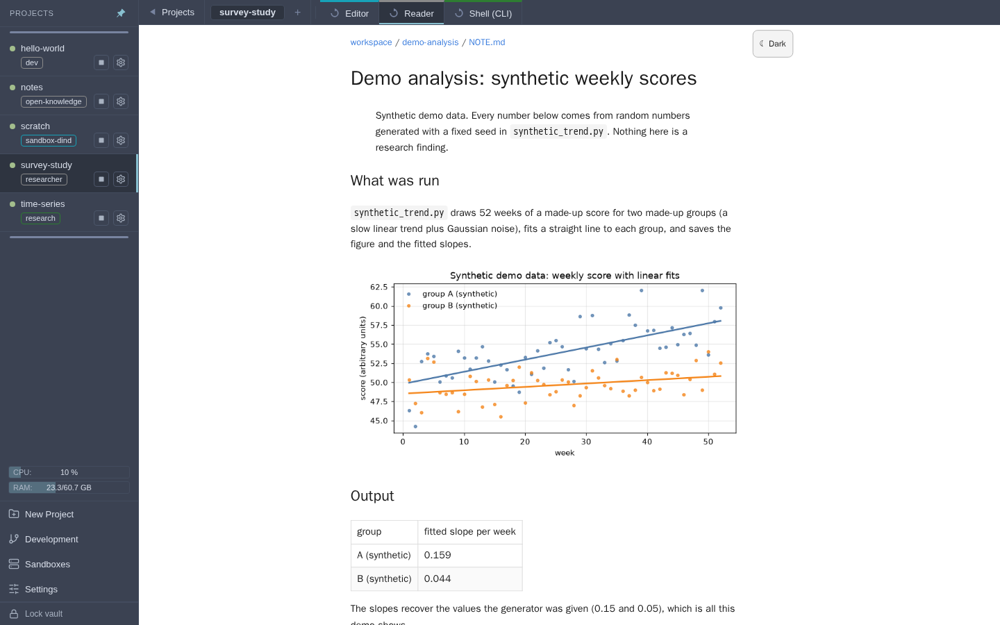
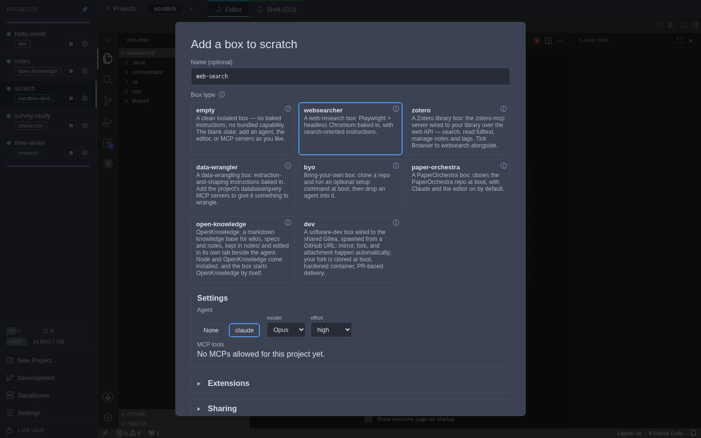
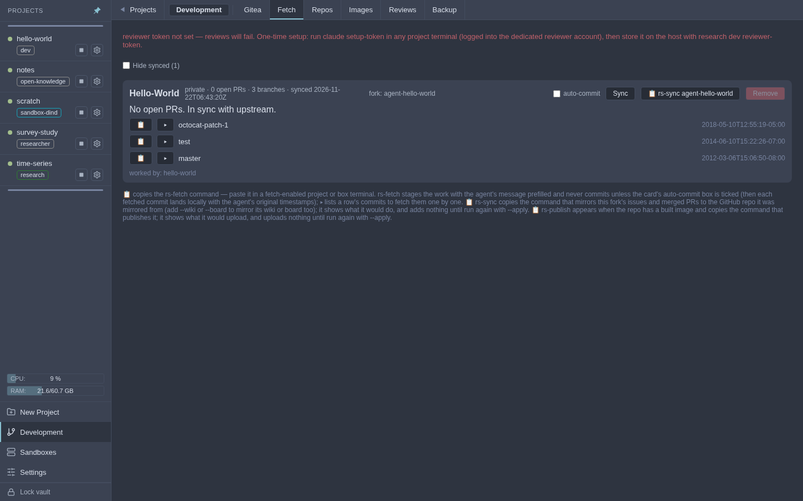

<div align="center" markdown="1">


<h3>Research Sandbox</h3>

Run AI agents in containers on your own machine, from the browser: a research lab, a long-lived researcher, coding agents on your repositories, notes and literature tools.<br>
Each project is one sealed container with its own network and egress rules, and none of your machine's credentials.

[Install](user-guide/install.md) ·
[Workflows](user-guide/workflows.md) ·
[Boxes](architecture/Boxes.md) ·
[Dev lane](architecture/Dev-lane.md) ·
[MCP servers](architecture/MCP-servers.md) ·
[Security](SECURITY.md)

</div>



## What it does

- **Projects**: one container per project, with its own agent, workspace and network. Create, start, stop and destroy them in the browser; destroying a project removes everything it ran.
- **Workflows**: choose what a project is when you create it: a research lab, one researcher with a memory, a coding agent on a GitHub repository, an OpenKnowledge notes base, a bare sandbox, or a curated repository from the store.
- **Agents**: Claude Code and pi, side by side and treated alike. Each signs in inside its project.
- **Boxes**: extra containers inside an inner-Docker project: a web browser, a Zotero library, a notes base, a second agent on its own fork. Up to 12, added and removed while the project runs.
- **Dev lane**: agents work your GitHub repositories through a private Gitea, one fork per agent, by pull request. You review and carry the work to GitHub; no agent holds a GitHub credential.
- **MCP servers**: add a server once, test it, and choose which project agents (not a research project's own) and boxes may use it.
- **Browser**: terminals, a VS Code editor, a file reader and each project's web apps, in tabs. The sidebar shows which agents are working and can alert you when one waits for you. Terminals work on a phone.
- **Containment**: all traffic leaves through a router, open or locked to web ports, and private addresses are blocked; two [host firewall rules](SECURITY.md#-host-hardening-operator-applied) you apply yourself close the paths around it. Data folders are mounted read-only.

## Install

You need Docker 29 or newer with Compose 2.33.1 or newer, Python 3.9 or newer, and a Claude account or an API key for pi (OpenRouter or another provider). On Linux, install [Sysbox](https://github.com/nestybox/sysbox#installation) for projects that run their own Docker; without it RS runs them privileged, which isolates them less.

```sh
git clone https://github.com/joaopn/research-sandbox && cd research-sandbox
python research.py start            # builds the images, starts the router
python research.py broker passwd    # sets the master password, once
python research.py broker start
python research.py webui start
```

Open https://localhost:7777, accept the self-signed certificate, and set the same master password in the browser.

Put datasets in `data/` inside the clone. A project's **Add folders** picks folders there and mounts them read-only:

```
research-sandbox/
├── data/                 your datasets, mounted read-only into projects
└── container_volumes/    one workspace folder per project, created by RS
```

To keep settings, put them in a `.env` file next to `research.py`:

| Variable | Default | |
|---|---|---|
| `PROJECTS_DIR` | `./container_volumes/` | where project workspaces live |
| `WEBUI_BIND`, `WEBUI_PORT` | `127.0.0.1`, `7777` | address of the web interface; a LAN or tailnet address reaches it from elsewhere (read [Security](SECURITY.md) first) |
| `SANDBOX_DNS` | `9.9.9.9,149.112.112.112` | the resolvers a locked project may use |

**Update:** `git pull`, then the steps in [After updating](user-guide/after-updating.md).

## How it works

**1. Create a project.** **New Project** shows the workflow cards. Pick one, name it, add data folders, **Create**.



**2. Sign in.** In the project's terminal tab, run `claude` or `pi` and `/login`. The login stays with the project.



**3. Work.** Talk to the agent in the terminal or the editor. On an inner-Docker project, tick **Reader** under Extensions at create (always on for the researcher types) to read what it wrote: notebooks, figures, its memory.



**4. Add boxes.** On an inner-Docker project, the **+** on the tab strip adds a box: pick a type, an agent, the folders and tools it may see.



**5. Wire tools.** **Sandboxes → MCP**: add a server, **Test**, then pick a project, its agent or a box, tick the servers and **Save**.

**6. Hand over code.** Turn on Gitea under **Sandboxes → Infrastructure**, then create a **dev** project with a GitHub URL. Its agent works the repository by pull request. To collect the work, create a second, non-dev project with **rs-fetch** ticked: the **Development** page's Fetch tab copies the command that pulls it into a clone there.



Everything also runs from the command line: [CLI reference](user-guide/cli-reference.md).

## Workflows

Chosen in the New Project window. Inner-Docker projects can hold boxes and containers of their own.

<details markdown="1">
<summary>10 workflows</summary>

| Workflow | Container | Agents | What you get |
|---|---|---|---|
| `research` | inner Docker | Claude | A supervisor that plans with you, runs each analysis in a worker container, reviews it, and logs the session |
| `researcher` | inner Docker | Claude, pi | One agent on one line of inquiry for weeks, with a memory you read in the Reader tab; findings enter the record when you accept them |
| `researcher-subagents` | inner Docker | Claude, pi | A researcher that hands analyses to helpers running in parallel; each finding is re-run and refereed before you accept it |
| `dev` | inner Docker | Claude, pi | An agent on one GitHub repository's fork, with working modes and its own Docker for tests |
| `sandbox-dind` | inner Docker | Claude, pi | A confined agent with its own Docker and boxes |
| `sandbox` | single | Claude, pi | A bare confined container: terminal and editor |
| `open-knowledge` | single | Claude, pi | An OpenKnowledge notes base in its own tab, its history optionally kept on Gitea |
| `social-data-pipeline` | inner Docker | Claude, pi | A pipeline for processing and classifying large-scale social data |
| `academic-research-skills` | single | Claude, pi | Research-writing skills: research, write, review, revise |
| `scientific-agent-skills` | single | Claude, pi | A large collection of scientific and research skills |

`research` always runs Claude; `dev`, `researcher` and `researcher-subagents` need at least one agent; the others may have none.

</details>

## Box types

<details markdown="1">
<summary>8 box types</summary>

| Type | What it is |
|---|---|
| `empty` | A blank box |
| `byo` | Clones a repository and runs a setup command |
| `dev` | Works a GitHub repository through its own fork |
| `websearcher` | Web research with Playwright and headless Chromium |
| `zotero` | Your Zotero library through its MCP server |
| `open-knowledge` | An OpenKnowledge notes base in its own tab |
| `paper-orchestra` | The PaperOrchestra repository, cloned at boot |
| `data-wrangler` | Schemas, queries and extracts through the project's database servers |

</details>

More types can be registered on the host; see [Boxes](architecture/Boxes.md).

## Built on

| | Used for |
|---|---|
| [Docker](https://www.docker.com/) and [Sysbox](https://github.com/nestybox/sysbox) | project containers, Docker inside them |
| [Claude Code](https://github.com/anthropics/claude-code) and [pi](https://www.npmjs.com/package/@earendil-works/pi-coding-agent) | the agents |
| [code-server](https://github.com/coder/code-server) | the editor tab |
| [Gitea](https://about.gitea.com/) | mirrors, forks and pull requests of the dev lane |
| [xterm.js](https://xtermjs.org/) and byobu | the terminal tabs |
| [Playwright](https://playwright.dev/) | the browser in websearcher boxes |
| [OpenKnowledge](https://github.com/inkeep/open-knowledge) | the notes workflow and box |

## License

AGPL-3.0.
