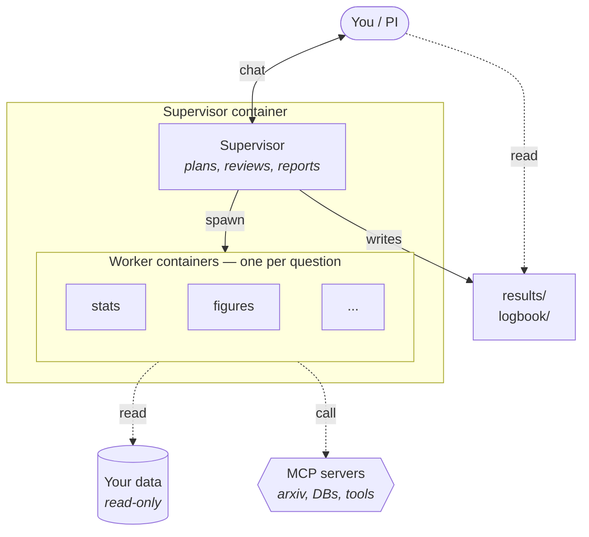

# Research Sandbox

An agentic sandbox for research and data analysis, modeled as a research lab: you are the research lead and drive a per-project supervisor that spawns sandboxed workers and their tools (MCP), supervises the tasks, keeps logbooks, and writes executive summaries for you. Drive the whole thing from a **browser UI** — a workflow store, project lifecycle, and in-browser terminals + editor — or from the host CLI. Built to work with flat-rate agentic AI subscriptions like Claude Code.


### TL;DR

```bash
# 1. One-time setup — builds images, starts the router, caches the agent + editor dists
python research.py start

# 2. (optional but recommended) bring up the browser UI
python research.py broker passwd     # set the operator/management password (once)
python research.py broker start       # the host daemon that owns docker access
python research.py webui start         # HTTPS SPA on https://localhost:7777

# 3. Open https://localhost:7777 → pick a workflow card → name it → Create.
#    Sign in to Claude once (a terminal tab → `claude` → OAuth), then chat.
```

Prefer the shell? The same lifecycle is a few `python research.py …` commands away — see [Quick Start](user-guide/quick-start.md).

## ◾ What it does





You talk to **one** Claude Code session — the *supervisor*. It lives in a per-project container that holds the conversation, the plans, and the project's memory. When a research question arrives, it doesn't answer end-to-end itself. Instead it:

1. **Drafts a plan** — what a worker should do, what inputs it needs, what deliverable it owes back, how the result gets verified. You approve before anything spawns.
2. **Spawns a worker** — a fresh container running headless Claude Code with your data mounted read-only. It writes a notebook, computes, produces figures, and reports back.
3. **Reviews the deliverable** against the plan, iterating with the worker or escalating to you, then asks you to **accept** — promoting it to `results/`.
4. **Logs the session** — a chronological record plus per-topic executive summaries you read next time.

Workers are persistent and themed (one per coherent question, many cycles over the project's life), and disposable between sessions: the container is thrown away, the files stay. **The conversation is replaceable — the filesystem is the memory.**

That's the **research** workflow. Leaner ones exist too — disposable docker-in-docker boxes, single confined containers, and curated GitHub-repo "store" boxes. See [Workflows & the store](user-guide/workflows.md).
