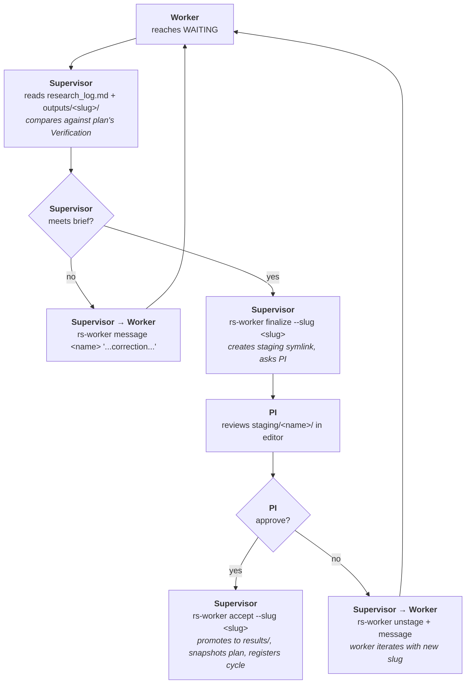

# Slugs, finalize, accept

Each cycle has a **slug** — a kebab-case identifier naming the facet that cycle answered. Rules:

- Descriptive of the *facet*, not the topic. `stats-per-language`, not `basic-stats`.
- Unique within a worker — `accept` refuses a slug already in `.workers/<name>.json::cycles`.
- Don't repeat the worker name in the slug. `stats/per-language`, not `stats/stats-per-language`.

The cycle gating sequence has two gates — the supervisor's quality gate, then the PI's approval gate:

`accept` refuses on:
- worker not terminal (`done` or `waiting`)
- empty `outputs/<slug>/`
- `research_log.md` unchanged from skeleton (first cycle only)
- denied files present (`__pycache__`, `.ipynb_checkpoints`, `*.pyc`, `*.tmp`)
- slug already in the registry

`accept --waived "<reason>"` bypasses the shape gate; the reason is persisted in the cycle entry.
